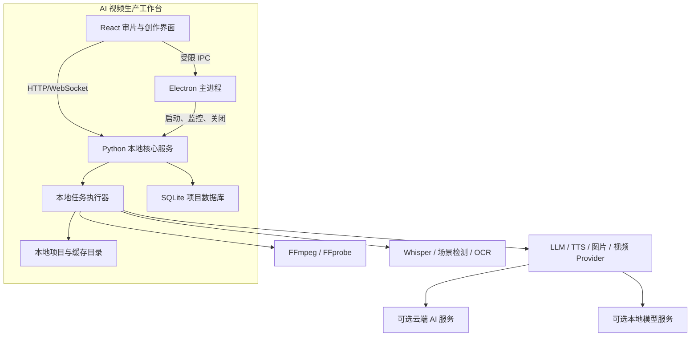
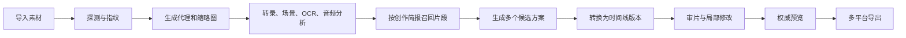

# Vortex Cut 系统架构设计

> 角色：LiuWei（架构师）
> 状态：架构基线 v1.0（模块边界、进程模型与设计原则）
> 首发日期：2026-08-07（首发平台：Windows 10/11 64 位）
> **当前实现阶段、能力边界与未闭环工作统一见 [`docs/STATUS.md`](docs/STATUS.md)，本文件不单独声明最新交付状态。**

## 1. 架构结论

本产品采用 **桌面优先、模块化单体、核心能力可替换、数据本地优先** 的架构。用户安装并启动一个桌面程序，在同一界面中完成素材导入、自动分析、AI 粗剪、审片修改、预览和多平台导出。

系统不把 Halo、n8n、多 Agent 或任何单一模型作为基础依赖。它们未来可以通过集成层接入，但不能掌握项目状态、时间线或渲染任务。

第一阶段的核心产品闭环是：

```text
安装程序
  -> 创建项目并描述创作目标
  -> 导入文本、图片、音频和视频
  -> 自动生成代理、转录和场景索引
  -> 生成多个短视频候选方案
  -> 人工审片、锁定和局部修改
  -> 生成权威预览
  -> 导出抖音、视频号和小红书版本
```

首个重点场景是游戏类短视频，但底层领域模型不得绑定某一款游戏或固定题材。游戏高光、搞笑片段、攻略解说、资讯视频等差异通过“制作配方”表达。

## 2. 目标与边界

### 2.1 产品目标

1. 将人工工作从完整观看、寻找片段、机械剪辑和重复适配，压缩为创作要求输入、候选选择、验收和局部微调。
2. 同时支持已有素材剪辑、从文本生成视频以及两者混合制作。
3. 在普通 PC 上可安装使用；基础媒体处理离线可用，云端 AI 是可选增强能力。
4. 保证项目可恢复、过程可追踪、操作可撤销、失败可重试、局部可重算。
5. 保留未来迁移到服务器部署、Web 访问和多人协作的演进路径。

### 2.2 第一阶段不做

> 以下为 Stage 0–1 起步期范围约束；多轨时间线编辑、OpenFilm 风格界面对齐等后续已交付能力见 [`docs/STATUS.md`](docs/STATUS.md) §3。

- 不复刻 Premiere、DaVinci Resolve 或剪映的完整专业时间线。
- 不做完全无人值守的开放题材自动发布。
- 不建立 CEO、导演、编剧等自由自治的多 Agent 组织。
- 不依赖 n8n、Halo、Docker Desktop、Redis、PostgreSQL 或 Kubernetes。
- 不在安装包中预置数 GB 的完整本地生成模型。
- 不开放可执行任意代码的第三方插件机制。
- 不承诺一次 AI 生成即可达到最终发布质量。

## 3. 架构原则

1. **唯一事实来源**：项目数据库和版本化时间线是唯一可信状态，聊天记录和模型输出不是。
2. **AI 负责建议，程序负责约束**：AI 输出必须经过 JSON Schema 校验、引用校验和时间范围校验，不能直接执行任意 FFmpeg 或系统命令。
3. **原素材只读**：任何分析、预览和渲染都不得原地修改用户素材。
4. **确定性骨架**：任务状态、重试、缓存、依赖和渲染由确定性程序控制，仅在需要语义判断时调用 AI。
5. **局部重算**：修改字幕、替换镜头或调整配音时，只使依赖它的产物失效。
6. **可替换能力**：模型、ASR、TTS、图片生成和视频生成都通过 Provider 接口接入。
7. **桌面与服务器同一领域核心**：桌面版不是一次性原型，核心 API、数据模型和任务模型从第一天保持部署无关。
8. **可观测和可解释**：每个候选片段记录来源、选择理由、模型、参数、费用和生成历史。
9. **默认本地和最小传输**：未经用户明确触发，不向外部 AI 服务上传素材或转录内容。

## 4. 总体架构



### 4.1 为什么选择模块化单体

桌面第一版只有一个用户和一台机器。拆分微服务会引入端口、认证、部署、版本兼容和故障诊断成本，却不能提升当前吞吐量。

因此系统按清晰模块编写，但随一个 Python 核心服务发布。媒体工具和重型模型可以是子进程或独立本地服务。未来服务器化时，只替换存储、任务执行和认证基础设施，不重写领域逻辑。

## 5. 运行时进程模型

### 5.1 Electron 主进程

职责仅限于操作系统集成：

- 管理窗口、菜单、文件选择、拖放和系统通知。
- 启动 Python Sidecar，分配随机本地端口并生成会话令牌。
- 监控 Sidecar 健康状态，异常退出时提供诊断和受控重启。
- 使用操作系统凭据保护能力保存 API Key。
- 管理自动更新、安装目录、用户数据目录和应用日志。
- 退出时通知核心服务停止接收新任务并完成安全落盘。

Electron 不直接访问 SQLite，不拼接 FFmpeg 命令，也不包含创作或时间线业务逻辑。

### 5.2 React Renderer

负责项目首页、素材箱、候选方案、播放器、简化时间线、字幕、音轨、AI 修改面板、任务中心和导出中心。

安全基线：

- `nodeIntegration: false`。
- `contextIsolation: true`。
- 仅通过白名单 preload API 使用系统能力。
- 所有业务读写通过核心服务 API 完成。
- 页面不持有长期 API Key。

### 5.3 Python 核心服务

采用 Python 3.12–3.13、FastAPI、Pydantic、Uvicorn、标准库 `sqlite3`（版本化 `MIGRATIONS`）、`faster-whisper`、`onnxruntime` 与 PyAV / FFmpeg。职责包括：

- 领域规则和项目生命周期。
- 素材注册、分析、代理和资产关系。
- 创作简报、配方、候选方案和时间线版本。
- Provider 选择、调用、限流、结果校验和费用记录。
- 持久化任务、资源调度、缓存失效和失败重试。
- 预览计划、最终渲染计划和平台导出。
- 诊断、日志、迁移、备份和项目归档。

服务只监听 `127.0.0.1` 的随机端口，要求每个请求携带 Electron 启动时生成的会话令牌。生产环境不暴露调试文档和任意文件访问接口。

### 5.4 本地任务执行器

第一版不使用 Redis/Celery。核心服务内置持久化调度器，实际媒体任务在受控子进程中运行。

任务资源分为：

- `cpu_light`：元数据、文本处理、数据库任务。
- `cpu_heavy`：转码、软件编码、场景分析。
- `gpu`：本地 ASR、视觉模型或生成模型。
- `network`：云端模型和素材服务。
- `disk_io`：复制、代理和缓存操作。

调度器按设备能力限制并发，避免同时转码、ASR 和最终渲染导致机器失去响应。FFmpeg 等子进程必须支持取消、超时、进度解析和进程树清理。

## 6. 领域模块

| 模块 | 职责 | 不负责 |
|---|---|---|
| Project | 项目、创作模式、目标平台、目录和版本 | 媒体分析 |
| Asset | 素材注册、指纹、引用关系、代理和派生产物 | AI 选片 |
| Analysis | 转录、场景、OCR、音频、画面和事件特征 | 决定最终时间线 |
| Brief & Recipe | 创作目标和可复用制作规则 | 直接渲染 |
| Planning | 脚本、分镜、片段召回、候选排序和理由 | 保存最终成片状态 |
| Timeline | 轨道、片段、字幕、音频、叠加、锁定和版本 | 调用供应商 |
| Preview | 快速交互预览和权威渲染预览 | 修改项目事实 |
| Render | 将时间线编译为受控 Render Plan 并执行 | 自主改变创作内容 |
| Provider | LLM、ASR、TTS、图片、视频和视觉能力适配 | 持有项目状态 |
| Job | 依赖、状态、进度、重试、缓存和资源限制 | 业务决策 |
| Export | 平台规格、封面、码率、命名和输出校验 | 自动发布账号内容 |
| Diagnostics | 环境检测、日志、崩溃包和依赖版本 | 上传隐私数据 |

模块之间通过应用服务和明确 DTO 协作，不允许跨模块随意修改数据库表。

## 7. 核心数据模型

### 7.1 主要实体

```text
Project
  |- CreativeBrief
  |- TargetPlatform[]
  |- Asset[]
  |    |- AssetDerivative[]
  |    |- Transcript
  |    |- Scene[]
  |    |- AnalysisResult[]
  |- RecipeSnapshot
  |- CandidatePlan[]
  |- TimelineRevision[]
  |- Job[]
  |- RenderArtifact[]
  |- ExportRecord[]
  `- ProviderInvocation[]
```

### 7.2 素材模型

素材分为：

- `external`：仅引用用户原文件，不复制。
- `managed`：复制到项目中，适合归档和迁移。
- `generated`：由 AI 或系统生成，必须记录来源。
- `derivative`：代理、缩略图、波形、抽帧、分离音频等可再生产物。

外部素材记录路径、文件大小、修改时间和采样指纹。打开项目时发现素材移动或改变，必须进入“重新定位/重新分析”状态，不能静默使用错误文件。

### 7.3 时间与时间线

时间线是本系统的核心契约。所有时间在领域层使用整数微秒，禁止使用浮点秒作为持久化格式。原因是游戏录像常包含可变帧率，浮点累计也会造成长视频音画偏移。

时间线文档至少包含：

```json
{
  "schema_version": 1,
  "canvas": { "width": 1080, "height": 1920, "fps_num": 30, "fps_den": 1 },
  "tracks": [],
  "clips": [],
  "captions": [],
  "audio_items": [],
  "overlays": [],
  "transitions": [],
  "locked_elements": [],
  "provenance": {}
}
```

每次被用户确认或 AI 修改后生成不可变 `TimelineRevision`，项目只保存当前版本指针。临时拖动可以保存为草稿；正式操作、AI 修改和渲染必须基于明确版本。撤销和比较通过版本关系实现，不能靠反向猜测命令。

### 7.4 创作简报与制作配方

创作简报描述本次目标：题材、受众、平台、时长、叙事意图、参考风格、保留内容和禁止事项。

制作配方描述可复用规则：

- 高燃操作、搞笑失误、攻略、新闻、剧情梳理等结构。
- 开头策略、节奏区间、镜头平均长度和最大静默。
- 是否保留原声、旁白比例、字幕风格和 BGM 强度。
- 横转竖布局、HUD 保护区、人脸或关键区域跟踪。
- 平台画幅、时长、码率、响度和封面规则。

每个项目保存配方快照，避免全局配方升级后历史项目自动变化。

### 7.5 AI 调用溯源

每次调用保存：

- Provider、模型和能力类型。
- 输入资产引用和脱敏后的参数摘要。
- Prompt 模板版本与结构化输出版本。
- 开始时间、耗时、状态、重试次数和错误分类。
- Token、媒体时长、估算/实际费用。
- 生成资产 ID、内容哈希和供应商任务 ID。

API Key、完整授权头和敏感正文不得写入日志。

## 8. 关键工作流

### 8.1 已有素材剪辑



### 8.2 生成式视频

```text
创作简报
  -> 脚本和分镜
  -> 镜头需求清单
  -> 搜索已有素材或调用图片/视频/TTS Provider
  -> 生成资产入库并记录溯源
  -> 装配到同一时间线
  -> 审片、局部重生成和导出
```

### 8.3 混合制作

已有素材和生成素材最终都必须注册为 Asset，并通过同一 Timeline、Preview 和 Render 模块处理。系统不维护两套渲染链路。

### 8.4 自然语言修改

用户输入“开头更紧凑，但不要修改已锁定的三个镜头”时：

1. 系统创建当前时间线的只读摘要和允许修改范围。
2. LLM 仅输出受约束的 `TimelinePatch`，不能输出命令。
3. 程序验证引用、时间范围、锁定项、轨道冲突和总时长。
4. 在事务中应用 Patch，生成新版本并计算失效产物。
5. 仅重新生成受影响的预览片段。
6. 用户可以比较新旧版本并撤销。

## 9. 预览与渲染

### 9.1 双层预览

为了同时保证交互速度和最终一致性，采用两层预览：

- **交互预览**：React 播放代理文件并叠加基础字幕、裁切和音量，响应拖动和修剪。它追求快速，不宣称像素级等同最终成片。
- **权威预览**：由 Render 模块使用与最终导出相同的 Render Plan 生成低分辨率或局部预览。用户最终验收以此为准。

### 9.2 Render Plan

Timeline 不能直接拼成 shell 字符串。编译器先生成受控、可检查的 Render Plan：

```text
TimelineRevision
  -> 资源存在性和时间范围校验
  -> 画面布局、字幕和音频计划
  -> Render Plan
  -> FFmpeg argv/filter graph
  -> 执行和产物验证
```

FFmpeg 必须通过参数数组启动，不通过 shell 执行用户输入。字幕第一阶段采用 ASS/libass，以获得稳定的字体、描边、定位和高亮效果。

代理可统一为便于随机访问的 CFR 格式，但所有剪辑点仍绑定原素材时间戳；最终渲染读取原素材，防止代理画质损失。

### 9.3 导出校验

导出完成后自动检查：

- 文件可解码、时长和分辨率正确。
- 音视频流存在且同步。
- 无意外黑帧、静音、响度越界和字幕越安全区。
- 编码、码率、帧率、音频采样率符合平台配置。
- 输出文件有明确的时间线版本和配置记录。

## 10. 任务可靠性

任务状态机：

```text
queued -> running -> succeeded
                 |-> failed -> retry_wait -> queued
                 |-> cancelling -> cancelled
                 `-> interrupted -> queued/failed
```

可靠性规则：

1. 任务入队和业务状态变更在数据库事务中完成。
2. 每个任务声明输入版本、输出类型和幂等键。相同输入和参数可复用成功产物。
3. 产物先写临时文件，校验后原子移动到最终路径。
4. 应用异常退出后，`running` 任务转为 `interrupted`，按任务策略恢复或提示用户重试。
5. Provider 失败区分限流、认证、余额、内容审核、暂时网络和永久参数错误，不能一律无限重试。
6. 用户取消项目时只取消相关任务，不破坏已成功的可复用产物。
7. 最终渲染、素材复制等长任务必须汇报可理解的阶段和百分比。

## 11. 文件和存储设计

### 11.1 应用级目录

```text
%LOCALAPPDATA%/AIVideoStudio/
  app.db
  config/
  logs/
  models/
  shared-cache/
  crash-reports/
```

### 11.2 项目目录

```text
project-id/
  project.json
  managed-assets/
  generated-assets/
  proxy/
  analysis/
  thumbnails/
  waveforms/
  previews/
  exports/
  temp/
```

默认采用“外部素材引用 + 项目派生产物”模式，避免复制数十 GB 游戏录像。用户执行“归档项目”时，系统复制外部素材并生成可迁移项目包。

SQLite 开启 WAL、外键和忙等待；数据库只允许核心服务写入。数据库迁移必须先备份，失败时保留旧版本并停止写入。

缓存按内容指纹、工具版本和参数生成键，并提供空间上限、最近使用淘汰和手动清理功能。项目事实和用户导出不能被当作缓存删除。

## 12. AI 与 Provider 设计

定义能力接口而不是厂商接口：

```text
TextReasoningProvider
VisionAnalysisProvider
SpeechToTextProvider
TextToSpeechProvider
ImageGenerationProvider
VideoGenerationProvider
MusicProvider
```

Provider 返回统一的任务状态、结构化结果、费用、供应商 ID 和错误分类。系统支持按任务选择 Provider，例如脚本与视觉分析使用不同模型。

第一版只提供内置 Provider 适配器。第三方插件机制在有明确需求后再设计签名、权限和沙箱，不能直接加载未知 Python 包。

### 12.1 AI 决策边界

适合交给 AI：

- 理解创作简报、生成脚本和分镜。
- 对转录、场景和事件特征做语义召回和排序。
- 生成候选标题、开头结构、旁白和修改建议。
- 在限定范围内生成 TimelinePatch。

不交给 AI：

- 修改原文件、数据库迁移、进程管理和文件删除。
- 直接执行 FFmpeg、PowerShell、Python 或网络上传命令。
- 决定是否覆盖用户导出。
- 绕过锁定镜头、平台约束和人工审核关卡。

## 13. 游戏短视频扩展

通用素材分析先提供：

- 转录、说话人和情绪/音量峰值。
- 场景切分、黑屏、静帧和快速画面变化。
- OCR 文本、画面主体和手动标记。

游戏专用能力通过 `GameAnalyzer` 扩展点实现：

- 某类游戏的 HUD 区域配置和 OCR 词表。
- 击杀、胜负、得分、回合和道具等事件检测。
- 游戏日志、回放或官方 API 导入。
- 横转竖的关键区域、摄像头区域和 HUD 保护规则。

没有游戏专用插件时，系统仍可依赖通用特征、转录和人工标记工作，不能让核心流程失效。

## 14. 安全、隐私和发布要求

1. API Key 使用 Windows 凭据保护能力加密，Renderer 和日志不得获取明文。核心服务只在实际调用期间获得短期内存副本。
2. 所有外部上传在任务确认界面显示供应商、数据类型和预计大小。
3. 日志默认脱敏用户路径、Token、授权头和完整 Prompt 正文。
4. 自动更新包、安装程序和 Sidecar 应进行代码签名和完整性校验。
5. 下载的本地模型使用版本清单、哈希校验和磁盘空间预检。
6. FFmpeg、模型、字体和其他依赖在商业分发前逐项核查许可证；维护第三方清单和 SBOM。FFmpeg 构建选项会影响 LGPL/GPL 义务，不能直接沿用来源不明的二进制。
7. AI 生成内容保存供应商、模型和参数溯源，为版权、审核和争议处理提供依据。
8. 第一阶段只做文件导出，不自动登录和发布用户平台账号。

## 15. 打包与开箱即用

推荐发布组成：

```text
Electron + React 应用
Python Sidecar 可执行文件
FFmpeg/FFprobe 合规发行版
内置数据库迁移和环境诊断
按需下载的 Whisper 模型
可选云端 AI Provider
```

Python 服务使用 PyInstaller 或 Nuitka 打包，不要求用户安装 Python。安装后首次启动执行设备检测：CPU、内存、GPU、显存、磁盘、硬件编码器和网络状态，并给出“云端优先、混合、本地优先”推荐。

本地基础功能不要求登录账号。若未来提供平台额度、云端同步或远程计算，再引入账号系统。

## 16. 未来服务器化路径

通过以下抽象控制迁移范围：

| 桌面版实现 | 服务器版替换 | 保持不变 |
|---|---|---|
| SQLite Repository | PostgreSQL Repository | 领域实体和应用服务 |
| LocalFileStore | S3/MinIO BlobStore | Asset 引用模型 |
| LocalJobExecutor | Redis/Celery 或 Temporal | Job 定义和状态语义 |
| 单机会话令牌 | 用户/团队 OAuth 或会话 | API DTO |
| Electron React | 浏览器 React | 页面和业务交互 |
| 本机媒体 Worker | CPU/GPU Worker 池 | Render Plan |
| OS 凭据库 | Secrets Manager | Provider 配置接口 |

服务器化之前不得在领域代码中依赖 Windows 绝对路径、Electron 对象或 SQLite 特有 SQL。文件通过 Asset URI 和 BlobStore 接口访问，时间线与 Render Plan 保持纯数据结构。

## 17. 推荐代码仓库结构

```text
apps/
  desktop/                 Electron 主进程和打包
  web/                     React 工作台
services/
  core/                    FastAPI 入口和应用组装
packages/
  contracts/               TypeScript 契约（**手写**——见下方现状对照）
  ui/                      可复用 UI 组件
python/
  domain/                  纯领域模型和规则
  application/             用例、事务和端口
  infrastructure/          SQLite、文件、Provider、FFmpeg
  media/                   探测、分析、Render Plan 和执行
  jobs/                    持久化调度器和资源控制
  tests/
resources/
  recipes/
  platform-profiles/
  fonts/
docs/
  adr/                     架构决策记录
```

### 17.1 现状对照（2026-09-24 核实）

> **上面是目标结构，与实际仓库现状有四处不符。** 新增此节是因为该节曾被读作现状描述，
> 导致新加入者去找不存在的目录（2026-09-24 文档审计发现）。

| 本节所列 | 现状 | 说明 |
|---|---|---|
| `apps/web/` | **不存在** | `apps/` 下只有 `desktop/`。`services/web/` 存在但仅一个未接线的占位组件，未进入 Electron/Renderer 链路（`ADR-0002` R4 已登记） |
| `packages/ui/` | **不存在** | `packages/` 下只有 `contracts/` |
| 顶层 `python/{domain,application,infrastructure,media,jobs}` | **不存在** | 领域代码位于 `services/core/src/aivs_core/`，**平铺单层**，未按本节分层。此为 `ADR-0002` R2 登记的结构债，采用"增量分层"渐进偿还 |
| 「前端类型从 **OpenAPI 契约生成**」 | **与现状相反** | `packages/contracts/src/` 为**手写** TypeScript（`index.ts` 约 2300 行 + `performance.ts`/`stage4e.ts`/`stage5.ts`/`stage6r.ts`），仓库内无 OpenAPI 产物；根 `package.json` 的 `contracts:generate` 实为 `contracts build`，**不是** OpenAPI 生成。契约的单一来源由手写 + 契约守卫测试保证，而非生成器 |

**仍然成立**：`apps/desktop/`、`services/core/`、`packages/contracts/`、`resources/`、`docs/design/adr/` 的位置与职责描述；以及"Python 领域层不得导入 FastAPI、Electron 或具体 Provider SDK"——该约束由代码证据支持（`ADR-0002` 评审结论：领域层纯净）。

## 18. 分阶段实施计划

以下周期按一名熟悉 Python/TypeScript 的全职工程师估算，仅用于规划。

### 阶段 0：技术验证（1-2 周）

实施依据：Stage 0 历史详细设计（已收口，见 [`docs/STATUS.md`](docs/STATUS.md) §2 与 Git 历史）

- Electron 启动、认证和关闭 Python Sidecar。
- FFprobe 读取常见游戏录像，FFmpeg 生成代理和竖屏样片。
- 验证可变帧率、长路径、中文路径和硬件编码回退。
- 打包到一台干净 Windows 机器安装运行。

退出条件：证明桌面壳、Sidecar、媒体工具和安装包链路可行。

### 阶段 1：可用剪辑基础（4-6 周）

实施依据：Stage 1 历史详细设计（已收口，见 [`docs/STATUS.md`](docs/STATUS.md) §2 与 Git 历史）

- 项目、素材、SQLite 迁移和本地任务系统。
- 代理、缩略图、波形、转录和场景切分。
- 播放器、转录文本选段、简化时间线和自动字幕。
- 权威预览以及 1080x1920 H.264/AAC 导出。
- 崩溃恢复、取消、日志和诊断。

退出条件：不依赖 AI 推理，也能完成“导入 -> 按文本剪辑 -> 预览 -> 导出”。

### 阶段 2：AI 粗剪闭环（4-8 周）

- 创作简报、制作配方和 Provider 管理。
- 多候选片段召回、排序、理由和候选时间线。
- 自然语言 TimelinePatch、锁定、版本比较和局部重算。
- Provider 失败处理、费用记录和外传确认。

退出条件：AI 能产出多个可审阅候选，用户主要进行选择和局部修改。

### 阶段 3：游戏配方与多平台（4-8 周）

- 高燃、搞笑、攻略、资讯等配方。
- HUD 保护、关键区域布局、BGM/原声混合和字幕模板。
- 抖音、视频号、小红书配置和批量导出。
- 建立真实样本集，持续评估候选命中率。

### 阶段 4：生成式素材（6-12 周）

- TTS、图片和视频生成 Provider。
- 脚本/分镜到资产需求清单。
- 镜头级生成、替换、重试和费用预算。
- 角色、场景和风格资产管理，为漫剧/短剧做准备。

## 19. 测试策略

### 19.1 自动化测试

- 领域单元测试：时间换算、锁定规则、Patch 校验、版本和缓存失效。
- 契约测试：前后端 OpenAPI、Provider 统一错误和结构化输出。
- 集成测试：SQLite 迁移、任务恢复、文件原子写和 FFmpeg Render Plan。
- 黄金样片测试：固定素材和时间线生成基准视频，比较时长、流信息、关键帧和感知差异。
- 故障注入：断网、余额不足、模型超时、磁盘不足、进程终止和素材移动。
- 安装测试：干净 Windows 虚拟机安装、升级、卸载和保留项目。

### 19.2 人工验收样本

至少覆盖：

- 30 秒、10 分钟和 2 小时视频。
- CFR/VFR、横屏/竖屏、无音频、多音轨和异常文件。
- 中文路径、空格路径、超长路径和外接硬盘素材。
- 普通办公机、集成显卡和 NVIDIA GPU 机器。
- 游戏高光、搞笑片段、攻略解说和非游戏口播。

## 20. 架构验收清单

架构进入编码阶段前，必须满足：

- [ ] 桌面、核心服务、任务、领域和工具边界明确。
- [ ] 时间线 schema、TimelinePatch 和 Render Plan 有版本化契约。
- [ ] 原素材只读，外部素材移动有明确恢复流程。
- [ ] 任务支持落盘、取消、重试、恢复和幂等。
- [ ] 预览与最终渲染共享 Render Plan，权威预览可验收。
- [ ] Provider 可替换，模型输出必须结构化校验。
- [ ] API Key、日志、外部上传和自动更新符合安全基线。
- [ ] 安装包不要求用户安装 Python、FFmpeg 或数据库。
- [ ] SQLite、本地文件和本地执行器均有服务器替换接口。
- [ ] 第一阶段范围可在无 Halo、n8n、多 Agent 的情况下完成。

## 21. 最终决策

本项目的核心产品不是“多个 AI 工具的启动器”，也不是“数字人员工组织”，而是一个掌握项目状态、素材关系、版本化时间线、任务恢复和可靠渲染的桌面视频生产工作台。

成熟开源工具负责专用执行能力，我们开发的系统负责把创作意图转换为可验证、可修改、可追踪的视频工程。先以游戏短视频验证 AI 粗剪和审片闭环，再逐步扩展题材、生成式素材和服务器部署，这是当前风险最低且能够积累长期产品资产的路线。
