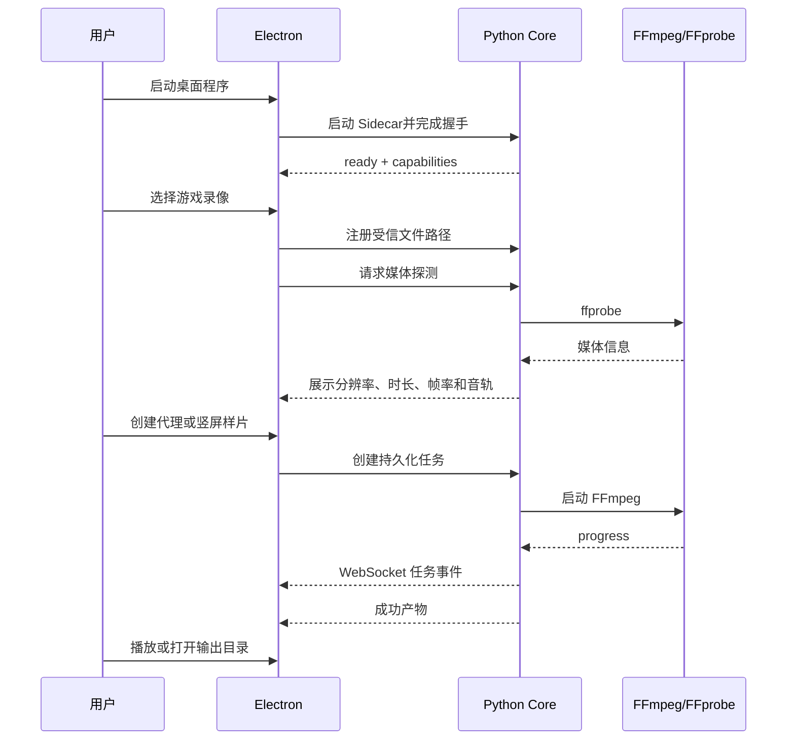
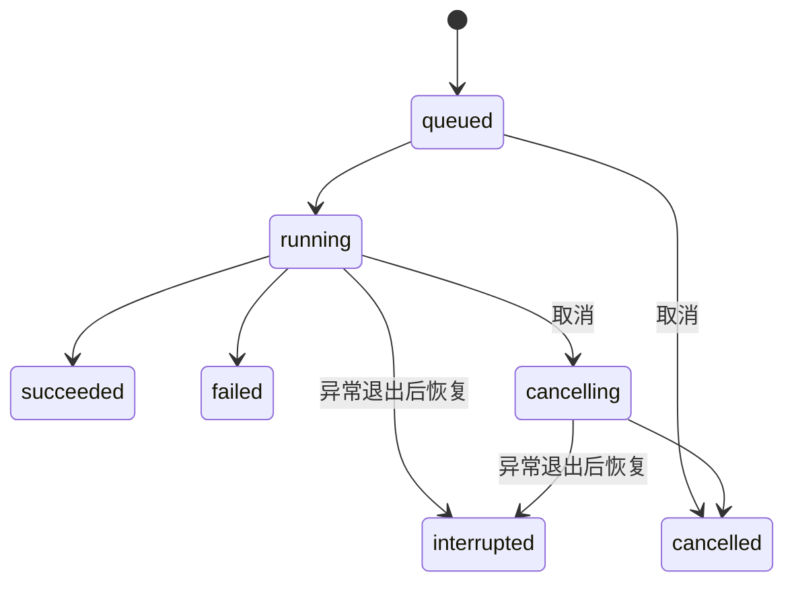

# 阶段 0 技术验证详细设计

> 设计角色：LiuWei（架构师）  
> 文档状态：可实施基线 v1.0  
> 日期：2026-08-07  
> 上位文档：[总体架构设计](../ARCHITECTURE.md)

## 1. 文档目的

本文将总体架构中的“阶段 0：技术验证”细化为开发人员可直接执行的工程方案。阶段 0 不实现完整视频产品，目标是优先消除以下高风险：

1. Electron 是否能够稳定启动、认证、监控和关闭 Python Sidecar。
2. Python、FFmpeg 和前端资源能否随一个 Windows 安装包发布。
3. 常见游戏录像、可变帧率、中文路径和长路径能否可靠处理。
4. 长时间 FFmpeg 作业能否展示进度、取消并清理完整进程树。
5. Sidecar 或应用异常退出后，任务状态能否恢复为可诊断状态。
6. 开发机可运行的功能能否在没有 Node、Python、FFmpeg 的干净 PC 上运行。

阶段 0 的交付物是一个内部技术验证版桌面程序和完整构建链路，不是可对外销售的 MVP。

## 2. 范围与验收场景

### 2.1 必须实现

- Windows 桌面窗口、单实例运行和基础错误页。
- Electron 主进程管理 Python Sidecar 生命周期。
- 本地 API 双层令牌认证和 Renderer 权限限制。
- 用户选择或拖入一个媒体文件。
- FFprobe 探测媒体元数据。
- 创建低码率代理视频任务。
- 创建 `1080x1920` 竖屏样片任务。
- 任务队列、持久化状态、进度、取消和异常中断识别。
- 系统能力检测和硬件编码器回退。
- 输出文件查看、打开所在目录和基础播放验证。
- Windows x64 安装包、卸载和升级覆盖验证。
- 自动化测试、测试素材生成脚本和干净机器验收记录。

### 2.2 明确不实现

- 项目、素材库和正式时间线领域模型。
- Whisper、OCR、场景检测和 AI Provider。
- 用户账号、云端同步、自动更新服务和在线发布。
- 多轨道剪辑、字幕编辑、BGM、转场和封面。
- 项目归档和跨机器迁移。
- 任务自动续跑；阶段 0 只验证异常任务可识别为 `interrupted`。
- macOS、Linux、ARM64 和 Windows 7/8。

## 3. 成功路径



## 4. 技术基线

### 4.1 选型

| 范围 | 选择 | 说明 |
|---|---|---|
| Node 开发环境 | Node.js 24 LTS | 使用根目录版本文件固定 |
| 包管理 | pnpm 10 workspace | 单仓库、严格锁文件 |
| 桌面构建 | Electron + electron-vite | 主进程、preload、Renderer 一体开发 |
| 前端 | React 19 + TypeScript strict | 阶段 1 可直接延续 |
| 状态/请求 | TanStack Query + 轻量本地状态 | 服务状态来自 API，不复制任务事实 |
| 前端测试 | Vitest + Testing Library | 单元与组件测试 |
| 桌面端到端 | Playwright Electron | 启动、导入、任务和退出验证 |
| Python | CPython 3.12 | 生态成熟、便于打包 |
| Python 依赖 | uv | 生成并严格使用 `uv.lock` |
| API | FastAPI + Pydantic v2 | OpenAPI 契约和异步子进程 |
| 数据 | SQLite + SQLAlchemy 2 + Alembic | 阶段 0 只保存任务与产物 |
| Python 测试 | pytest + pytest-asyncio | 单元和集成测试 |
| Python 质量 | Ruff + Pyright | 格式、静态检查和类型 |
| Sidecar 打包 | PyInstaller `onedir` | 启动快，便于诊断缺失动态库 |
| 安装包 | electron-builder + NSIS | Windows x64、按用户安装 |
| 媒体 | FFmpeg + FFprobe | 通过受控参数数组调用 |

具体依赖补丁版本由首次脚手架实现时选取当日稳定版并写入锁文件；后续构建禁止隐式升级。`packageManager`、Node 版本文件、`uv.lock` 和 Electron 版本必须提交。

### 4.2 不采用的方案

- 不用 Tauri：阶段 0 优先验证视频和 Sidecar 链路，避免同时引入 Rust 构建与 WebView 差异。
- 不用 Docker：目标是普通 Windows 用户开箱使用。
- 不用 Celery/Redis：单机验证不需要额外服务。
- 不用 MoviePy 作为主渲染层：直接控制 FFmpeg 参数和进度更透明。
- 不用 `shell=True`、PowerShell 字符串或批处理拼接命令。

## 5. 仓库结构

```text
AI-Vidio/
  apps/
    desktop/
      electron/
        main/
          index.ts
          sidecar-supervisor.ts
          core-admin-client.ts
          file-grants.ts
          process-tree.ts
          logging.ts
        preload/
          index.ts
          desktop-api.ts
      src/
        app/
        features/stage0/
        lib/core-client/
        components/
        styles/
      electron.vite.config.ts
      electron-builder.yml
      package.json
  services/
    core/
      src/aivs_core/
        main.py
        bootstrap.py
        api/
          dependencies.py
          errors.py
          routes_health.py
          routes_internal.py
          routes_media.py
          routes_jobs.py
          routes_events.py
        application/
          media_service.py
          job_service.py
          capability_service.py
        jobs/
          scheduler.py
          models.py
          repository.py
          runner.py
        media/
          ffprobe.py
          ffmpeg.py
          encoders.py
          progress.py
        infrastructure/
          database.py
          migrations/
          filesystem.py
          logging.py
          auth.py
        schemas/
      tests/
        unit/
        integration/
      pyproject.toml
  packages/
    contracts/
      src/generated/
      src/client/
      package.json
  resources/
    ffmpeg/win-x64/
    licenses/
  tools/
    fixtures/
      generate-media-fixtures.ps1
    packaging/
      build-sidecar.ps1
      verify-package.ps1
    dependencies/
      ffmpeg-manifest.json
  test-assets/
    generated/              # gitignore，脚本生成
    manual/                 # gitignore，人工游戏样本
  docs/
  package.json
  pnpm-workspace.yaml
  pnpm-lock.yaml
  uv.lock
  pyproject.toml
  .nvmrc
  .editorconfig
  .gitignore
```

### 5.1 模块约束

- `apps/desktop/electron/main` 可以调用操作系统和 Core 管理接口。
- Renderer 不允许导入 Node 内置模块或 Electron 主进程代码。
- `packages/contracts` 由 OpenAPI 生成类型，禁止手工复制 API DTO。
- `services/core/application` 不直接拼 FFmpeg 参数；由 `media` 模块完成。
- Core 只能读写配置的数据目录、任务目录和主进程已注册的文件路径。
- 阶段 0 不建立伪造的 `domain` 大目录；正式领域模型从阶段 1 开始。

## 6. 开发与构建命令

根目录统一暴露以下命令，开发人员不需要进入子目录执行：

```text
pnpm bootstrap            安装 Node/Python 依赖并准备 FFmpeg
pnpm dev                  启动 Core 开发进程和 Electron
pnpm lint                 执行 ESLint、Ruff 和格式检查
pnpm typecheck            执行 TypeScript 和 Pyright
pnpm test                 执行前后端单元/集成测试
pnpm test:e2e             执行 Electron 端到端测试
pnpm fixtures:generate    生成无版权测试媒体
pnpm contracts:generate   从 OpenAPI 生成 TypeScript 契约
pnpm sidecar:build        构建 Python onedir Sidecar
pnpm package:win          生成 Windows x64 NSIS 安装包
pnpm package:verify       校验安装包内容、哈希和依赖
pnpm run ci              lint + typecheck + test + build
```

`pnpm bootstrap` 必须是幂等命令，不允许修改锁文件；首次锁版本由单独的维护命令完成。CI 使用 `pnpm install --frozen-lockfile` 和 `uv sync --frozen`。

## 7. 应用目录和打包布局

### 7.1 用户数据目录

Electron 在 `ready` 前将 `userData` 设置为：

```text
%LOCALAPPDATA%/AIVideoStudio/
  stage0.db
  logs/
  runtime/
  jobs/
  temp/
  diagnostics/
```

- `runtime/` 保存当前进程握手临时目录，正常退出时删除。
- `jobs/<job-id>/work/` 保存临时输出。
- `jobs/<job-id>/artifacts/` 保存已校验产物。
- 日志滚动保留 14 天，单文件默认不超过 20 MB。

### 7.2 安装目录资源

```text
resources/
  core/aivs-core/aivs-core.exe
  core/aivs-core/_internal/...
  ffmpeg/win-x64/ffmpeg.exe
  ffmpeg/win-x64/ffprobe.exe
  licenses/THIRD_PARTY_NOTICES.txt
  manifests/components.json
```

Core、FFmpeg 和 FFprobe 的路径由 Electron 根据 `process.resourcesPath` 计算，并作为显式参数传给 Sidecar。Python 不猜测安装目录。

### 7.3 FFmpeg 来源

阶段 0 开始实现 `ffmpeg-manifest.json`，至少记录来源 URL、版本、SHA-256、构建配置摘要和许可证。依赖准备脚本必须校验哈希。商用分发前由 LiuWei 再次审查 LGPL/GPL 义务；来源不明的二进制不得进入安装包。

## 8. Electron 启动协议

### 8.1 启动顺序

1. 获取单实例锁；失败则激活已有窗口并退出。
2. 设置用户数据目录，初始化桌面日志。
3. 创建窗口，显示“正在启动本地核心服务”状态。
4. 生成 32 字节随机 `admin_token`，只保存在 Electron 主进程和 Sidecar 环境变量中。
5. 创建 `%LOCALAPPDATA%/AIVideoStudio/runtime/<electron-pid>-<nonce>/`。
6. 使用 `spawn` 启动 Sidecar，`shell: false`、`windowsHide: true`；stdout/stderr 写入当前运行目录的 `core.log`，不依赖 Windows 管道。
7. Sidecar 在 `127.0.0.1:0` 预绑定随机端口并启动 API。
8. Sidecar 在 `--ready-file` 指定的运行目录写入一次 `ready.json`；文件内容不得包含令牌和用户路径。Core stdout/stderr 同步写入 `core.log`。
9. Electron 轮询并读取 `ready.json`，校验 PID、端口和协议版本，再使用管理令牌请求健康检查。
10. Electron 请求创建 Renderer 会话，得到权限受限的 `ui_token`。
11. preload 将 `base_url`、`ui_token` 和协议版本交给 Renderer 内存客户端。
12. Renderer 建立 WebSocket 并进入可用状态。

Sidecar 启动参数：

```text
aivs-core.exe
  --host 127.0.0.1
  --port 0
  --parent-pid <electron-pid>
  --data-dir <local-data-dir>
  --ffmpeg <absolute-ffmpeg-path>
  --ffprobe <absolute-ffprobe-path>
  --runtime-dir <runtime-dir>
  --log-level info
```

管理令牌通过环境变量 `AIVS_ADMIN_TOKEN` 传递，不出现在命令行和日志中。

### 8.2 就绪消息

就绪文件内容必须是小于 4 KB 的 JSON，并严格采用：

```text
{"protocol_version":1,"port":49152,"pid":12345,"build_version":"0.0.1"}
```

Electron 只接受一次合法 `ready.json`。启动超时为 20 秒；超时、提前退出、JSON 非法或协议版本不匹配均进入错误页，并提供“重试启动”和“打开日志目录”。

### 8.3 开发模式

开发模式仍复用同一协议，但启动目标为：

```text
uv run python -m aivs_core
```

不得为开发模式另写假服务。开发和打包环境的差异只能存在于可执行文件定位和日志详细度。

### 8.4 父进程与退出

- Sidecar 每 2 秒检查一次 `parent_pid`；父进程不存在时开始自我关闭。
- Electron 正常退出前查询运行任务；有任务时提示用户退出将取消任务。
- 确认退出后，Electron 调用管理接口 `POST /internal/shutdown`。
- Core 停止接收任务，将运行任务置为 `cancelling`，终止 FFmpeg 进程树并落盘。
- 等待 5 秒；Sidecar 未退出则 Electron 执行受控进程树强制清理。
- Electron 异常死亡时，Sidecar 父进程看门狗执行同一清理流程。

Windows 进程树操作封装在 `process-tree.ts` 和 Python `runner.py` 中，业务代码不得直接调用 `taskkill`。每次强制清理前必须核对 PID 属于当前会话启动的子进程。

## 9. 本地认证与权限

### 9.1 令牌类型

| 令牌 | 持有者 | 权限 | 生命周期 |
|---|---|---|---|
| `admin_token` | Electron 主进程、Core | 文件注册、会话创建、关闭、产物路径解析 | 一次 Sidecar 生命周期 |
| `ui_token` | 当前 Renderer 内存 | 探测媒体、创建/读取/取消任务、读取能力 | 当前窗口/Sidecar 生命周期 |

令牌使用 256 位随机值。Core 内存中只保存令牌哈希；`ui_token` 由管理接口创建，不写数据库。Renderer 不得持久化到 localStorage、配置文件或日志。

### 9.2 HTTP 和 WebSocket

- HTTP 使用 `Authorization: Bearer <token>`。
- WebSocket 连接后 3 秒内发送 `authenticate` 消息，认证前不推送业务事件。
- WebSocket URL 中禁止携带令牌。
- Core 只监听 IPv4 loopback，不监听 `0.0.0.0`、局域网或 IPv6 全地址。
- 开发环境允许固定 Vite Origin；打包环境允许 Electron `file` Origin。所有业务接口仍必须认证。

### 9.3 文件授权

Renderer 不向 Core 提交任意文件路径。用户通过 Electron 文件选择器或拖放选择文件后：

1. preload 将文件交给主进程。
2. 主进程获得绝对路径并调用管理接口注册。
3. Core 校验文件存在、是普通文件且可读，创建内存 `file_grant`。
4. Renderer 只获得 `grant_id`、显示名称、大小和修改时间。
5. 媒体接口只接受 `grant_id`。

任务创建后，Core 将规范化输入路径和文件快照写入任务记录，支持异常诊断。`file_grant` 本身随 Sidecar 退出失效。

## 10. API 契约

统一前缀为 `/api/v1`。成功响应直接返回 DTO；错误响应统一为：

```json
{
  "error": {
    "code": "MEDIA_UNSUPPORTED",
    "message": "无法读取该媒体文件",
    "details": {},
    "trace_id": "01J..."
  }
}
```

用户提示使用 `message`，日志和诊断使用 `trace_id`。不得把完整命令行、堆栈或绝对路径直接返回 Renderer。

### 10.1 管理接口

仅接受 `admin_token`：

```text
GET  /api/v1/internal/health
POST /api/v1/internal/sessions
POST /api/v1/internal/file-grants
GET  /api/v1/internal/artifacts/{artifact_id}/resolve
POST /api/v1/internal/shutdown
```

创建会话响应：

```json
{
  "token": "opaque-ui-token",
  "expires_with_process": true,
  "scopes": ["system:read", "media:probe", "jobs:write", "jobs:read"]
}
```

文件注册请求和响应：

```json
{ "path": "C:\\Videos\\sample.mp4" }
```

```json
{
  "grant_id": "01J...",
  "display_name": "sample.mp4",
  "size_bytes": 1048576,
  "modified_at": "2026-08-07T12:00:00Z"
}
```

### 10.2 健康和能力

```text
GET /api/v1/health
GET /api/v1/system/capabilities
```

健康响应：

```json
{
  "status": "ok",
  "protocol_version": 1,
  "build_version": "0.0.1",
  "database": "ok",
  "scheduler": "ok"
}
```

能力响应至少包含操作系统、CPU 逻辑核、内存、FFmpeg/FFprobe 版本、可用编码器、选中的默认编码器、数据目录剩余空间。阶段 0 不收集或上传硬件信息。

### 10.3 媒体探测

```text
POST /api/v1/media/probe
```

请求：

```json
{ "grant_id": "01J..." }
```

响应至少包含：

```json
{
  "media_id": "01J...",
  "display_name": "sample.mp4",
  "format_name": "mov,mp4,m4a,3gp,3g2,mj2",
  "duration_us": 10000000,
  "size_bytes": 12000000,
  "video_streams": [
    {
      "index": 0,
      "codec": "h264",
      "width": 1920,
      "height": 1080,
      "avg_frame_rate_num": 60000,
      "avg_frame_rate_den": 1001,
      "rotation": 0,
      "pixel_format": "yuv420p"
    }
  ],
  "audio_streams": [
    { "index": 1, "codec": "aac", "sample_rate": 48000, "channels": 2 }
  ],
  "warnings": []
}
```

探测使用 15 秒超时，输出 JSON 上限 10 MB。只读取元数据，不生成缩略图。没有视频流时返回 `MEDIA_HAS_NO_VIDEO`；不可解析返回 `MEDIA_UNSUPPORTED`。

### 10.4 任务接口

```text
POST /api/v1/jobs/proxy
POST /api/v1/jobs/vertical-sample
GET  /api/v1/jobs
GET  /api/v1/jobs/{job_id}
POST /api/v1/jobs/{job_id}/cancel
```

代理请求：

```json
{
  "media_id": "01J...",
  "encoder_mode": "auto"
}
```

竖屏样片请求：

```json
{
  "media_id": "01J...",
  "start_us": 0,
  "duration_us": 10000000,
  "layout": "blurred_background",
  "encoder_mode": "auto"
}
```

约束：竖屏样片的 `duration_us` 默认 10 秒、最大 30 秒；代理任务未指定 `duration_us` 时使用从 `start_us` 到媒体结尾的剩余时长，显式时长最大 30 秒。起止时间必须在媒体时长内。阶段 0 只支持 `blurred_background` 布局。

创建响应：

```json
{
  "job_id": "01J...",
  "status": "queued",
  "created_at": "2026-08-07T12:00:00Z"
}
```

任务详情：

```json
{
  "job_id": "01J...",
  "type": "vertical_sample",
  "status": "running",
  "stage": "encoding",
  "progress": 0.42,
  "message": "正在生成竖屏样片",
  "encoder_requested": "auto",
  "encoder_used": "h264_nvenc",
  "fallback_reason": null,
  "artifacts": [],
  "error": null,
  "created_at": "...",
  "started_at": "...",
  "finished_at": null
}
```

取消接口是幂等的。已结束任务返回当前状态；运行任务先转为 `cancelling`，进程树退出并清理临时文件后转为 `cancelled`。

### 10.5 事件接口

```text
WS /api/v1/events
```

客户端认证后接收：

```json
{
  "event_id": "01J...",
  "type": "job.updated",
  "occurred_at": "...",
  "payload": { "job_id": "01J...", "status": "running", "progress": 0.42 }
}
```

阶段 0 支持 `system.ready`、`system.degraded`、`job.created`、`job.updated` 和 `job.finished`。WebSocket 断开后 UI 退回轮询 `GET /jobs`；重连后以服务端当前状态为准，不依赖事件补放。

## 11. SQLite 设计

阶段 0 使用正式迁移机制，但只建立最小表。

### 11.1 `media_inputs`

```text
id TEXT PK
path TEXT NOT NULL
display_name TEXT NOT NULL
size_bytes INTEGER NOT NULL
modified_at TEXT NOT NULL
probe_json TEXT NOT NULL
created_at TEXT NOT NULL
```

### 11.2 `jobs`

```text
id TEXT PK
type TEXT NOT NULL
status TEXT NOT NULL
stage TEXT
progress REAL NOT NULL DEFAULT 0
input_json TEXT NOT NULL
encoder_requested TEXT
encoder_used TEXT
fallback_reason TEXT
error_code TEXT
error_message TEXT
worker_pid INTEGER
cancel_requested INTEGER NOT NULL DEFAULT 0
attempt INTEGER NOT NULL DEFAULT 1
created_at TEXT NOT NULL
started_at TEXT
finished_at TEXT
updated_at TEXT NOT NULL
```

### 11.3 `artifacts`

```text
id TEXT PK
job_id TEXT NOT NULL FK jobs(id)
kind TEXT NOT NULL
path TEXT NOT NULL
size_bytes INTEGER NOT NULL
sha256 TEXT NOT NULL
media_info_json TEXT NOT NULL
created_at TEXT NOT NULL
```

SQLite 启用 WAL、外键、`busy_timeout=5000`。时间统一使用 UTC ISO 8601。Core 启动时在一个事务内把遗留 `running`、`cancelling` 状态更新为 `interrupted`，保留工作目录和错误说明供诊断，不自动重新排队。

## 12. 任务状态机与调度



### 12.1 调度规则

- 阶段 0 只有一个 `cpu_heavy` 执行槽，代理和样片串行执行。
- FFprobe 不进入持久化队列，但有独立并发限制和超时。
- 调度器从 SQLite 拉取最早的 `queued` 作业，状态变更和 PID 记录必须事务化。
- 任务在独立子进程中运行；Core API 事件循环不得执行同步转码。
- 进度更新最高每 250 ms 写内存、每 1 秒或变化超过 2% 写数据库，避免写放大。
- 任务完成前必须探测输出、计算 SHA-256，然后从 `work` 原子移动到 `artifacts`。

### 12.2 错误分类

至少实现：

```text
MEDIA_NOT_FOUND
MEDIA_CHANGED
MEDIA_UNSUPPORTED
MEDIA_HAS_NO_VIDEO
MEDIA_PROBE_TIMEOUT
FFMPEG_NOT_FOUND
FFMPEG_FAILED
ENCODER_UNAVAILABLE
OUTPUT_VALIDATION_FAILED
DISK_SPACE_LOW
JOB_CANCELLED
INTERNAL_ERROR
```

错误信息面向用户，stderr 截断并脱敏后保存在日志，数据库只保存简短摘要和 `trace_id`。

## 13. FFprobe 和 FFmpeg 设计

### 13.1 进程规则

- 始终使用参数数组启动，`shell=False`。
- 传入绝对可执行文件路径。
- stdin 关闭，防止 FFmpeg 等待交互。
- stderr 独立捕获并设置大小上限。
- 使用 `-nostdin -hide_banner -loglevel warning`。
- FFmpeg 使用 `-progress pipe:1 -nostats` 输出机器可读进度。
- 启动时记录 PID；取消时终止整个进程树。

### 13.2 媒体探测

FFprobe 参数基线：

```text
ffprobe -v error -print_format json -show_format -show_streams <input>
```

应用层将 `duration`、帧率等字符串转换为整数微秒和分数，禁止把浮点秒持久化为权威时间。对旋转元数据进行标准化。

### 13.3 代理视频规格

目标：快速播放和验证转码链路，不作为最终成片。

```text
容器：MP4
视频：H.264, yuv420p, CFR 30 fps
尺寸：保持比例，宽高均不超过 960，尺寸为偶数
音频：首个音轨，AAC 128 kbps，48 kHz；无音轨时允许纯视频
其他：faststart
软件编码：LGPL 构建使用 libopenh264，固定 4 Mbps；若部署包含 libx264 的构建，则可使用 preset veryfast、CRF 28。
```

核心视频滤镜：

```text
scale=960:960:force_original_aspect_ratio=decrease:force_divisible_by=2,
fps=30,format=yuv420p
```

### 13.4 竖屏样片规格

```text
容器：MP4
画布：1080x1920
帧率：CFR 30 fps
布局：模糊铺满背景 + 原画等比居中
音频：保留首个音轨，AAC 192 kbps，48 kHz
时长：默认 10 秒，最大 30 秒
像素格式：yuv420p
```

滤镜语义：

```text
输入视频 split 两路
背景路：等比放大覆盖 1080x1920 -> 中心裁切 -> 模糊
前景路：等比缩放完整放入 1080x1920
两路居中 overlay -> fps=30 -> format=yuv420p
```

滤镜由代码结构化生成并做单元测试，不在 API 中接受用户滤镜字符串。

### 13.5 编码器探测与回退

能力检测不能只解析 `ffmpeg -encoders`，还要对候选硬件编码器执行 1 秒 `testsrc2` 烟雾测试。优先级：

```text
h264_nvenc -> h264_qsv -> h264_amf -> libopenh264 (LGPL build) -> libx264 (optional)
```

`encoder_mode=auto` 时使用第一个烟雾测试通过的编码器。批准的 LGPL FFmpeg 构建不包含 `libx264`，因此软件回退优先使用 `libopenh264`；若部署了包含 `libx264` 的构建，则可继续作为可选回退。硬件编码初始化失败时写入 `fallback_reason`；内容错误、磁盘错误和用户取消不得触发回退。

阶段 0 验收同时保留 `software` 模式，映射到 `libopenh264`，确保 LGPL 组件在无硬件编码器的机器上仍可运行。

### 13.6 进度计算

解析 FFmpeg `out_time_us`：

```text
progress = clamp(out_time_us / expected_duration_us, 0, 0.99)
```

只有输出探测、哈希和原子移动完成后才更新为 `1.0/succeeded`。没有可用时长时显示阶段型进度，不伪造百分比。

## 14. Renderer 技术验证界面

阶段 0 只做一个工作页，不制作营销首页。界面包含：

1. 顶部状态栏：Core 状态、FFmpeg 版本、默认编码器、数据目录剩余空间。
2. 素材区：选择文件、拖放区、文件名和媒体元数据。
3. 操作区：“生成代理”“生成竖屏样片”，样片可设置起点和 1-30 秒时长。
4. 任务区：任务类型、状态、阶段、进度、编码器、取消按钮和错误说明。
5. 产物区：基础播放、文件大小、编码信息、“打开文件”“在资源管理器中显示”。
6. 诊断入口：复制脱敏诊断摘要、打开日志目录。

布局以工作台为导向，不使用营销 Hero 和装饰卡片。按钮使用现有图标库中的导入、播放、停止、文件夹和刷新图标，并提供 tooltip。任务行尺寸固定，状态文字变化不得造成布局跳动。

### 14.1 文件和产物操作

- 文件选择和拖放路径通过 preload 交给主进程注册。
- Renderer 仅使用 `grant_id`、`media_id` 和 `artifact_id`。
- “打开文件/目录”通过受限 IPC 请求主进程，主进程先使用管理接口解析 `artifact_id`，确认路径位于应用任务产物目录后再调用系统能力。
- 基础播放可以由主进程为已验证产物生成受限本地 URL；不得接受 Renderer 传入任意路径。

## 15. 日志和诊断

### 15.1 日志字段

桌面和 Core 日志使用 JSON Lines，至少包含：

```text
timestamp, level, component, event, trace_id, job_id, duration_ms, message
```

默认脱敏：

- 用户目录替换为 `%USERPROFILE%`。
- 不记录令牌、Authorization、完整环境变量。
- FFmpeg 参数中的输入路径显示文件名和路径哈希。
- stderr 最多保留末尾 32 KB，进入诊断包前再次脱敏。

### 15.2 诊断摘要

用户主动点击后生成本地摘要，包含应用/Core/FFmpeg 版本、操作系统、编码器烟雾测试结果、最近任务状态和最近错误 `trace_id`。阶段 0 不自动上传任何内容。

## 16. 打包方案

### 16.1 Sidecar

PyInstaller 使用 `onedir`：

- 入口为 `aivs_core.bootstrap:main`。
- 构建前执行迁移与 API 测试。
- 产物启动时不得依赖系统 Python、PATH 或当前工作目录。
- 构建后在独立 PowerShell 会话中运行健康检查。

### 16.2 Electron/NSIS

`electron-builder` 基线：

```text
target: nsis
arch: x64
oneClick: false
perMachine: false
allowToChangeInstallationDirectory: true
artifactName: AIVideoStudio-Setup-${version}-x64.exe
```

`extraResources` 包含 Sidecar、FFmpeg、许可证和组件清单。安装包不包含测试素材。阶段 0 可以使用测试证书验证签名流程，但对外发布前必须使用正式代码签名证书。

### 16.3 升级和卸载

- 覆盖安装不得删除 `%LOCALAPPDATA%/AIVideoStudio`。
- 数据库迁移前创建备份。
- 卸载默认保留用户数据，并提供明确的“同时删除本地数据”选项。
- 新旧桌面与 Sidecar 的 `protocol_version` 不匹配时拒绝运行并提示重新安装，不能带病连接。

## 17. 测试素材

### 17.1 自动生成素材

`pnpm fixtures:generate` 使用开发依赖 FFmpeg 生成：

| 文件 | 特征 | 目的 |
|---|---|---|
| `cfr-landscape-av.mp4` | 1920x1080、30fps、10秒、立体声 | 标准路径 |
| `cfr-portrait-av.mp4` | 1080x1920、30fps、10秒 | 竖屏输入 |
| `vfr-landscape-av.mp4` | 可变帧率、约15秒 | 时间和 CFR 输出 |
| `video-only.mp4` | 无音轨 | 可选音频映射 |
| `short-odd-size.mp4` | 奇数源尺寸或非标准比例 | 偶数缩放与兼容性 |
| `rotated.mp4` | 旋转元数据 | 探测标准化 |
| `corrupt.mp4` | 截断文件 | 错误路径 |
| `中文 空格/测试 视频.mp4` | 中文和空格路径 | Windows 路径 |
| `long-path/.../sample.mp4` | 超长目录 | 长路径能力 |

脚本必须由滤镜源生成无版权画面和正弦音频，输出固定随机种子和版本说明。

### 17.2 人工样本

至少准备两段不提交仓库的游戏录像：

- 10-30 分钟、H.264/AAC、OBS 或显卡录屏。
- 1-2 小时、VFR 或高帧率录像，文件大于 5 GB。

测试记录只保存媒体摘要、工具版本和结果，不复制或上传用户素材。

## 18. 自动化测试设计

### 18.1 Python 单元测试

- FFprobe JSON 到 DTO 的转换。
- 小数/分数帧率和微秒转换。
- 旋转元数据标准化。
- FFmpeg 参数中不存在 shell 字符串。
- 代理和竖屏滤镜生成。
- `-progress` 解析和进度节流。
- 编码器选择和硬件回退条件。
- 状态机非法转换拒绝。
- 日志路径和令牌脱敏。

### 18.2 Python 集成测试

- SQLite 迁移、WAL 和异常任务恢复。
- 使用真实 FFmpeg 生成代理和竖屏样片。
- 无音轨、VFR、中文路径和损坏媒体。
- 任务取消后无 FFmpeg 子进程残留。
- 低磁盘空间通过可注入文件系统能力模拟。
- 输出探测失败时不产生成功 Artifact。

### 18.3 Electron/前端测试

- Sidecar 就绪消息、超时、提前退出和协议不匹配。
- UI 启动、错误、降级和可用状态。
- 文件选择注册后 Renderer 不获得绝对输入路径。
- 创建任务、WebSocket 更新、断线轮询和取消。
- 产物操作只接受 `artifact_id`。
- 退出确认和 Sidecar 清理。

### 18.4 安装包 E2E

在 Windows 沙箱或干净虚拟机验证：

1. 未安装 Node、Python、FFmpeg。
2. 安装应用并启动。
3. 探测合成素材。
4. 生成代理和竖屏样片。
5. 取消一个进行中的任务。
6. 强制结束 Sidecar，再次启动后任务显示 `interrupted`。
7. 覆盖安装新版本，数据库和产物仍存在。
8. 卸载后按选择保留或删除用户数据。

## 19. 手工兼容矩阵

| 维度 | 最低覆盖 |
|---|---|
| Windows | Windows 10 22H2、Windows 11 当前稳定版 |
| CPU | 4 核 x64 办公 CPU、8 核以上桌面 CPU |
| GPU | 无独显/集显、NVIDIA、可选 AMD/Intel |
| 内存 | 8 GB、16 GB 以上 |
| 路径 | 中文、空格、长路径、外接盘 |
| 输入 | CFR、VFR、30/60fps、横/竖、无音轨 |
| 编码 | 硬件自动、强制软件、硬件失败回退 |
| 文件规模 | 小于 100 MB、5 GB 以上 |

如果 AMD 或 Intel 硬件编码无法在现有测试机器验证，不阻塞阶段 0，但必须记录为未验证能力，并确认软件编码正常回退。

## 20. 验收标准

### 20.1 功能验收

- [ ] 安装包可在无开发环境的 Windows x64 机器安装和启动。
- [ ] 用户不需要配置 Python、FFmpeg、数据库、端口或环境变量。
- [ ] Electron 能在 20 秒内启动并认证 Sidecar；失败时提供可理解错误和日志入口。
- [ ] Renderer 不能调用管理接口，也不能向 Core 提交任意文件路径。
- [ ] FFprobe 能正确展示测试素材的时长、画幅、帧率和音轨。
- [ ] 标准、VFR、无音轨和中文路径素材均能生成代理。
- [ ] 能生成 `1080x1920`、H.264/AAC、CFR 30fps 的竖屏样片。
- [ ] 自动模式能够选择可用硬件编码器，失败时回退 `libopenh264` 并记录原因。
- [ ] UI 显示任务阶段和进度，刷新窗口后状态仍来自 SQLite。
- [ ] 取消任务后 5 秒内无相关 FFmpeg 进程，且不存在伪成功产物。
- [ ] 强制终止 Sidecar 后重新启动，遗留任务显示 `interrupted`。
- [ ] 输出完成后经过 FFprobe 校验并计算 SHA-256。
- [ ] 可以播放产物、打开文件和在资源管理器中显示。
- [ ] 覆盖安装不会删除数据库、日志和任务产物。

### 20.2 质量验收

- [ ] `pnpm run ci` 全部通过。
- [ ] `pnpm test:e2e` 在开发构建通过。
- [ ] `pnpm package:win` 和 `pnpm package:verify` 通过。
- [ ] Python 核心关键模块单元测试覆盖率不低于 80%。
- [ ] 所有外部进程调用均使用参数数组且有超时/取消策略。
- [ ] 日志和错误响应不包含令牌、授权头和未经脱敏的用户路径。
- [ ] 安装包内组件版本、哈希和许可证清单完整。
- [ ] 在至少一台干净 Windows 机器完成书面验收记录。

### 20.3 性能观察项

阶段 0 不以性能指标作为唯一阻塞条件，但必须记录：

- 应用冷启动到 Core 可用时间。
- 10 分钟和 1-2 小时录像的 FFprobe 时间。
- 代理和 10 秒竖屏样片的软件/硬件编码速度。
- 峰值 CPU、内存和临时磁盘使用。
- 取消任务到进程完全退出的时间。

这些数据用于阶段 1 制定正式性能目标。

## 21. 实施顺序

开发人员严格按以下顺序实施，避免前端先行后无法打包：

1. 建立 monorepo、锁文件、质量命令和 CI 基线。
2. 实现 Core 空服务、双层令牌、健康接口和 Sidecar 就绪协议。
3. 实现 Electron SidecarSupervisor、启动错误页和正常退出。
4. 实现 FFmpeg 依赖准备、组件清单和能力检测。
5. 实现文件注册、FFprobe 和媒体 DTO。
6. 实现 SQLite 迁移、任务状态机和单槽调度器。
7. 实现代理任务、进度、产物校验和取消。
8. 实现竖屏样片、编码器烟雾测试和软件回退。
9. 实现技术验证工作台、事件更新和产物操作。
10. 实现 Sidecar onedir、NSIS 安装包和打包校验。
11. 运行自动化测试、兼容矩阵和干净机器验收。
12. LiuWei 对照第 20 节逐项架构验收，决定是否进入阶段 1。

## 22. 开发交付清单

ZhangSan 完成实施后必须汇报：

- 修改和新增文件列表。
- 最终依赖版本与锁文件变化。
- 开发、测试、Sidecar 构建和 Windows 打包命令及结果。
- 测试素材矩阵和每项结果。
- 干净 Windows 机器或沙箱验收记录。
- 安装包路径、大小、SHA-256 和组件清单。
- 启动、转码、取消、异常恢复和升级的实际行为。
- 未能验证的硬件编码器和其他剩余风险。

## 23. 阶段 0 退出决策

只有第 20 节验收项通过，LiuWei 才能确认阶段 0 完成。若 Sidecar 生命周期、FFmpeg 取消、干净机打包或 VFR/路径兼容性存在结构性问题，应先修正本阶段设计或总体架构，不得绕过问题进入正式产品功能开发。

阶段 0 通过后，再基于验证结果编写阶段 1 详细设计，届时正式定义 Project、Asset、持久化任务恢复、代理索引、Timeline Schema v1 和 Render Plan v1。
