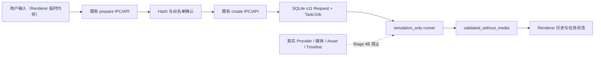
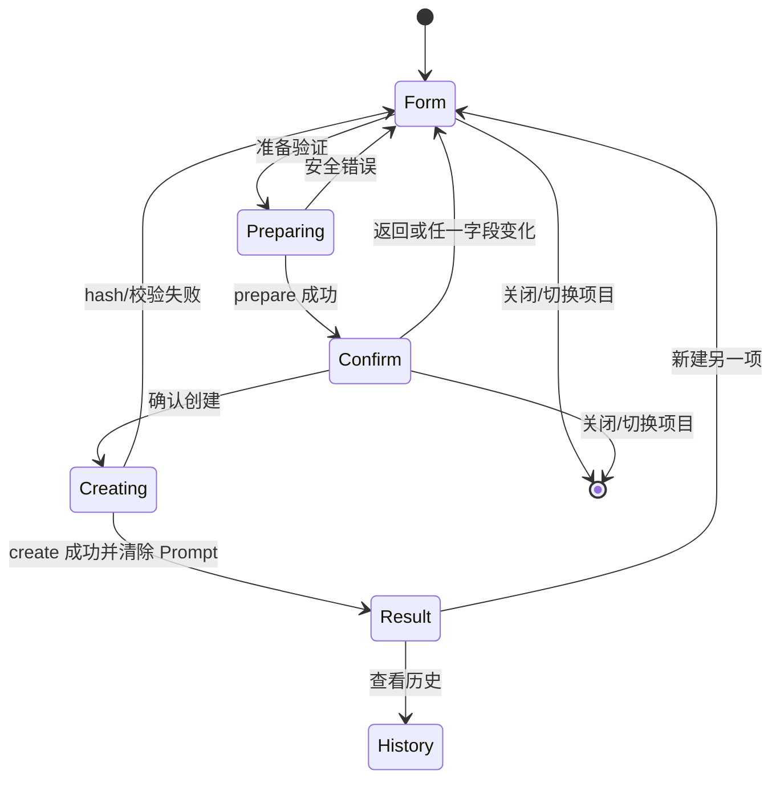

# Stage 4B 详细设计草案：生成任务验证工作台

> 负责人：LiuWei（架构师）
> 状态：已确认冻结；Gate 4B-1 至 Gate 4B-4 通过；Gate 4B-5 已授权，随本次 PR 合并主干后通过
> 日期：2026-08-18
> 上位契约：`docs/STAGE4B_CONTRACT_FREEZE.md`
> 实现基线：Stage 4A / SQLite v11 / `simulation_only`

## 1. 设计目标

Stage 4B 在不改变 Stage 4A 领域、接口和数据模型的前提下，为正式 Desktop 增加一个可达的模拟生成任务工作台。设计重点不是模型能力，而是验证：

- Prompt 的瞬时命令边界；
- prepare 与 create 的 hash 确认链；
- Request 幂等与 Task attempt 历史；
- 快速任务、取消、retry 和重启后的 UI 一致性；
- Renderer、Electron、Core、SQLite 四面的隐私隔离；
- Windows 安装包中的正式产品交互。

成功标准是“用户可以可靠操作并理解模拟任务”，不是“产出了图片或语音”。

## 2. 架构边界



### 2.1 复用

- Stage 4A 七个 Core API；
- `MediaGeneration*` Contracts types、guards 和 parsers；
- `CoreClient` 七个方法；
- `stage4-ipc.ts` 七个固定 channel；
- Preload 七个窄方法；
- 通用 `subscribeJob` 作为刷新提示；
- SQLite v11 Request/Task 与 Jobs 生命周期。

### 2.2 不修改

- `services/core/src/aivs_core/media_generation.py` 的领域语义；
- v1–v11 migrations/checksum；
- `packages/contracts` 公开 DTO 和 `CONTRACT_VERSION`；
- `stage4-ipc.ts`、Preload API 和通用 Job 事件格式；
- Asset、Timeline、Preview、Render、Export 和 Stage 3 Batch；
- Provider 配置与调用实现。

若生产实现证明上述复用不足，必须回到 Gate 4B-1 更新契约；不得在 Renderer 任务中隐式扩展后端。

## 3. Renderer 信息架构

### 3.1 入口

建议在现有顶栏增加独立按钮“生成验证”，仅在已选择项目时可用。点击打开 modal 或右侧独立工作台，不新增全局路由系统，不重构现有编辑器导航。

入口要求：

- 未选项目时禁用；
- `aria-label` 明确为“打开生成任务模拟验证”；
- 不把 Prompt、Request ID 或 Project ID 写入 URL；
- 打开时加载当前项目 Request 首页；
- 项目切换时关闭或完整重置工作台，禁止跨项目保留状态。

### 3.2 页面结构

工作台包含两个稳定视图：

1. **新建验证**：kind、input refs、参数、Prompt、prepare 确认、create 状态；
2. **历史记录**：Request 列表、选中 Request 的 Task attempts、取消/重试。

顶部固定警示：

> 模拟验证：Provider 调用 0 次；不会生成媒体，不会注册素材，也不会写入时间线。

结果区域不得使用“图片已生成”“语音已生成”等容易误导的文案。

### 3.3 建议组件

可从 `App.tsx` 抽出以下 Renderer 私有组件，降低继续扩大单文件的风险：

- `MediaGenerationWorkbench`
- `MediaGenerationForm`
- `MediaGenerationConfirmation`
- `MediaGenerationHistory`
- `MediaGenerationTaskList`

建议目录：`apps/desktop/src/app/media-generation/`。这些组件只接受 `Project`、当前项目 Asset 摘要和已存在的 `window.desktop` 方法，不直接访问 Core URL、Electron module、文件系统或数据库。

## 4. 前端私有状态模型

公开 Contracts 不变。Renderer 内部可使用以下非导出状态：

```ts
type WorkbenchView = "create" | "history";
type CreateStep = "form" | "preparing" | "confirm" | "creating" | "result";

type GenerationDraft = {
  generation_kind: "image" | "tts";
  prompt: string;
  input_refs: string[];
  parameters: ImageGenerationParameters | TtsGenerationParameters;
};

type PreparedLocal = {
  prepared: MediaGenerationPreparedRequest;
  draftFingerprint: string;
};
```

`draftFingerprint` 只用于 Renderer 判断确认是否因字段变化失效；它不是 Core 的权威 `request_sha256`，不得替代 Core prepare。可选择直接在任何字段变化时无条件清空 `PreparedLocal`，从而避免在 Renderer 实现另一套 canonical hash。

推荐采取后者：**字段变化即清空确认，不在 Renderer 重写 canonical hash 算法。**

### 4.1 状态不变式

- `confirm` 必须同时存在 draft 与 Core `prepared`；
- `create` 只能使用产生该 prepared 的原 draft；
- `result` 中不保留 Prompt；
- close/project change/unmount 清除 draft、prepared、错误、选中 Request 和 timer/subscriptions；
- 历史 DTO 永不与 draft 合并，避免 Prompt 被附加到持久事实展示模型；
- 所有错误只保存安全字符串，不保存 raw exception。

## 5. 表单设计

### 5.1 公共字段

- Kind：图片验证 / TTS 验证；
- Prompt：1–4000 字符；允许换行和 tab，拒绝其他控制字符；
- input refs：从当前项目 Asset 列表选择，1–32 个且唯一；
- 切换 kind 时重置参数并使 prepared 失效。

Renderer 可以做即时可用性校验，但提交前仍使用现有 Contracts parser，Core 是最终权威。

### 5.2 图片参数

- width/height：整数 64–4096；
- `style_preset_id`：可选、合法 ID；Stage 4B 不增加 preset discovery，界面可提供少量纯 UI 固定值或可选合法 ID 输入；
- seed：可选整数 0–2147483647。

推荐首版不虚构模型风格能力：`style_preset_id` 留空或提供明确标注为“验证参数”的本地选项，不宣称 Provider 支持。

### 5.3 TTS 参数

- `voice_preset_id`：合法 ID；不代表真实声音模型；
- language：`zh-CN | en-US`；
- speed_milli：500–2000；界面可显示为 0.5×–2.0×，提交整数值。

固定语音 ID 必须标注为验证 preset，不得使用真实人物姓名或暗示声音已安装。

### 5.4 Asset 选择

- 只显示当前项目的安全 Asset DTO：display name、kind、availability；
- 提交仅包含 Asset ID；
- 不显示/提交 location URI 或绝对路径；
- Stage 4A Core 目前只把 `input_refs` 当白名单 ID，不验证 Asset 归属，因此 Renderer 必须限制当前项目选择，但安全权威仍不能依赖 Renderer；
- Stage 4B 不借机增加 input ref 外键或数据库迁移。若独立审查认为跨项目伪造构成必须修复的领域缺陷，应阻断 Gate 并单独重新冻结。

## 6. Prepare / Confirm / Create 流程



### 6.1 Prepare

1. UI 验证本地字段；
2. 构造全新白名单对象，不 spread 任意状态对象；
3. 调用 `prepareMediaGeneration({ project_id, request })`；
4. 响应经现有 guard；
5. 只保存 prepared DTO 和当前 draft 引用；
6. 展示 hash、参数、引用数量和固定零 Provider 提示。

### 6.2 Confirm

确认页不回显完整 Prompt。可显示：

- 类型；
- Prompt 字符数和 `prompt_sha256`；
- input refs 的安全显示名与数量；
- 白名单参数；
- `request_sha256`；
- `simulation_only`；
- Provider 0 次、无媒体、无 Asset。

用户返回修改或任何字段改变时清空 prepared。

### 6.3 Create

1. 使用原 draft 加 `prepared.request_sha256` 构造 `MediaGenerationCreateInput`；
2. 调用 `createMediaGeneration`；
3. 成功后立即清空 Prompt 与 prepared；
4. 保存返回的 Request/Task 安全 DTO；
5. 立即调用 `listMediaGenerationTasks` 回读，不能等待 Job 订阅后才读；
6. 切换到结果或历史视图。

若 create 返回 hash mismatch，提示“确认已失效，请重新准备”，清空 prepared，不显示服务端内部信息。

## 7. 历史、刷新与竞态

### 7.1 Request 历史

- 打开工作台或切到历史时请求第一页（建议 limit 20）；
- 使用 `next_cursor` 显式加载更多；
- 项目切换后丢弃旧请求的迟到响应；
- 可用 monotonic request token 或 `AbortController`（若调用层支持）阻止 stale response 覆盖新项目；
- 不在前端重新按时间排序。

### 7.2 Task attempts

- 选中 Request 后请求对应 Task 页；
- 显示 attempt、status、stage、created/updated/finished、安全 error、retry parent；
- 不显示 Job 原始 payload 或数据库内容；
- Task 响应是权威生成状态。

### 7.3 快速完成竞态

`simulation_only` 可能在 UI 建立 Job 订阅前结束。处理顺序冻结为：

1. create 返回；
2. 立即回读 Task；
3. 若 Task 非终态，订阅对应 Job；
4. 订阅建立后再次回读一次；
5. Job event 只触发节流后的 Task 回读；
6. 工作台可见且仍有非终态任务时，以有限频率轮询兜底；
7. Task 进入终态后停止订阅和轮询。

建议轮询间隔 1–2 秒；不得在工作台关闭后后台永久轮询。

### 7.4 并发与迟到响应

- 每个选中 Request 维护 generation token；切换选择后旧响应不得覆盖新选择；
- cancel/retry 操作期间对同一 Task 禁用重复按钮；
- 不对状态做乐观修改；操作响应后重新读取 Task 列表；
- 组件卸载后不得 setState 或保留订阅。

## 8. Cancel 与 Retry

### 8.1 Cancel

- 可用状态：`queued | running`；
- 点击后调用既有 `cancelMediaGenerationTask(task_id)`；
- 返回 DTO 经 guard；
- UI 显示 Core 返回状态并立即刷新；
- 若任务已终态，显示通用的“状态已变化，请刷新”并回读。

### 8.2 Retry

- 可用状态：`failed | cancelled | interrupted`；
- 调用既有 `retryMediaGenerationTask(task_id)`；
- 新 Task 的 attempt 必须递增，`retry_of_task_id` 指向原任务，Job ID 必须不同；
- UI 将新 Task 追加/刷新为服务端权威列表，不覆盖原 attempt；
- succeeded 和非终态不显示可用 retry。

## 9. 错误与安全展示

### 9.1 允许展示

- Contracts/Core 返回的稳定、安全中文 message；
- 稳定错误码（仅在需要诊断的折叠区域）；
- Request/Task/Job ID；
- hash、白名单参数、时间和状态；
- Asset display name 与 kind。

### 9.2 禁止展示或持久化

- Prompt 正文（除当前受控输入框）；
- 绝对路径、URI、字幕/转写正文；
- token、API key、Authorization、Provider payload；
- raw response、原始异常对象、stack、stderr、command、traceback；
- 任意生成媒体预览，因为 Stage 4B 不存在生成媒体。

### 9.3 错误处理

catch 只映射为预定义安全文案或已去敏 Error message；不得 `console.error(error)`。测试应注入带 sentinel 的异常并断言 sentinel 不进入 DOM、console、snapshot 或 trace。

## 10. API、DTO 与数据表变更清单

| 层 | Stage 4B 变更 | 说明 |
|---|---:|---|
| Core API | 0 | 复用七个 Stage 4A API |
| Core service | 0（默认） | 仅发现契约缺陷时重新过 Gate |
| SQLite | 0 | 保持 v11，无 v12 |
| Contracts DTO | 0 | 复用 `MediaGeneration*` |
| Contract version | 0 | 保持 `stage3b-v1` |
| Core Client | 0 | 七个方法已存在 |
| Electron IPC | 0 | 七个固定 channel 已存在 |
| Preload API | 0 | 七个窄方法已存在 |
| Renderer | 新增 | 工作台组件、状态编排、样式 |
| 测试 | 新增/扩展 | Renderer、竞态、E2E、Windows 验收 |
| README | 0 | 不处理 |

## 11. 预计文件变更

生产实现预计只涉及：

```text
apps/desktop/src/app/App.tsx
apps/desktop/src/app/media-generation/*       # 建议新增
apps/desktop/src/styles.css                   # 或组件专属样式
apps/desktop/tests/app.test.tsx
apps/desktop/tests/media-generation-workbench.test.tsx  # 建议新增
apps/desktop/e2e/*                            # Stage 4B 正式交互
```

默认不得修改：

```text
services/core/src/aivs_core/*
services/core/tests/*
packages/contracts/src/index.ts
apps/desktop/electron/main/stage4-ipc.ts
apps/desktop/electron/preload/index.ts
apps/desktop/src/lib/core-client.ts
README.md
```

回归测试可能读取默认不得修改的文件；任何写入需求都必须说明原因并重新审查边界。

## 12. 开发切片（不规定执行顺序）

### 切片 A：Renderer 工作台骨架

- 入口、modal/面板、固定警示、create/history 视图；
- 项目和 Asset 安全输入；
- 无 Core/Contracts 改动。

### 切片 B：Prepare/Create 状态机

- 表单、确认失效、hash 确认链；
- Prompt 清理；
- 快速终态立即回读。

### 切片 C：历史、Cancel、Retry 与刷新协调

- cursor 分页、Task attempts；
- 订阅仅提示、Task 回读权威；
- timer/subscription 生命周期和 stale response 防护。

### 切片 D：安全与自动化测试

- guard/IPC/Preload 回归；
- DOM/console/snapshot sentinel；
- 快速完成、项目切换、关闭卸载、重复操作测试。

### 切片 E：Windows 正式验收

- build、package、NSIS 安装、启动；
- 创建/历史/取消/重试/重启流程；
- Provider=0、无媒体、无 Asset、无 Prompt 泄漏证据。

切片可串行或并行；文档只规定接口与互斥写集，不规定人员调度方式。

## 13. 测试设计

### 13.1 Renderer 单元/组件测试

至少覆盖：

1. 未选项目入口不可用；
2. 固定模拟边界文案始终可见；
3. image/tts 正反表单；
4. input refs 只提交 ID，不提交路径；
5. prepare 响应不含 Prompt；
6. 字段变化、关闭、项目切换使 prepared 失效；
7. create 成功后清空 Prompt；
8. reused 状态正确显示；
9. 六种 Task 状态映射；
10. succeeded 显示 `validated_without_media`；
11. cancel/retry 按状态可用；
12. attempt lineage 不被覆盖；
13. 快速完成在订阅前发生仍能显示终态；
14. 迟到响应不污染新项目/新 Request；
15. 关闭/终态后 timer 和 subscription 清理；
16. sentinel 不进入 DOM、console、snapshot。

### 13.2 Contracts / Electron 回归

- 现有 `contracts.test.ts`、`core-client.test.ts`、`stage4-ipc.test.ts`、`preload.test.ts` 全部通过；
- 七个 channel 和七个 Preload 方法数量不增加；
- raw extra field 和敏感 key 继续被拒绝；
- `CONTRACT_VERSION` 不变。

### 13.3 Core / SQLite 回归

- Stage 4A 定向测试全过；
- Core 全量排除 `real_provider` 后通过；
- v1–v11 migration checksum 不变；
- Provider fail-on-call 计数为 0；
- Request/Task/Job 恢复、取消和 retry 不变。

### 13.4 E2E

使用真实 Electron + Sidecar、隔离 user data：

- 创建项目并导入最小合成素材或复用安全 fixture；
- 完成 image 和 TTS 各一次模拟流程；
- 重开工作台读取历史；
- 对可控的 queued/running fixture 验证 cancel；
- 对 cancelled/interrupted fixture 验证 retry；
- 重启应用后历史和状态可恢复；
- 验证没有输出媒体或新增 Asset。

若模拟 runner 太快导致 UI 无法人工点击 cancel，E2E 可使用测试专用、非生产暴露的受控 runner 时序；不得改变生产 API 或在正式包中加入调试开关。

### 13.5 Windows 独立真实验收

- 干净目录构建 Sidecar 与 Desktop；
- 生成 Windows 安装包并验证产物哈希；
- NSIS 实际安装、启动和 Sidecar 握手；
- 在安装版本完成工作台核心流程；
- 退出并重启检查历史；
- 检查项目数据库无 Prompt，安装/用户数据目录无生成媒体；
- 检查日志、Renderer 和截图证据无禁止内容；
- Provider invocation 实际计数为 0；
- 卸载不误删项目事实，升级兼容沿用既有打包契约。

## 14. 验收证据模型

允许记录：

- commit、构建版本、Windows 版本；
- 测试数量和退出码；
- Request/Task/Job 的合成 ID 与状态；
- hash、attempt、retry parent、Provider 调用计数 0；
- 安装包和产物 hash；
- “无生成媒体、无新增 Asset、无 Prompt 持久化”的扫描结论。

禁止记录：

- Prompt/脚本/字幕/转写正文；
- 真实媒体绝对路径；
- Provider token、API key、Authorization 或请求载荷；
- 原始异常、stderr、command、traceback；
- 包含真实用户输入的截图或 trace。

## 15. 风险与退路

1. **误导用户认为已真实生成**
   退路：入口、确认、结果三处固定模拟警示；结果禁止“已生成”文案。

2. **快速任务导致漏状态**
   退路：create 后立即回读、订阅后再回读、有限轮询兜底；Task API 为权威。

3. **Prompt 泄漏**
   退路：只在表单内存、响应不含正文、成功/关闭/切项目清空、sentinel 测试。

4. **App.tsx 继续膨胀**
   退路：抽出独立组件目录，保持 Core 调用封装和 props 边界清晰。

5. **UI 为方便扩展后端**
   退路：API/DTO/SQLite 变更清单固定为 0；缺口返回 Gate，不隐式新增。

6. **跨项目迟到响应污染**
   退路：project/request token、卸载清理、旧响应丢弃。

7. **取消路径因 simulation 太快无法人工复现**
   退路：自动化受控时序 + 数据库故障注入；不在生产引入延迟或调试接口。

8. **真实 Provider 范围偷渡**
   退路：依赖扫描、网络 fail-on-call、Provider=0 硬门禁。

## 16. 技术可行性结论

### ZhangSan（Core / SQLite / Jobs）

现有七个 API、v11 Request/Task、Job runner、恢复和 retry lineage足以支撑工作台。Task 列表可作为状态权威，通用 Job 订阅作为刷新提示，不需要新增 Task 单项接口。默认不修改 Core 与 SQLite。

待生产验证的风险点：模拟任务过快、cancel 人工窗口短、跨项目 input ref 当前主要由命令白名单和 Renderer 约束。后者不得在 Stage 4B 未经重新冻结时扩展迁移。

### YeJing（Contracts / Desktop / Electron）

现有 Contracts、Core Client、七个 IPC 和 Preload 方法已覆盖工作台操作，无需扩充 Renderer 权限。主要成本在 React 状态机、Prompt 生命周期、迟到响应防护、任务刷新协调和 E2E/安装包交互。

应从 `App.tsx` 抽出组件，避免继续把完整状态机压入单文件。正式 UI 必须清楚区分模拟验证与真实媒体生成。

### LiuKeAi（独立审查）

范围适中且可验收，但只有在以下硬条件成立时通过：API/DTO/SQLite 零变更、Provider=0、无媒体/Asset、Prompt 无持久化、快速终态和重启恢复可复现、Windows 安装版本可完成真实交互。

## 17. Gate 推进建议

1. Gate 4B-1 已通过，两份文档已冻结；
2. Gate 4B-2 隔离交互原型、竞态与隐私验证已通过；
3. Gate 4B-3 正式 Renderer 工作台与开发验证已通过；
4. Gate 4B-4 Windows 独立真实验收已通过；
5. Gate 4B-5 收尾、提交、推送、PR 和合并已获授权；本次 PR 合并主干后 Gate 4B-5 通过；
6. 之后另行规划 Stage 4C，候选才包括单一真实 Provider 或脚本/分镜需求清单。

以上为门禁依赖关系，不约束团队成员必须串行执行；互不冲突的工作可由单会话或恢复后的 subagent 按文件所有权并行推进。
