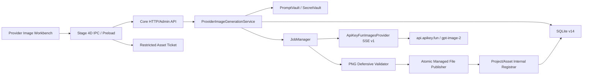

# Stage 4D 详细设计：APIKEY.FUN 受控真实图片生成

> 负责人：LiuWei（架构师）
> 基线：`master` / `799ef8e` / Stage 4C
> 文档契约：`stage4d-v3`（API/DTO `CONTRACT_VERSION` 仍为 `stage4d-v2`）
> 数据库：SQLite v14
> 固定 Provider：`apikey_fun_images / apikey_fun_images_sse_v1 / gpt-image-2`

## 1. 目标与非目标

目标是从本地 Prompt 到单张受管图片形成最小真实闭环：Prepare 形成不含正文的权威确认，Create 建立 Request/Task/Invocation，后台任务至多一次调用固定 Provider，防御性验证 PNG 后原子落盘并注册 Asset/Provenance，最后通过受限票据预览且可重启恢复。

非目标：2K 像素能力、第二 Provider、参考图、编辑、Batch、TTS、视频生成、质量评分、Requirement 编排和 Timeline 自动装配。

## 2. 组件架构



职责：

- `ProviderImageConfigService`：只管理固定第三方身份、显示名、启停和 CNY 公示价格；
- `ProviderImageGenerationService`：Prepare/Create/Retry/Cancel/List、状态和事务权威；
- `PromptVault`：TTL、有界、进程内 Prompt 保存，不可序列化；
- `ApiKeyFunImagesProvider`：固定 endpoint/profile 的一次 SSE dispatch；
- `JobManager`：队列、取消、重启恢复；
- Asset 内部 registrar：复用项目安全边界注册 managed image，不允许生成服务绕过领域约束直接制造公开路径。

Stage 2 的文本 Provider adapter 不复用，因为其 schema、endpoint、usage 和响应协议与图片 SSE 不同。Stage 4A/4B simulation runner 继续独立且 fail-on-call。

## 3. 状态与一致性模型

### 3.1 Request

canonical 事实：

```json
{
  "schema_version": 1,
  "project_id": "id",
  "generation_kind": "image",
  "execution_mode": "provider_image_v1",
  "prompt_sha256": "sha256:...",
  "input_refs": [],
  "parameters": { "size": "1024x1024" },
  "provider_profile_sha256": "sha256:..."
}
```

Prompt 明文不进入 canonical JSON。`request_sha256` 对 canonical JSON 计算。

### 3.2 Provider profile

profile hash 覆盖：config ID、kind、adapter、capability、protocol、model、endpoint identity、size、output format、transport=`sse`、response format=`b64_json`、stream=`true`。不包含 secret、display name 或价格。

### 3.3 Task

状态保持既有枚举：`queued | running | succeeded | failed | cancelled | interrupted`。每次用户显式 retry 创建新 Task，`attempt+1`，`retry_of_task_id` 指向直接父 Task。

新 Task 执行前再次核验 profile 身份必须严格等于当前 adapter；历史官方 Task 身份不匹配时返回 `GENERATION_RETRY_NOT_ALLOWED`，不会被第三方 adapter 接管。

### 3.4 Invocation

每个 Task 恰有一条 Invocation，初始 `prepared`。调用 `on_dispatch()` 时在数据库原子递增为 1 并标记 `provider_may_have_processed=1`。成功或失败只更新同一行，不创建隐式重试 Invocation。

成功不变式：

```text
Task.status = succeeded
Invocation.status = succeeded
provider_call_count = 1
provider_may_have_processed = 1
validated_format = png
validated_width = Provider 原生宽度（1..4096）
validated_height = Provider 原生高度（1..4096）
validated_size_bytes > 0
output_sha256 != null
error_code = null
cleanup_required = 0
Asset/Provenance 均存在且 hash 一致
```

失败时 Task/Invocation 错误码一致；Asset/Provenance 不存在；如文件发布后事务失败，通过 cleanup debt 或同步删除保证不会被当作成功。

## 4. Prompt 与凭据生命周期

### 4.1 Prepare

1. 验证项目 active、配置 enabled、凭据 configured；
2. 校验 Prompt 非空、长度和字符边界；
3. 请求参数只接受 `1024x1024`，其语义为 1K 请求意图，不是输出尺寸等式；
4. 计算 Prompt/profile/payload hash；
5. 把 Prompt 和冻结 facts 写入 TTL 5 分钟、有界容量 64 的进程内 vault；
6. 返回不含 Prompt 的 Prepared DTO。

Prepare 不调用 Provider。修改 Prompt、配置或尺寸会使旧 preview 失效。

### 4.2 Create

1. reserve preview，拒绝重复确认；
2. 对比客户端提交的 payload hash；
3. 单事务写入 Request、profile、Task、Invocation 和 Job；
4. 把 vault key 从 preview 转移到 task；
5. Job 完成后删除 vault entry。

任何数据库异常释放 reservation，不把 Prompt 写入日志或异常。

### 4.3 Secret

Renderer 仅提交用户键入的凭据给 Electron Main。Main 用 `safeStorage` 保存，启动时通过受限 Admin API 注入 Core `ProviderSecretVault`。Core API 与公开 DTO 只暴露 configured/missing；删除时同时删除 safeStorage 密文和 Core 内存值。

## 5. SSE Adapter

### 5.1 固定请求

```python
payload = {
    "model": "gpt-image-2",
    "prompt": prompt,
    "n": 1,
    "size": "1024x1024",
    "stream": True,
    "response_format": "b64_json",
}
```

固定调用 `POST https://api.apikey.fun/v1/images/generations`；`Accept=text/event-stream`。`httpx.AsyncClient` 设置 `follow_redirects=False`、`trust_env=False`、connect 15 秒、总超时 900 秒。

### 5.2 流解析

- 按 `\n\n`、`\r\n\r\n`、`\r\r` 分帧，允许 chunk 跨边界；
- 忽略注释、空帧和 `[DONE]`；
- 每帧只解析 `data:` JSON；
- 只认 `type=image_generation.completed`；
- completed 必须恰好一个；
- 图片取顶层 `b64_json` 或 `data[0].b64_json`；
- base64 使用严格模式解码；
- envelope 最大 36 MiB，图片最大 25 MiB；
- 响应体只做增量 SHA-256，不持久化 raw SSE。

### 5.3 状态和错误

`on_dispatch()` 在网络发送前恰好调用一次，因此连接错误也保守视为可能已处理。401/403、429、5xx、timeout、connect/transport、非 SSE、重复/缺失 completed、JSON/base64 异常全部映射为固定安全错误。Provider body 和底层异常不得向外传播。

取消发生在 dispatch 前：`provider_call_count=0`；发生在 dispatch 后：`provider_call_count=1`、`provider_may_have_processed=true`，不补发。

## 6. 图片验证、发布与 Asset

验证顺序：

1. 文件大小上限；
2. PNG signature、首个 IHDR 结构、CRC 和宽高安全上限检查，发生在完整解码前；
3. PyAV 防御性完整解码；
4. 必须单帧；
5. 格式必须 PNG；
6. IHDR 与解码后的宽高必须一致、单边不超过 4096、总像素不超过 16,777,216；
7. 不执行 resize、crop、pad、拉伸、重编码或格式转换，原始字节直接进入 hash 和受管发布；
8. 计算输出 SHA-256。

发布文件只写项目 managed image 目录：临时文件采用排他创建，flush/fsync 后同卷原子 rename，拒绝 symlink/reparse point 和目录逃逸。公开层只保存/返回相对受管关系和 Asset ID，不返回绝对路径。

Asset 内部注册输入只包含项目 ID、固定 image kind、受管相对位置、MIME、尺寸、字节数、hash 和生成 provenance 关联。若命中 `UNIQUE(project_id,fingerprint)`，以 `GENERATED_ASSET_DUPLICATE` 安全失败并删除本次文件；首版不自动复用既有 Asset。

数据库注册失败时回滚 Asset/Provenance，并删除文件；删除失败记录受控 cleanup debt，Task 不得 succeeded。Timeline 始终不自动变化。

## 7. SQLite v14 详细设计

### 7.1 迁移路径

- v1→v12 和 v12→v13 完全复用已冻结 migration/checksum；
- v14 只重建四张 Stage 4D 表以扩展 CHECK 和费用字段；
- v13 官方历史行原样复制到 v14 表；
- 复制 Invocation 时新增费用币种和价格档位为 `NULL`，不得把历史未知费用伪造成 CNY；
- 删除旧表、rename v14 表、重建 index 和 immutable trigger；
- migration 前创建备份，整个 v14 SQL 单事务执行。

### 7.2 表约束

`image_provider_configs`：

```text
历史：openai_images / openai_images_generations_v1 / gpt-image-1
新建：apikey_fun_images / apikey_fun_images_sse_v1 / gpt-image-2
新建价格：0.10 / 0.15 / CNY
UNIQUE(project_id, provider_kind)
```

`provider_image_request_profiles`：

```text
历史官方 profile 只读保留
新第三方 endpoint_identity=apikey_fun_images_generations
新第三方 size=1024x1024
profile immutable trigger
```

`provider_image_invocations` 新增：

```text
estimated_cost_currency NULL | CNY
price_tier NULL | 1K | 2K
```

`generated_asset_provenance` 允许两套完整且互不混用的身份组合，并保持 immutable trigger。

### 7.3 门禁

- fresh v1→v14 和 v13→v14；
- v1–v13 checksum 不变、v14 checksum 正确；
- 历史官方 config/request/task/invocation/provenance 行数和 hash 保持；
- 第三方配置/model/价格/币种 CHECK；
- 第三方请求拒绝非 `size=1024x1024`；输出原生宽高不要求等于请求值，但必须满足安全边界；
- backup 存在；故障注入后原库完全回滚；
- foreign key check 为空、integrity check 为 ok。

## 8. Core API

### 配置

```text
POST /projects/{project_id}/provider-images/configs
body = { display_name, enabled }
```

不接受 endpoint、model、adapter 或价格。服务端写入固定第三方身份与 CNY 价格。列表只显示第三方配置，v13 官方历史不混入。

### Prepare / Create

```text
POST /projects/{project_id}/provider-images/prepare
POST /projects/{project_id}/provider-images/tasks
```

Prepare body 包含 Prompt 和 `size=1024x1024`，Create 只包含 preview ID 与 payload hash。Prompt 不进入 Create body。

### Retry / Cancel / Query

Retry 先由用户重新输入 Prompt，Core 比较 hash，并严格核验原 Task 是当前第三方身份。Cancel 不保证撤销已由 Provider 处理的请求。Request/Task/List 只查询当前第三方身份；历史官方事实保持可审计但不通过新 API 投影。

## 9. Contracts

冻结类型：

```ts
type ProviderImageExecutionMode = "provider_image_v1";
type ImageProviderKind = "apikey_fun_images";
type ImageProviderAdapterId = "apikey_fun_images_sse_v1";
type ProviderImageSize = "1024x1024";
type ProviderImageFormat = "png";
type ProviderPriceCurrency = "CNY";
type ProviderPriceTier = "1K";
```

Prepared/Task/Result 添加 `estimated_cost_currency` 和 `price_tier`，与 `estimated_cost` 一起进行 guard。Provider 配置展示供应商公示的 1K/2K CNY 价格，但 Task 只能是 `1K`。DTO guard 拒绝 Prompt、credential、endpoint、路径、URI、payload、raw response、base64、未知 provider identity 和额外字段。

`CONTRACT_VERSION` 继续为 `stage4d-v2`；本修订没有 API/DTO 字段或 union 结构变化，因此不为纯语义修订制造协议版本抖动。Stage 4A/4B/4C DTO 不改 union 语义。

## 10. Desktop / Electron

页面分区：

- 固定 Provider 卡：`APIKEY.FUN Images / gpt-image-2`、密钥状态；
- 价格说明：`1K ¥0.10`、`2K ¥0.15`，明确当前只开放 1K；
- Prompt 本地编辑区；
- 唯一请求意图 `1024×1024（1K）`，成功结果展示 Provider 实际输出宽高；
- Prepare 安全摘要；
- 明确确认框：`CNY 0.10 · 1K`、一个 Task 最多一次调用；
- Task 历史、安全错误和受限成功预览。

Main/Preload 暴露窄 IPC，参数和响应均经 contracts guard。图片 ticket 验证 project/asset 归属、MIME、过期和单次访问，不返回真实文件路径。

竞态处理：Prepare 后修改 Prompt/配置/尺寸立刻作废 preview；提交中禁用重复点击；Core 重启后 Prompt vault 清空，未启动任务转 interrupted，不自动恢复 dispatch。

## 11. 测试矩阵

### Core / Provider

- SSE 顶层/嵌套图片、LF/CRLF、chunk 边界、`[DONE]`；
- endpoint/profile/header 固定；dispatch 恰好一次；
- 401/403/429/5xx/400、timeout/network、非 SSE、缺失/重复 completed；
- 非法 JSON/base64、envelope/image 超限、错误格式/尺寸/多帧；
- dispatch 前/后取消；Prompt/key/raw response/异常不泄漏；
- 原子发布、symlink/reparse point、冲突、事务与 cleanup debt。

### SQLite / API

- v1→v14、v13→v14、checksum、backup、rollback、FK、integrity；
- v13 官方历史保留且新 API 隔离；
- 当前 adapter 拒绝历史 Task retry；
- Prepared/Create 幂等与过期、payload hash、单次 dispatch；
- success/failure/cancel/interrupted/retry lineage 和重启恢复；
- simulation Provider=0 回归。

### Contracts / Desktop / Electron

- DTO guard 与敏感字段拒绝；
- 固定身份、价格、币种、档位和唯一尺寸；
- safeStorage 保存/删除/重启重注入；
- IPC fail-closed；
- 受限图片 ticket；
- 工作台确认、错误、恢复和重复点击。

### E2E / Windows

- 离线 E2E 先证明不调用 Provider；
- 真实开发态一个 Task、至多一次 dispatch；
- 单帧 PNG 原生尺寸安全边界、原始字节 hash、Asset/Provenance、受限预览、重启恢复；
- SQLite v14、Timeline delta=0 和隐私扫描；
- Windows 全新包体验证、NSIS fresh、v13→v14 升级、安装态成功闭环和卸载保留。

## 12. 独立验收证据

证据只允许保存：

```json
{
  "provider_identity": {
    "kind": "apikey_fun_images",
    "adapter_id": "apikey_fun_images_sse_v1",
    "model": "gpt-image-2"
  },
  "provider_call_count": 1,
  "budget_estimate": {
    "prior_usd": 0.40,
    "per_new_dispatch_usd": 0.15,
    "hard_stop_usd": 2.0
  },
  "provider_price": {
    "amount": 0.10,
    "currency": "CNY",
    "tier": "1K"
  },
  "image": {
    "format": "png",
    "width": 1024,
    "height": 1536,
    "size_bytes": 1,
    "sha256": "sha256:..."
  },
  "asset_registered": true,
  "provenance_registered": true,
  "timeline_delta": 0,
  "privacy_scan_passed": true
}
```

不得保存 Prompt、API key、request payload、SSE、base64、绝对路径、Provider 原始错误或截图。

## 13. 开发切片与角色边界

切片不规定执行顺序，可按文件所有权并行：

- Provider/SSE/Prompt 安全边界；
- SQLite v14 与领域状态；
- 图片验证、文件和 Asset/Provenance；
- Contracts/API；
- Electron/Desktop；
- 自动化、Windows 与独立验收。

角色边界：LiuWei 负责契约与 Gate；ZhangSan 拥有 Core/SQLite/Provider/Asset 文件；YeJing 拥有 Contracts/Desktop/Electron/打包文件；LiuKeAi 独立复跑证据。跨切片只通过冻结接口对接，不约束串行/并行或是否启用 subagent。

## 14. 风险与退路

1. **第三方协议漂移**：任何 endpoint、事件、字段或模型变化均 fail-closed，回到契约 Gate；
2. **费用币种混淆**：产品价格只用 CNY；USD 仅为验收预算；
3. **Provider 已收费但本地失败**：保守标记可能处理，不自动 retry；
4. **历史身份串线**：新列表过滤第三方身份，runtime guard 拒绝历史 retry；
5. **未知 2K 像素映射**：只展示公示价格，不创建 2K 请求；
6. **Prompt/凭据泄漏**：vault、safeStorage、无 trace、稳定错误与扫描共同门禁；
7. **文件/数据库双写**：原子 rename、事务和补偿删除；
8. **回退**：恢复 v13→v14 前备份，旧 Core 不得直接打开 v14。

## 15. Gate 推进

1. Gate 4D-1、4D-2、4D-3 已通过；
2. Gate 4D-4 使用测试执行模型 `gpt-5.6-luna`，图片 Provider 固定为 `apikey.fun / gpt-image-2`；
3. 历史严格尺寸 Task 已真实 dispatch 1 次并以 `GENERATED_IMAGE_DIMENSION_MISMATCH` 失败；该失败事实、调用数 1 和零 Asset/Provenance 不回写、不 retry、不改判；
4. Gate 4D-4A 已冻结 D2 原生尺寸契约，并通过离线全量门禁；SQLite v14 与 API/DTO `stage4d-v2` 结构保持不变；
5. 用户授权后创建全新隔离 Task，执行一次真实 dispatch；Task `succeeded`，`provider_call_count=1`，自动 retry=0；
6. Provider 原生 PNG 为 1254×1254、1,862,105 字节，满足最大单边、总像素、文件大小、单帧 PNG、IHDR/完整解码一致性门禁；保存原始字节，不做 resize/crop/pad/重编码；
7. managed Asset、Invocation、Provenance 的字节数和 SHA-256 一致；Timeline Revision 增量 0；SQLite v14、FK 与 integrity 通过；
8. 原始真实 E2E 曾因验收脚本把 Windows `file://` URI 直接交给 `Path(...)` 而在资产存在性断言产生假阴性。只读复核证明生产落盘和数据库正确；修复 URI 解析后只使用既有成功数据库完成零网络重启恢复，未新增 Provider 调用；
9. 重启后成功历史、safeStorage 配置状态和受限预览恢复；数据库前后投影一致；脱敏扫描未发现 Prompt、明文凭据、payload、SSE、base64、原始异常或绝对路径泄漏；
10. D2 新调用后的保守累计为 USD 0.55 / USD 2，硬停止线未触发；
11. Gate 4D-5 已执行当前源码的最终收尾验证：Core 404 passed / 1 skipped；Ruff、py_compile、Contracts、Desktop typecheck、171 个 Desktop 测试和 production build 通过；
12. 开发态零调用 Electron E2E 通过；基于当前 D2 源码生成全新 Windows x64/NSIS 包，包体校验、NSIS 静默安装、安装态 fresh、v13→v14、重启恢复和真实卸载全部通过；
13. Gate 4D-5 Provider 调用增量为 0；公开证据隐私扫描失败计数 0；当前保守累计保持 USD 0.55 / USD 2；
14. **Gate 4D-5 收尾门禁已通过，Stage 4D 已完成。README 不处理，等待版本控制收口。**
