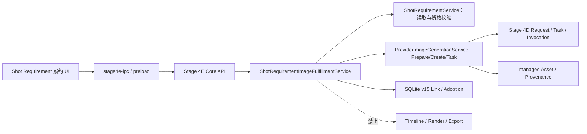

# Stage 4E 详细设计草案：图片 Requirement 履约与生成关联

> 负责人：LiuWei（架构师）
> 基线：`master` / `30dcb4e`
> 契约草案：`stage4e-v1`
> 数据库目标：SQLite v15
> 状态：Gate 4E-1 至 Gate 4E-5 已通过；Stage 4E 已完成
> Provider 调用：Gate 4E-4 保守累计 10 次独立 fresh dispatch；Gate 4E-5 实际增量为 0

## 1. 目标与非目标

### 1.1 目标

在不修改 Stage 4C Requirement 和 Stage 4D 图片生成语义的前提下，增加薄编排层：

- 从当前 confirmed image Requirement 发起受控 Prepare/Create；
- 原子记录 Requirement→Stage 4D Request 的不可变 link；
- 聚合 Request 下 Task lineage 与安全输出；
- 允许用户把一个 succeeded Task 的 managed image 显式采用为该 Requirement 当前 Asset；
- 用追加式 adoption ledger 保留选择历史并通过 CAS 防止并发覆盖；
- 保持 Timeline、Preview、Render、Export、Batch 零副作用。

### 1.2 非目标

TTS、视频、第二 Provider、2K、参考图/编辑、Batch、自动 Prompt、自动 dispatch、自动 retry、自动 adoption、Timeline 装配、资产替换、角色/场景/风格库均不属于 Stage 4E。

## 2. 设计原则

1. **编排不复制执行器**：Provider、Prompt vault、Request/Task、Invocation、retry、Asset/Provenance 都复用 Stage 4D。
2. **关联不污染上游对象**：不修改不可变 Requirement，不把 Requirement ID 写入 Stage 4D Request。
3. **生成与采用分离**：Task succeeded 只表示可审阅输出，不表示用户采用。
4. **采用历史追加**：切换当前 Asset 只插入新事件，不更新旧事件。
5. **权限在每个写点重验**：Prepare、Create、Adopt 均验证当前 confirmed Revision。
6. **先提交事实再启动执行**：Job worker 只能在 Request/Task/Invocation/link 同一事务提交后看到任务。
7. **fail-closed**：任何跨项目、身份、hash、Revision、Task、Asset、Provenance 不一致均拒绝。
8. **隐私最小化**：link/adoption 不持久化 Requirement 正文副本或 Prompt。

## 3. 组件边界



### 3.1 新 Core 服务

建议文件：

```text
services/core/src/aivs_core/shot_requirement_image_fulfillment.py
```

职责：

- Requirement context 读取和 hash；
- 当前 confirmed Revision 校验；
- 外层 TTL fulfillment preview vault；
- Stage 4D Prepare 组合；
- Create 原子 link hook；
- fulfillment state、links、adoptions 查询；
- adoption CAS 与跨表一致性；
- DTO 投影和稳定错误码。

不负责：Provider HTTP、SSE、图片解码、文件落盘、retry 状态机、Timeline。

### 3.2 Stage 4D 最小内部扩展

公开 API/DTO 不变。建议把 `_create_from_facts` 抽成可接受一个内部 callback 的事务路径：

```py
create_from_reserved_preview(
    project_id,
    preview_id,
    payload_sha256,
    confirmed,
    transaction_hook: Callable[[sqlite3.Connection, RequestTaskFacts], T] | None = None,
) -> tuple[CreateResponse, T | None]
```

约束：

- hook 在 fresh/reused Request/Task 已解析、事务尚未 COMMIT 时执行；
- hook 不得联网、读写文件或启动 worker；
- hook 异常使整个事务 rollback；
- 普通 Stage 4D API 传 `None`，行为和响应逐字保持；
- Prompt vault reservation 的 release/transfer/discard 语义保持；
- 不允许 Stage 4E 直接复制私有 SQL 创建 Request/Task。

Gate 4E-2 原型必须先证明 hook 在 reused 分支也处于显式事务中。当前 Stage 4D reused 分支会提前 COMMIT，因此生产实现需要把 return 延迟到 hook 执行后，但外部行为保持不变。

### 3.3 Provider SSE 防御性兼容

Gate 4E-4 仅依据安全结构事实扩展图片候选识别，不猜测或固化未知事件名：

```text
candidate := type == "image_generation.completed"
             OR payload 严格匹配 data=[{b64_json: string}]
```

实现约束：

1. 冻结事件路径与唯一严格 nested-data 候选进入同一 completed candidate 计数；
2. 计数为 0 或大于 1 均返回既有安全失败；
3. URL-only、data URI 或其他字段形状不能绕过候选规则；
4. 候选的字符串仍经严格 base64 解码、36 MiB 上限、单帧 PNG、尺寸元数据和 SHA-256 链校验；
5. 进程内诊断 schema v2 只保留白名单计数/布尔值/枚举，以 task identity 关联，最多 64 条并一次性读取；
6. 诊断不进入 SQLite、API、DTO、Renderer、生产日志或验收公开证据，不保留事件名、字段值、SSE/base64、正文、路径或异常；
7. 公开 Stage 4D API/DTO、Request hash、retry、Task 成败语义与图片安全边界不变。

## 4. Requirement Context

### 4.1 查询

单次 SQL 应读取：

```text
projects
JOIN shot_lists
JOIN shot_list_revisions
JOIN shot_requirements
```

并得到：

- project status；
- shot_list id；
- current / confirmed Revision；
- Revision document hash；
- Requirement 所有字段；
- Requirement ordinal。

### 4.2 资格函数

```py
require_current_confirmed_image_requirement(
    project_id,
    requirement_id,
    expected_confirmed_revision_id,
) -> RequirementContext
```

顺序：

1. ID 格式；
2. Project 存在且 active；
3. Requirement 存在并属于 Project；
4. expected 等于 `confirmed_revision_id`；
5. Requirement Revision 等于 confirmed；
6. visual kind 是 image；
7. source asset 必须 null；
8. 计算 requirement hash。

错误消息必须是安全中文，不含标题、visual direction、Prompt、路径或 SQL。

### 4.3 Hash

使用独立 schema version 1。不得直接以 Shot List `document_sha256` 代替 Requirement hash，因为 link 必须稳定指向单条 Requirement。

## 5. Fulfillment Preview Vault

### 5.1 外层事实

```py
FulfillmentPreviewFacts = {
  "schema_version": 1,
  "project_id": ...,
  "shot_list_revision_id": ...,
  "shot_requirement_id": ...,
  "requirement_sha256": ...,
  "provider_image_preview_id": ...,
  "provider_image_payload_sha256": ...,
  "provider_config_id": ...,
  "provider_kind": "apikey_fun_images",
  "adapter_id": "apikey_fun_images_sse_v1",
  "model": "gpt-image-2",
  "size": "1024x1024",
}
```

外层 payload hash 覆盖以上字段，但不覆盖或保存 Prompt 正文。

`size='1024x1024'` 只复用 Stage 4D 的 1K 请求意图。不得把它解释为实际输出必须精确为 1024×1024；输出验收继续复用 Stage 4D 的 PNG、解码、尺寸元数据一致和安全上限规则。

### 5.2 TTL 与容量

- TTL 与 Stage 4D preview 对齐为 5 分钟；
- 容量建议 32；
- 外层过期时间不得晚于内层 Stage 4D preview；
- reserve/release/discard 行为与 Stage 4D vault 等价；
- shutdown 或过期清理不得写日志输出正文；
- 如果外层存入失败，必须丢弃刚创建的内层 preview，避免孤儿 Prompt；
- Create 成功/reused 后丢弃外层与内层；失败且可安全重试时释放 reservation。

## 6. Create 原子性

### 6.1 fresh 请求

```text
BEGIN IMMEDIATE
  validate current confirmed Requirement again
  INSERT media_generation_requests
  INSERT provider_image_request_profiles
  INSERT jobs
  INSERT media_generation_tasks
  INSERT provider_image_invocations
  INSERT shot_requirement_image_generation_links
COMMIT
worker may start
```

任一 INSERT 或验证失败：ROLLBACK，Prompt vault 恢复到可重试状态，Provider=0。

### 6.2 reused 请求

```text
BEGIN IMMEDIATE
  locate existing Request by Stage 4D request_sha256
  locate attempt=1 Task
  validate current confirmed Requirement again
  INSERT OR SELECT existing Requirement+Request link
COMMIT
return reused Request/Task/link
```

不得创建新 Task，不得重新 dispatch。

### 6.3 同 Request 多 Requirement

这是允许行为，但必须满足：

- 每条 Requirement 都独立经过 Prepare/Create；
- Project 相同；
- Prompt/config/size 相同导致 Stage 4D request hash 相同；
- 每条 Requirement 产生独立 link；
- 一次 reused Create 不产生 Provider 调用；
- UI 必须明确显示“复用既有生成请求”，不得伪装为新生成。

## 7. SQLite v15 详细约束

### 7.1 Link 表

建议索引：

```sql
CREATE INDEX idx_shot_requirement_image_links_requirement_created
ON shot_requirement_image_generation_links(
  shot_requirement_id, created_at DESC, id DESC
);

CREATE INDEX idx_shot_requirement_image_links_request
ON shot_requirement_image_generation_links(request_id, created_at DESC, id DESC);
```

触发器检查使用 `EXISTS` 联查 Project、Revision、Requirement、Shot List 和 Request。UPDATE/DELETE 一律 abort。

### 7.2 Adoption 表

建议索引：

```sql
CREATE INDEX idx_shot_requirement_image_adoptions_current
ON shot_requirement_image_adoptions(
  shot_requirement_id, adoption_ordinal DESC
);
```

不在表中保存 `is_current`，避免可变标记。当前事件查询：

```sql
SELECT *
FROM shot_requirement_image_adoptions
WHERE shot_requirement_id=?
ORDER BY adoption_ordinal DESC
LIMIT 1;
```

### 7.3 Previous 链

- ordinal 1：`previous_adoption_id IS NULL`；
- ordinal N：previous 必须属于同 Requirement，且其 ordinal=N-1；
- 应用层读取当前 adoption 后校验 `expected_current_adoption_id`；
- 在 `BEGIN IMMEDIATE` 内计算 next ordinal，防止并发重复；
- 如果目标与当前 adoption 的 link/task/asset 相同，返回当前项且 `reused=true`；
- 若 expected stale，先报 conflict，不把相同目标当作幂等成功，以维持 CAS 语义；仅 expected 与当前匹配后才判断 reused。

### 7.4 为什么不存 status

Link 状态来自 Task lineage，adoption 状态来自事件最大 ordinal。额外保存可变 status 会引入双写和恢复不一致，因此 v15 不保存 fulfillment status。

## 8. API 设计

### 8.1 获取 state

```text
GET /api/v1/projects/{project_id}/shot-requirements/{requirement_id}/image-fulfillment
```

响应建议：

```ts
interface ShotRequirementImageFulfillmentState {
  project_id: ProjectId;
  shot_list_revision_id: ShotListRevisionId;
  shot_requirement_id: ShotRequirementId;
  requirement_sha256: string;
  currently_confirmed: boolean;
  lifecycle: "unstarted" | "in_progress" | "review_required" | "adopted" | "adopted_unavailable" | "no_usable_output";
  link_count: number;
  current_adoption: ShotRequirementImageAdoption | null;
  current_asset_availability: "available" | "missing" | "changed" | "unsupported" | null;
}
```

历史 Revision state 可读，但 `currently_confirmed=false`。如果当前 adoption 的 managed Asset 后续不可用，事件仍保持，lifecycle 为 `adopted_unavailable`；用户可改采另一个仍 available 的成功结果。

### 8.2 Prepare

```text
POST .../image-fulfillment/prepare
```

Prepared DTO 在 Stage 4D 字段外增加：

```text
shot_list_revision_id
shot_requirement_id
requirement_sha256
fulfillment_payload_sha256
```

只返回 hash，不返回 visual direction 或 Prompt。

### 8.3 Create

```text
POST .../image-fulfillment/create
```

响应：

```ts
interface ShotRequirementImageFulfillmentCreateResponse {
  link: ShotRequirementImageGenerationLink;
  request: ProviderImageGenerationRequest;
  task: ProviderImageGenerationTask;
  generation_reused: boolean;
  link_reused: boolean;
}
```

### 8.4 List links/adoptions

- keyset 或签名 cursor 均可；不得把 SQL/路径编码进 cursor；
- `limit 1–100`，默认 20；
- link DTO 可包含最近 Task 摘要，但不复制 Prompt；
- 简化首版建议 link page 只返回 link，UI 再复用 Stage 4D tasks API。

### 8.5 Adopt

```text
POST .../image-fulfillment/adopt
```

响应：

```ts
interface ShotRequirementImageAdoptResponse {
  adoption: ShotRequirementImageAdoption;
  reused: boolean;
}
```

## 9. DTO 安全白名单

新增 guard 必须递归拒绝：

```text
path, uri, absolute_path, prompt, visual_direction, narration_text,
transcript, caption, authorization, api_key, secret, payload,
raw_exception, raw_response, sse, base64, stderr, command, traceback
```

说明：Stage 4C 原 DTO 合法包含 `visual_direction` / `narration.text`；Stage 4E fulfillment DTO 不包含它们。两组 parser 分开定义，不能全局复用相互冲突的 sensitive-key set。

Asset 仅使用 Stage 4D `ProviderImageAssetSummary` 与受限 presentation ticket；不返回 location URI。

## 10. Desktop 交互设计

### 10.1 入口

在 Stage 4C Requirement 卡片内：

- existing_media：保持现状，不显示生成入口；
- image + 当前 confirmed：显示“图片履约”；
- image + 非当前 confirmed：只显示历史 state，所有写按钮禁用。

### 10.2 创建流程

1. 用 visual direction 本地预填 textarea；
2. 用户可编辑；
3. 选择现有图片 Provider 配置；
4. 点击“准备外传确认”；
5. 展示 Provider、模型、1K、CNY 0.10、Prompt hash、Requirement hash、过期时间；
6. 用户勾选/点击显式确认；
7. Create 后展示 queued/running/终态；
8. reused 时明确标识“复用既有请求，未新增调用”。

### 10.3 历史与采用

- 每个 link 显示 Request 创建时间与 Task lineage；
- Task 显示 attempt、调用数、可能已处理、safe error；
- succeeded Task 显示安全图片预览与“采用此结果”；
- 当前 adoption 高亮；
- 采用切换弹出确认，说明不会修改 Timeline；
- CAS 冲突后刷新 state，不自动重发 adoption。

### 10.4 重启

- UI state 全部从 SQLite links/adoptions 和 Stage 4D Request/Task 恢复；
- Prompt 输入不恢复；
- Provider secret 仍由 safeStorage 恢复到 Core 内存；
- 离线恢复不 dispatch 新 Task。

## 11. Electron 与 Main

### 11.1 IPC channel 建议

```text
shot-requirement-image-fulfillment:get
shot-requirement-image-fulfillment:list-links
shot-requirement-image-fulfillment:list-adoptions
shot-requirement-image-fulfillment:prepare
shot-requirement-image-fulfillment:create
shot-requirement-image-fulfillment:adopt
```

### 11.2 校验

- 所有 ID 使用统一 ID parser；
- input 只允许精确字段；
- prepare 可瞬时携带 Prompt；其他 API 禁止 Prompt；
- Core response 先过 Stage 4E parser 再送 Renderer；
- 未知 error 只返回固定安全消息；
- 不新增文件选择器、shell open 或任意网络能力。

## 12. 错误映射

| 错误 | HTTP | 场景 |
|---|---:|---|
| `SHOT_REQUIREMENT_IMAGE_INELIGIBLE` | 400 | 非 image 或 Project 状态不允许 |
| `SHOT_REQUIREMENT_REVISION_STALE` | 409 | expected/confirmed/Requirement Revision 不一致 |
| `SHOT_REQUIREMENT_FULFILLMENT_NOT_FOUND` | 404 | link/adoption 不存在 |
| `SHOT_REQUIREMENT_FULFILLMENT_CONFIRMATION_INVALID` | 400 | preview/hash/confirmed 不匹配或过期 |
| `SHOT_REQUIREMENT_GENERATION_LINK_CONFLICT` | 409 | link 跨项目或关联事实冲突 |
| `SHOT_REQUIREMENT_ADOPTION_INVALID` | 400 | Task 未成功或 Asset/Provenance 不一致 |
| `SHOT_REQUIREMENT_ADOPTION_CONFLICT` | 409 | stale expected current adoption |

Stage 4D 凭据、Provider、Task、图片错误原样保留，但 Electron 仍做白名单投影。

## 13. 并发、幂等与恢复

### 13.1 两窗口 Create

- 两者相同 Requirement/Prompt/config/size：Stage 4D request hash 唯一；第一事务 fresh，第二事务 reused；link unique 防重复；
- 两者不同 Prompt：产生两个 Request 和两个 link，均为显式用户操作；
- confirmed Revision 在任一事务前变化：对应事务全部失败且零新增；
- 不依赖 UI 禁用作为一致性保证。

### 13.2 两窗口 Adopt

- 都读取 adoption A；
- 窗口 1 append B 成功；
- 窗口 2 仍提交 expected=A，返回 adoption conflict；
- UI 刷新后用户可重新确认；
- 不自动采用窗口 2 的选择。

### 13.3 崩溃恢复

- COMMIT 前崩溃：SQLite 回滚，无 link、无可见 queued Job；
- COMMIT 后 worker 前崩溃：既有 Job 恢复语义处理；link 已存在；
- dispatch 后崩溃：沿用 Stage 4D `provider_may_have_processed` 和 interrupted 事实；不得自动补发；
- Create COMMIT 后 confirmed Revision 改变：已授权 Task 不自动取消，完成后作为旧 Revision 历史保留，但不可 Adopt；
- Asset 成功、Adopt 前崩溃：state 派生为 `review_required`；
- Adopt COMMIT 后崩溃：重启按最大 ordinal 恢复当前采用项。

## 14. 迁移计划

### 14.1 文件

```text
services/core/src/aivs_core/database_v15.py
services/core/tests/unit/test_migrations_v15.py
```

`database.py` 只追加 import、`V15_VERSION` 和 MIGRATIONS 尾项。不得修改 v1–v14 SQL 文本。

### 14.2 用例

- fresh v15；
- v14→v15；
- migration 重跑幂等；
- v1–v14 checksum fixture 不变；
- FK owner mismatch；
- non-confirmed link；
- simulation/TTS request link 拒绝；历史非当前 Provider Profile 的 request link 拒绝；
- immutable update/delete；
- failed Task adoption 拒绝；
- provenance mismatch 拒绝；
- ordinal/previous 链错误拒绝；
- `foreign_key_check` / `integrity_check`。

### 14.3 向后兼容

- v15 空表对历史行为无影响；
- 不回填等于“不猜测历史图片意图”；
- 若用户显式以相同输入重新发起，才允许幂等复用 Stage 4D Request 并建立 link；
- 老二进制不承诺打开 v15 数据库；安装升级前保留备份。

## 15. 开发拆分

### Gate 4E-2：隔离原型（已通过）

建议只新增原型/测试，不接生产 UI：

1. v15 SQL 内存数据库验证；
2. Stage 4D transaction hook fresh/reused 原子性原型；
3. Requirement hash 固定向量；
4. adoption CAS 双连接并发；
5. lifecycle 纯函数；
6. Renderer 静态状态模型；
7. 隐私扫描；
8. Provider=0。

### Gate 4E-3：生产实现（已通过）

#### ZhangSan 写入集

1. v15 migration；
2. fulfillment service；
3. Stage 4D internal transaction hook；
4. API/wiring；
5. Core migration/unit/integration tests。

#### YeJing 写入集

1. Contracts DTO/guards/parsers；
2. Desktop core-client；
3. stage4e IPC/preload；
4. Requirement 卡片履约 UI；
5. Desktop/IPC/E2E tests。

共享热点 `app.py`、preload、App/styles 由各自所有者修改；整合时由 LiuWei 做契约核对。角色定义不约束工作顺序或是否使用 subagent。

### Gate 4E-4：独立真实验收（已通过）

- 每轮使用全新隔离目录、Project、confirmed image Requirement 和 fresh Task；
- 每轮最多一次 dispatch，失败不 retry；
- R5–R9 只记录安全结构计数和枚举，不记录或推导真实事件名；
- R10 以一次 dispatch 闭合 managed PNG Asset、Invocation/Provenance/hash、immutable link 与 Adoption ordinal=1；
- Prepare 数据库/Provider 增量 0，Timeline Revision 增量 0；
- 零网络重启恢复新增调用 0；
- SQLite v15、FK、integrity 与隐私检查通过；
- 保守累计 USD 2.05 / USD 4.00；详细事实见独立验收文档。

### Gate 4E-5：收尾（已通过）

- Core 全量：`444 passed / 1 skipped / 1 warning`；
- Ruff、compileall、Contracts build、Desktop lint/typecheck/build：通过；
- Desktop：`26 files / 194 tests passed`；
- 新增 Stage 4E 离线 Electron E2E，覆盖 Prepare-only、SQLite v15、safeStorage 重启恢复和零副作用；
- 开发态 fresh 与 v14→v15：各 `1 passed`；
- 当前源码 Windows x64/NSIS：构建、包体校验与静默安装通过；
- 安装态 fresh 与 v14→v15：各 `1 passed`；
- v14→v15 checksum、migration backup、历史事实保留、FK/integrity：通过；
- 静默卸载后程序与卸载器移除，fresh/upgrade 数据库保留且哈希不变；
- 公开安全 JSON、桌面日志与文档隐私扫描：12 个文件、10 类检查、0 命中；
- Provider dispatch 增量：0；预算保持 USD 2.05 / USD 4.00；
- README 未修改；设计与验收文档已随 Stage 4E 完成变更集收口。

## 16. 测试矩阵
### 16.1 Core

- Requirement eligibility 每个失败分支；
- hash 固定向量和字段变化；
- preview TTL/capacity/reservation；
- outer/inner preview 生命周期；
- fresh/reused atomic link；
- race with confirmed Revision；
- multi-Requirement reuse；
- Task lineage aggregation；
- lifecycle 优先级；
- `adopted_unavailable` 高于 `adopted`，且不抹除历史 adoption；
- adoption success/reuse/conflict；
- Asset/Provenance/Project mismatch；
- adoption 后 Asset 变为不可用时 state 安全降级且历史事件保持；
- recovery；
- 既有 Stage 4C/4D 回归。

### 16.2 Contracts / Desktop

- exact-key guards；
- sensitive-key rejection；
- Prompt 只允许 prepare input；
- current/historical Revision UI；
- Prepare→确认→Create；
- reused 标识；
- Task 状态、预览、Adopt；
- stale CAS 刷新；
- no Timeline wording；
- IPC channel/ID/error 白名单。

### 16.3 数据库副作用

每项验收记录 delta：

```text
shot_requirement_image_generation_links
shot_requirement_image_adoptions
media_generation_requests
media_generation_tasks
provider_image_invocations
generated_asset_provenance
assets
jobs
timeline_revisions
render_artifacts
exports / batches
```

Prepare：全部 0。Adopt：仅 adoptions +1。Timeline/render/export/batch 始终 0。

## 17. 风险与退路

1. **Stage 4D reused 分支提前 COMMIT**
   - 退路：Gate 4E-2 先验证内部 transaction hook；验证不通过则不得生产实现。
2. **同 Request 多 Requirement 语义混淆**
   - 退路：每条 link 必须独立显式确认，UI 标记 reused；不允许自动回填。
3. **Revision 切换导致旧意图继续生成**
   - 退路：Create/Adopt 事务内重验 confirmed Revision；旧历史只读。
4. **生成成功被误认为已装配**
   - 退路：`review_required` 与 `adopted` 分离，UI 明示“不会修改 Timeline”。
5. **adoption 当前标记双写**
   - 退路：不存 `is_current`，只按最大 ordinal 派生。
6. **正文泄漏**
   - 退路：link/adoption 仅存 IDs/hash；Stage 4E parser 独立敏感字段集；证据扫描。
7. **范围滑向 TTS/Batch/Timeline**
   - 退路：进入变更控制，退回 Gate 4E-1。

## 18. Gate 4E-1 完成判据

- 已基于真实仓库确认 Stage 4C/4D 数据与 API 边界；
- 已比较三种候选并唯一推荐独立 link + adoption ledger；
- 已提出 SQLite v15、`stage4e-v1`、API/DTO/IPC；
- 已冻结生成、采用、Revision、幂等、并发、恢复和隐私原则；
- 已定义角色与互斥文件所有权但不固化执行顺序；
- 已定义独立验收和 Gate 4E-2 至 4E-5；
- 本 Gate 不改生产代码、不迁移数据库、不调用 Provider、不提交；
- 契约文档第 17 节事项已于 2026-08-19 获用户确认，Gate 4E-1 已通过。


