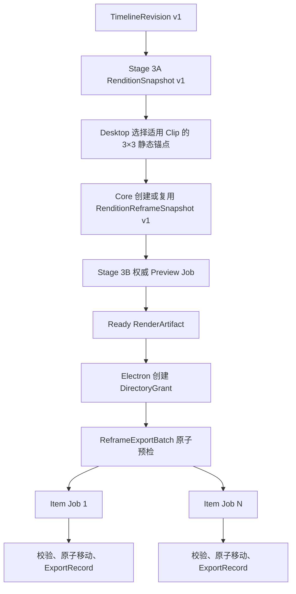

# 阶段 3B 详细设计：逐片段静态焦点锚点重构图

> 角色：LiuWei（架构师）
> 状态：已确认、待实现
> 日期：2026-08-18
> 基线：`5222e3a feat: add Stage 3A rendition batch export`
> 上位契约：`docs/design/STAGE3B_CONTRACT_FREEZE.md`

## 1. 交付目标与设计原则

阶段 3B 在不修改 Stage 1–3A 冻结行为的前提下，为 Stage 3A 基础 Rendition 中解析为 `crop_fill` 的
Clip 增加用户指定的静态 3×3 焦点锚点，并完成独立的权威 Preview、批量导出、partial 失败隔离、
retry lineage、重启恢复和真实 Windows 包验收。

设计原则：

1. Timeline 是剪辑内容事实；Stage 3A RenditionSnapshot 是基础输出事实；Stage 3B ReframeSnapshot 是
   静态构图覆盖事实；RenderPlan 是执行计划。
2. Stage 3B 不向 Timeline 或 Stage 3A Snapshot 反向写入。
3. 公开契约新增独立名称，避免 optional 字段改变 Stage 3A 严格 DTO。
4. 锚点是有限枚举，不允许用户提供数值几何或 FFmpeg 表达式。
5. Core 是适用性、规范化、hash、Preview 和 Export 一致性的唯一裁决者。
6. Preview 和 Export 完整渲染目标；不在本阶段引入局部渲染或依赖图。
7. Provider 调用数固定为 0。
8. 本文中的角色和文件所有权定义职责与冲突边界，不定义执行顺序。实现可以按依赖串行或并行，
   可以由单个或多个执行单元完成。

## 2. 现有实现基线

只读审计基于 `5222e3a`：

| 领域 | 当前实现 | 3B 设计约束 |
| --- | --- | --- |
| Contracts | `CONTRACT_VERSION=stage3a-v1`；Stage 3A DTO 使用严格 `onlyKeys` 和敏感键拒绝 | 新增独立 Stage 3B DTO/guard，不扩充 Stage 3A DTO |
| Timeline | `TimelineDocument v1`；Clip layout 为 `fit/crop_fill/blurred_background` | 不修改 schema、Patch、Lock 或 Revision |
| Rendition | `RenditionSnapshotService` 冻结 resolved segments、字幕样式和输出 profile | Reframe Snapshot 只引用并验证基础 Snapshot |
| RenderPlan | Stage 1C 与 Stage 3A 编译路径；Stage 3A 从 Snapshot 取 resolved layout | 增加版本化 Reframe 编译路径，不改变旧编译结果 |
| FFmpeg | `crop_fill` 固定中心 `scale increase + crop` | 新路径生成显式、受控、偶数规范化的裁切偏移 |
| Preview | Stage 3A 以 Snapshot、Profile 和工具链复用权威 Preview | Reframe hash 必须进入独立复用键 |
| Batch | Stage 3A 1–8 项、DirectoryGrant、partial、retry | 复用内部基础设施，公开实体和 lineage 分离 |
| SQLite | 最新 v9，含 Stage 3A Snapshot/Batch/Item 和关联列 | 只追加 v10，冻结 v1–v9 SQL/checksum |
| Desktop | 多平台导出面板选择平台、画幅、layout policy 并生成 Preview/Batch | 在基础 Snapshot 上提供可选高级静态构图流程 |
| Electron | 白名单 Preload、DirectoryGrant、受限媒体协议 | 不新增路径型 Renderer 参数或通用 IPC |
| 打包 | 打包 Core、FFmpeg、字体、recipes、platform/rendition resources | 无新增模型/字体；扩展真实包验证链路 |
| 测试 | Stage 3A 单元测试较集中，真实包脚本已覆盖双画幅、partial、retry | 在改公共渲染/批次代码前补足 Stage 3A 特征回归 |

维护提示（**已于 2026-09-24 处理，保留作历史记录**）：`README.md` 的阶段描述当时停留在
Stage 2C，用户当时确认不在 Stage 3B 处理。该过期表述最终于 2026-09-24 文档审计中修正——
README 与 `BRAND_BASELINE.md` 不再复述阶段，统一引用 `docs/STATUS.md`
（纪律见 `AGENTS.md`「Documentation Sync Discipline」）。
当时"不得把该修正混入 Stage 3B 实现 diff"的约束依然成立：**文档修正与实现 diff 不应混提**。

## 3. 总体数据流



详细流程：

1. Desktop 从现有 Stage 3A 基础 Snapshot 进入静态焦点模式。
2. Core 或现有安全 DTO 提供基础 Snapshot 可识别的适用性信息；Desktop 只允许对 `crop_fill` Clip 操作。
3. 用户在本地编辑会话选择非中心锚点，Desktop 提交基础 Snapshot ID 和 adjustments。
4. Core 读取数据库中的基础 Snapshot 与 TimelineRevision，重新验证全部跨实体关系。
5. Core 读取素材安全媒体元数据，计算旋转/SAR 归一化后的显示几何，规范化无效轴。
6. Core 创建或复用不可变 Reframe Snapshot。
7. Core 查找匹配 Reframe hash、Profile、工具链和输入 fingerprint 的 ready Preview；无匹配时创建 Job。
8. Job 编译 Reframe RenderPlan、构建受控 FFmpeg 参数、生成 ASS、渲染并验证 Artifact。
9. 所有选定目标拥有匹配的 ready Preview 后，用户选择一次输出目录。
10. Electron Main 创建短期 DirectoryGrant，Renderer 只得到安全 DTO。
11. Core 原子预检 1–8 个 item，创建独立 Reframe Batch/Item/Job。
12. 每个 Job 独立完成临时文件、完整校验、原子移动和 ExportRecord；失败不回滚其他成功项。
13. 显式 retry 使用新授权并创建新 lineage；原批次不变。

## 4. Contracts 设计

### 4.1 版本与品牌类型

```ts
export const CONTRACT_VERSION = "stage3b-v1" as const;

export type RenditionReframeSnapshotId = Brand<string, "RenditionReframeSnapshotId">;
export type ReframeExportBatchId = Brand<string, "ReframeExportBatchId">;
export type ReframeExportBatchItemId = Brand<string, "ReframeExportBatchItemId">;

export type HorizontalAnchor = "left" | "center" | "right";
export type VerticalAnchor = "top" | "center" | "bottom";
export type ReframeWarningCode =
  | "STATIC_REFRAME_APPLIED"
  | "REFRAME_AXIS_NORMALIZED"
  | "REFRAME_MAY_HIDE_OPPOSITE_EDGE";
```

Batch/Item 状态类型可以在内部复用 Stage 3A 相同的字符串集合，但对外导出独立别名，避免未来一方扩展时
无意改变另一方契约。

### 4.2 DTO

```ts
export interface RenditionReframeAdjustment {
  clip_id: string;
  horizontal_anchor: HorizontalAnchor;
  vertical_anchor: VerticalAnchor;
}

export interface RenditionReframePreviewCreateInput {
  base_rendition_snapshot_id: RenditionSnapshotId;
  adjustments: RenditionReframeAdjustment[];
  encoder_mode?: EncoderMode;
}

export interface RenditionReframeSnapshotSummary {
  rendition_reframe_snapshot_id: RenditionReframeSnapshotId;
  project_id: ProjectId;
  timeline_revision_id: TimelineRevisionId;
  base_rendition_snapshot_id: RenditionSnapshotId;
  base_snapshot_sha256: string;
  platform_preset_id: PlatformPresetId;
  rendition_preset_id: RenditionPresetId;
  adjustment_count: number;
  reframe_snapshot_sha256: string;
  warnings: ReframeWarningCode[];
  created_at: string;
}

export interface RenditionReframePreview extends RenditionReframeSnapshotSummary {
  render_artifact_id: RenderArtifactId;
  status: RenderArtifactStatus;
  profile_id: TargetRenderProfileId;
  display_name: string;
  size_bytes: number;
  sha256: string;
  media_info: RenderedMediaInfo;
  encoder: string;
  fallback_reason: string | null;
}

export interface ReframeExportBatchCreateItem {
  rendition_reframe_snapshot_id: RenditionReframeSnapshotId;
  preview_artifact_id: RenderArtifactId;
  encoder_mode?: EncoderMode;
}

export interface ReframeExportBatchCreateInput {
  directory_grant_id: DirectoryGrantId;
  items: ReframeExportBatchCreateItem[];
}
```

`ReframeExportBatchItem` 和 `ReframeExportBatch` 镜像 Stage 3A 的安全展示结构，但字段使用独立 Reframe ID，
item 引用 `RenditionReframeSnapshotSummary`。创建输入不再单独接受 `timeline_revision_id`，Core 从每个
Reframe Snapshot 解析并要求全部属于同一个 Project/Revision，避免调用方提交第二个 Revision 事实源。

### 4.3 Guard

所有新 guard 必须：

- 先拒绝敏感键，再做 `onlyKeys`；
- ID 使用统一 ID guard；hash 使用统一 SHA-256 guard；
- `adjustments` 为 1–500，Clip ID 唯一；
- 输入项必须是非中心请求；真正的轴规范化仍由 Core 根据媒体几何裁决；
- Batch items 为 1–8，Reframe Snapshot ID 和目标组合均不得重复；
- 状态、progress、error、job/export 引用组合与 Stage 3A 同等严格；
- 旧 Stage 3A DTO 的 key 数组和 guard 测试不得改变。

### 4.4 Renderer 安全 DTO

公开 Snapshot 只返回 adjustment count、hash 和固定警告，不返回完整内部 Snapshot JSON。当前用户编辑选择
保存在 Renderer 当前会话状态中；历史 Preview 可播放和复用，但首版不承诺重启后从历史 Snapshot 恢复为
可继续编辑的 3×3 表单。若未来需要历史编辑详情，必须新增经过独立冻结的 detail DTO，而不是放宽 Summary。

## 5. Reframe Snapshot 服务

建议新增：

```text
services/core/src/aivs_core/renditions/reframe.py
```

核心接口：

```py
class RenditionReframeSnapshotService:
    def create_or_reuse(
        self,
        project_id: str,
        base_rendition_snapshot_id: str,
        adjustments: list[dict[str, Any]],
    ) -> dict[str, Any]: ...

    def safe_summary(self, snapshot_id: str) -> dict[str, Any]: ...
```

### 5.1 校验流程

在同一数据库事务中：

1. 验证 Project 存在且未归档。
2. 读取基础 `rendition_snapshots` 行并验证属于 Project。
3. 读取关联 TimelineRevision，验证 ID、Project 和 `timeline_document_sha256`。
4. 严格解析基础 `snapshot_json`，重新计算并验证基础 `snapshot_sha256`。
5. 验证基础 Snapshot 的 preset hash、Profile、resolved segments 和当前已打包资源仍可解释；历史 hash
   不因当前资源更新而改写，但未知/损坏历史事实必须安全失败。
6. 构建 `clip_id -> resolved layout`，拒绝未知 Clip、重复 Clip 和非 `crop_fill` Clip。
7. 从 Asset `media_info_json` 读取几何，不读取或输出素材正文。
8. 运行几何规范化，拒绝规范化后完全无效果的输入。
9. 按 Timeline Clip 顺序排序 adjustments；序列化规范 JSON并计算 hash。
10. 查询唯一事实并复用；否则插入不可变 Snapshot。

### 5.2 Snapshot hash

`reframe_snapshot_sha256` 计算范围必须包括：

```text
schema_version
project_id
timeline_revision_id
timeline_document_sha256
base_rendition_snapshot_id
base_snapshot_sha256
platform_preset_id
rendition_preset_id
base_layout_policy
geometry_contract_version
resolved_adjustments
warnings
```

不包括随机 ID 和 `created_at`，以便同一事实稳定复用。规范 JSON 沿用数据库的稳定排序和紧凑序列化方法。

### 5.3 适用 Clip 展示

首版不新增返回完整 Snapshot 的 API。Desktop 可以从当前 TimelineRevision 的 Clip ID/顺序以及创建基础
Snapshot 时选择的 layout policy 推导候选控件，但 Core 始终重新验证。若 `preserve_timeline`，Desktop 读取
Timeline Clip layout；若 `crop_fill_all`，所有 Clip 是候选；`fit_all/blurred_background_all` 不显示入口。
此推导仅用于交互，不是安全边界。

## 6. 几何规范化

建议新增受单元测试覆盖的纯函数模块，或放入 `reframe.py` 的无 I/O 部分：

```py
@dataclass(frozen=True)
class DisplayGeometry:
    width: int
    height: int

@dataclass(frozen=True)
class CropWindow:
    x: int
    y: int
    width: int
    height: int
```

### 6.1 显示几何

- 解析 FFprobe width/height、SAR 和 rotation。
- SAR 归一化在比例域计算，避免持久化浮点；建议使用整数或 `Fraction`。
- 90/270 度旋转交换显示宽高和轴语义。
- 非法、缺失或非正几何返回稳定领域错误，不猜测。

### 6.2 裁切算法

对目标画布 `W×H` 与显示源比例：

1. 计算满足 `scale increase` 的规范缩放尺寸 `Sw×Sh`。
2. `overflow_x=max(0, Sw-W)`，`overflow_y=max(0, Sh-H)`。
3. 锚点系数为 `0, 1/2, 1`，使用整数有理数计算原始偏移。
4. 偏移限制在 `[0, overflow]`。
5. 使用固定向下偶数规范化；如果靠右/靠下锚点因取偶产生偏差，仍必须保证不越界。
6. 无 overflow 的轴将锚点规范化为 `center` 并产生去重后的 `REFRAME_AXIS_NORMALIZED`。
7. 两轴均无 overflow 或均规范化为 center 时，该 adjustment 无效果并拒绝。

实际 FFmpeg 可以使用经验证的静态整数偏移，或使用只由 Core 构造的固定表达式；用户输入不得拼接到表达式。
为了保证 Preview/Export 的归一化意图一致，Snapshot 冻结锚点，不冻结某一输出分辨率的像素偏移；每个 Profile
由同一 `geometry_contract_version` 确定性求值，RenderPlan 则冻结该次执行的最终像素几何。

### 6.3 警告

- 有有效 adjustment：`STATIC_REFRAME_APPLIED`。
- 任一轴被规范化：`REFRAME_AXIS_NORMALIZED`。
- 任一非中心裁切会增加相对边缘被隐藏的概率：`REFRAME_MAY_HIDE_OPPOSITE_EDGE`。
- warnings 固定排序、去重，进入 Snapshot hash。

## 7. RenderPlan v2

Stage 1C/3A 既有计划和 content fingerprint 不得变化。Reframe 编译器产生内部版本化计划：

```json
{
  "schema_version": 2,
  "compiler_version": "render-plan-reframe-v1",
  "timeline_revision_id": "revision_01",
  "mode": "authoritative_preview",
  "rendition_reframe_snapshot_id": "reframe_01",
  "base_rendition_snapshot_id": "snapshot_01",
  "content_fingerprint": "sha256:...",
  "inputs": [],
  "segments": [
    {
      "clip_id": "clip_01",
      "layout": "crop_fill",
      "reframe": {
        "horizontal_anchor": "left",
        "vertical_anchor": "center",
        "geometry_contract_version": 1,
        "crop_x": 0,
        "crop_y": 0
      }
    }
  ],
  "captions": {},
  "output": {}
}
```

仅 `crop_fill` 且有 adjustment 的 segment 有 `reframe`。其他 segment 的输出必须与基础 Stage 3A 计划一致。

content fingerprint 至少覆盖：

- Stage 3A content semantics；
- base snapshot hash；
- Reframe Snapshot hash；
- 最终逐 segment 布局和裁切几何；
- 字幕样式版本/hash；
- Profile。

Plan 可以在内部包含 Caption 正文以执行渲染，但不得通过 Renderer DTO、日志或验收证据输出。

## 8. FFmpeg 设计

在 `rendering/ffmpeg.py` 中保留旧 `_visual_filter("crop_fill", ...)` 输出不变。新增独立构造器，例如：

```py
def _reframe_crop_filter(
    width: int,
    height: int,
    crop_x: int,
    crop_y: int,
) -> str: ...
```

输出结构保持受控：

```text
scale=W:H:force_original_aspect_ratio=increase,
crop=W:H:X:Y
```

其中 `W/H/X/Y` 全部是 Core 验证后的整数，不接受字符串。既有：

- SAR 归一化；
- 旋转处理；
- fps=30；
- yuv420p；
- 音频 trim/resample/stereo；
- ASS；
- H.264/AAC；
- faststart；
- progress 和取消；

均保持。硬件编码回退和软件编码选择沿用 Stage 3A，且工具链事实必须进入复用判断。

## 9. Preview、cache、stale 与恢复

### 9.1 创建

`POST /projects/{project_id}/rendition-reframe-previews`：

- Request 使用 Pydantic strict/extra forbid。
- 创建或复用 Reframe Snapshot。
- 根据 Preview Profile 选择 encoder/toolchain。
- 查找 ready、文件存在、hash/size/media info 有效的 Reframe Artifact。
- 命中返回 `{ job:null, preview, reused:true }`；否则创建 Job 并返回 `{ job, preview:null, reused:false }`。

Job kind 继续使用受控 `authoritative_preview`，Job input 对 Renderer 只暴露 Reframe Snapshot ID；内部执行通过
数据库读取事实，不把 adjustments、路径或 Caption 正文放入公开 Job input/event。

### 9.2 复用和 stale

可复用 Artifact 必须同时匹配：

- Project/Revision/document hash；
- Reframe Snapshot ID/hash；
- 基础 Snapshot ID/hash；
- Preview Profile；
- content fingerprint；
- toolchain；
- encoder/fallback 语义；
- Artifact ready、文件存在、size/hash/media info 有效。

输入 fingerprint、Timeline、Snapshot、Profile 或工具链变化时不复用。历史 Preview 保留，可标为 stale；不删除历史文件。

### 9.3 恢复

Core 启动沿用现有 interrupted 恢复和 orphan 清理机制，但清理必须识别 Reframe Job 所拥有的临时文件。
重启后 ready 历史 Preview 可查询；内存 DirectoryGrant 失效；未完成 Reframe Job 不自动重发或导出。

## 10. Reframe Batch 设计

建议新增：

```text
services/core/src/aivs_core/renditions/reframe_batch.py
```

### 10.1 原子预检

在 claim DirectoryGrant 和插入数据库事实前完成所有无副作用校验：

- items 为 1–8；
- Reframe Snapshot ID 不重复；
- 所有 Snapshot 同 Project、同 TimelineRevision；
- 基础 platform+rendition 目标不重复；
- Snapshot/基础 Snapshot/document hash/Project/Revision 完整一致；
- Preview Artifact 属于同一 Reframe Snapshot、ready、Profile/toolchain 匹配；
- encoder mode 合法并可解析；
- DirectoryGrant 存在、未过期、未 claim；
- 所有安全文件名可生成且目标不存在；
- 批次所有数据库外键可解析。

全部通过后：

1. 生成 Batch/Item/Job ID 和安全目标名。
2. claim DirectoryGrant 给该 Batch。
3. 在一个数据库事务中插入 Batch、Items、Jobs。
4. 事务失败时释放尚未进入执行的 grant claim，且不创建文件。
5. 提交后启动 Jobs。

不得出现部分 Batch 或部分 Job。

### 10.2 Job 和文件

每个 item：

- 独立 final_export Job；
- 独立同目录临时文件；
- 独立进度、错误、Artifact 和 ExportRecord；
- 完整验证后原子移动；
- 成功后不因其他 item 失败而删除；
- 失败只记录安全 error code/message。

### 10.3 状态派生

完全复用 Stage 3A 状态集合和优先级：

- 全 queued：queued；
- 有 queued/running 且未全终态：running；
- 全 succeeded：succeeded；
- 有 succeeded 且其余终态非成功：partial；
- 全 cancelled：cancelled；
- 无成功且含 interrupted：interrupted；
- 其他无成功终态组合：failed。

公共状态派生函数可以抽取复用，但必须有 Stage 3A 特征测试证明输出未变。

### 10.4 取消与 retry

取消只作用于 queued/running item，不改变 succeeded。Retry 只接受原 Reframe item ID，重新验证其终态和 lineage，
要求新 DirectoryGrant并创建全新 Batch/Item/Job。Retry 可以复用原 ready Preview，但必须重新验证 Snapshot、
Artifact、Profile、toolchain 和文件有效性；不能复用旧目标路径授权。

## 11. SQLite v10 详细设计

建议逻辑表结构如下；实现 SQL 仍需遵循仓库现有 migration 兼容写法和 SQLite 版本约束。

```sql
CREATE TABLE rendition_reframe_snapshots (
  id TEXT PRIMARY KEY,
  project_id TEXT NOT NULL REFERENCES projects(id),
  timeline_revision_id TEXT NOT NULL REFERENCES timeline_revisions(id),
  timeline_document_sha256 TEXT NOT NULL,
  base_rendition_snapshot_id TEXT NOT NULL REFERENCES rendition_snapshots(id),
  base_snapshot_sha256 TEXT NOT NULL,
  platform_preset_id TEXT NOT NULL,
  rendition_preset_id TEXT NOT NULL,
  geometry_contract_version INTEGER NOT NULL CHECK(geometry_contract_version = 1),
  snapshot_json TEXT NOT NULL,
  snapshot_sha256 TEXT NOT NULL,
  adjustment_count INTEGER NOT NULL CHECK(adjustment_count BETWEEN 1 AND 500),
  warnings_json TEXT NOT NULL,
  created_at TEXT NOT NULL,
  UNIQUE(project_id, base_rendition_snapshot_id, base_snapshot_sha256, snapshot_sha256)
);

CREATE TABLE reframe_export_batches (
  id TEXT PRIMARY KEY,
  project_id TEXT NOT NULL REFERENCES projects(id),
  timeline_revision_id TEXT NOT NULL REFERENCES timeline_revisions(id),
  timeline_document_sha256 TEXT NOT NULL,
  directory_display_name TEXT NOT NULL,
  retry_of_batch_id TEXT NULL REFERENCES reframe_export_batches(id),
  created_at TEXT NOT NULL
);

CREATE TABLE reframe_export_batch_items (
  id TEXT PRIMARY KEY,
  reframe_export_batch_id TEXT NOT NULL REFERENCES reframe_export_batches(id),
  ordinal INTEGER NOT NULL,
  project_id TEXT NOT NULL REFERENCES projects(id),
  timeline_revision_id TEXT NOT NULL REFERENCES timeline_revisions(id),
  rendition_reframe_snapshot_id TEXT NOT NULL REFERENCES rendition_reframe_snapshots(id),
  preview_artifact_id TEXT NOT NULL REFERENCES render_artifacts(artifact_id),
  platform_preset_id TEXT NOT NULL,
  rendition_preset_id TEXT NOT NULL,
  destination_display_name TEXT NOT NULL,
  retry_of_item_id TEXT NULL REFERENCES reframe_export_batch_items(id),
  created_at TEXT NOT NULL,
  UNIQUE(reframe_export_batch_id, ordinal),
  UNIQUE(reframe_export_batch_id, platform_preset_id, rendition_preset_id)
);
```

追加列：

```sql
ALTER TABLE jobs ADD COLUMN reframe_export_batch_item_id TEXT NULL
  REFERENCES reframe_export_batch_items(id);
ALTER TABLE render_artifacts ADD COLUMN rendition_reframe_snapshot_id TEXT NULL
  REFERENCES rendition_reframe_snapshots(id);
ALTER TABLE export_records ADD COLUMN reframe_export_batch_item_id TEXT NULL
  REFERENCES reframe_export_batch_items(id);
```

索引：

- Reframe Snapshot 按 project/revision/created_at；
- Batch 按 project/created_at；
- Item 按 batch/ordinal；
- Job 按 reframe item；
- ExportRecord 对非空 reframe item 唯一。

触发器：

- Reframe Snapshot 禁止 UPDATE/DELETE。
- Batch 禁止 UPDATE/DELETE。
- Item 禁止 UPDATE/DELETE。
- Job 不能同时有 `export_batch_item_id` 和 `reframe_export_batch_item_id`。
- RenderArtifact 不能同时有 `rendition_snapshot_id` 和 `rendition_reframe_snapshot_id`。
- ExportRecord 不能同时有 `export_batch_item_id` 和 `reframe_export_batch_item_id`。

SQLite 无法用单一 `CHECK` 约束 ALTER 后的历史表时，使用 INSERT/UPDATE triggers 强制互斥，并为正反路径写测试。
应用层仍必须验证跨表 Project、Revision 和 Snapshot 一致性；外键本身不足以表达全部领域约束。

### 11.1 迁移验证

- 记录 v1–v9 当前 checksum 并断言保持不变。
- 从真实 v9 副本升级，核验 Project、Asset、Transcript、Timeline、Provider、Stage 3A Snapshot/Batch/Export。
- 新库直接初始化 v10。
- initialize 两次幂等。
- 模拟 v10 中途失败，核验事务回滚和备份。
- 注入未知版本、旧 checksum 不匹配并安全拒绝。
- 旧二进制面对 v10 的拒绝行为按既有机制验证，不修改旧二进制。

## 12. Core API 设计

| 方法 | 路径 | 响应 |
| --- | --- | --- |
| POST | `/api/v1/projects/{project_id}/rendition-reframe-previews` | `RenditionReframePreviewCreateResponse` |
| GET | `/api/v1/projects/{project_id}/rendition-reframe-previews` | `RenditionReframePreviewPage` |
| POST | `/api/v1/projects/{project_id}/reframe-export-batches` | `ReframeExportBatchCreateResponse` |
| GET | `/api/v1/projects/{project_id}/reframe-export-batches` | `ReframeExportBatchPage` |
| GET | `/api/v1/reframe-export-batches/{batch_id}` | `ReframeExportBatch` |
| POST | `/api/v1/reframe-export-batches/{batch_id}/cancel` | `ReframeExportBatch` |
| POST | `/api/v1/reframe-export-batches/{batch_id}/retry` | `ReframeExportBatchRetryResponse` |

所有 UI API 使用现有 Bearer UI session。DirectoryGrant 继续由内部管理 API创建，不新增 Renderer 可调用的路径接口。
Pydantic request 全部 `extra="forbid", strict=True`。

建议 HTTP 映射：

| code | HTTP |
| --- | --- |
| `REFRAME_ANCHOR_INVALID`、`REFRAME_ADJUSTMENT_DUPLICATE`、`REFRAME_BATCH_INVALID` | 400/422 |
| `REFRAME_CLIP_NOT_FOUND` | 404 |
| `REFRAME_NOT_APPLICABLE`、`REFRAME_SNAPSHOT_INVALID`、`REFRAME_PREVIEW_REQUIRED`、`REFRAME_PREVIEW_STALE`、`REFRAME_RETRY_NOT_ALLOWED` | 409 |
| DirectoryGrant/目标冲突 | 沿用 Stage 3A 映射 |
| 安全内部渲染失败 | 500 |

错误响应继续使用 `{error:{code,message,trace_id}}`，不返回 details、路径或原始异常。

## 13. Job 与事件

- Preview Job kind：复用 `authoritative_preview`，内部以 Reframe Snapshot 关联区分。
- Export Job kind：复用 `final_export`，通过 `reframe_export_batch_item_id` 关联。
- 不新增 Provider Job kind。
- stage 可以复用既有 prepare/render/validate/persist 阶段；若新增固定 stage 字符串，必须进入 Contracts 白名单和测试。
- Renderer 可见 Job input 只含必要实体 ID，不含 adjustments、Snapshot JSON、路径、Caption 或 FFmpeg 参数。
- Job error 只保存固定 code 和安全 message。
- 进度范围和状态转换沿用现有 Job 状态机。
- 取消必须终止 FFmpeg 进程树并清理当前临时文件。

## 14. Desktop 交互设计

### 14.1 入口与编辑

在现有多平台导出目标卡片中，对存在 `crop_fill` 适用 Clip 的基础 Snapshot显示“调整静态焦点”。
打开后展示：

- 当前平台和画幅；
- Clip 的安全序号/时间范围，不展示 Caption/Transcript 正文；
- 当前布局；
- 3×3 按钮；
- 非权威交互画面；
- 固定说明：“仅静态构图；不执行 HUD/主体识别；参考线不代表平台审核安全区。”

UI 默认不发送中心项。用户将 Clip 恢复中心时，从 adjustments 中删除该项。

### 14.2 门禁

- 没有有效非中心 adjustment：禁用 Stage 3B Preview，可继续使用原 Stage 3A 流程。
- adjustment 改变：当前 Reframe Preview 失配，必须重新生成或复用完全匹配的 Preview。
- Job 未 succeeded 或 Preview stale：不能加入 Reframe Batch。
- 1–8 个目标全部 ready 后才能选择目录。
- Stage 3A Preview 不能被 UI 误标为 Reframe ready。

### 14.3 Batch 与结果

显示：

- 安全 batch ID 短摘要；
- platform/rendition；
- `adjustment_count`；
- item 状态和进度；
- 安全目标 display name；
- 固定 error code 的本地化消息；
- succeeded 播放/打开/定位入口；
- failed/cancelled/interrupted 的重新授权重试入口。

UI 不显示本地绝对路径、Snapshot 内部 JSON、FFmpeg 命令或 stderr。

## 15. Electron Main、Preload 与受限媒体

### 15.1 Main

新增具体 IPC handler：

- 创建/列出 Reframe Preview；
- 创建/列出/查询/取消/重试 Reframe Batch；
- 可以复用现有目录选择 handler，不新增接收 Renderer 路径的接口。

Main 在发往 Core 前再次验证：

- 允许的 key；
- ID；
- anchor 枚举；
- adjustments 1–500 和唯一 Clip；
- items 1–8；
- encoder mode。

Core 响应先通过 Contracts guard 和递归 `rendererSafe`，再送 Renderer。

### 15.2 Preload

只增加具名方法和精确 TypeScript 类型，不暴露：

- `ipcRenderer`；
- 任意 channel；
- 通用 fetch；
- 绝对路径参数；
- Provider 或 safeStorage 接口变体。

### 15.3 受限媒体

Reframe Preview 和 Export Artifact 继续通过 Artifact ID 在 Main 中向 Core 管理 API解析路径，并注册短期
restricted-media ticket。Renderer 只看到 `aivideo://` 受限 URL。ticket TTL、Range、entity-purpose 绑定和路径
归一化规则保持不变。

## 16. Windows 打包与真实验收资源

### 16.1 包内容

Stage 3B 不新增模型、字体、Provider adapter 或网络资源。打包脚本必须继续验证：

- Core sidecar；
- FFmpeg/FFprobe；
- fonts；
- platform-presets；
- renditions；
- manifests/licenses；
- Stage 3B Python 模块已被 PyInstaller 收集。

不能为了 Stage 3B 修改来源不明的 FFmpeg 二进制或许可证声明。

### 16.2 合成九宫格素材

建议新增或运行时生成不含用户数据的测试素材：

- 16:9 九宫格，每格使用明确颜色和几何标记；用于 9:16 左/中/右焦点。
- 9:16 九宫格；用于 16:9 上/中/下焦点。
- 旋转 metadata 样本。
- 非 1:1 SAR 样本。
- 奇数尺寸、CFR/VFR、有声/无声样本。

自动验收不能仅依赖人眼。可以在远离边缘和字幕区域的固定采样块计算颜色/像素统计，确认不同锚点显示预期区域；
同时用 FFprobe、完整解码和 SHA-256 验证媒体规格与完整性。像素判断应设置明确容差，避免编码噪声造成脆弱测试。

### 16.3 实际安装

真实验收必须使用本轮生成的 NSIS 安装包，在隔离目录实际安装和启动，而不是仅运行 unpacked 目录。证据只写：

- 安装/启动结果；
- 目标数量和固定状态；
- 锚点/画幅枚举；
- 安全媒体规格和 hash 比对布尔值；
- partial/retry/restart 布尔检查；
- Provider invocation count；
- 敏感字段扫描结果。

不得写安装绝对路径、用户路径、Caption/Transcript 正文、命令或 stderr。

## 17. 隐私、安全和 Provider 设计

- Reframe 路由不得 import 或调用 Provider service；Provider 表仅在验收时以计数方式确认无新增调用。
- 不读取 Provider secret，不触发 capability test，不创建 egress consent/invocation。
- API input 只能包含受控 ID、枚举和数组。
- 日志使用实体 ID、安全 stage 和固定 code，不输出 request body。
- Snapshot JSON 仅存安全 ID、hash、枚举和受控几何；不存路径、Caption/Transcript 正文。
- RenderPlan 可能含执行所需 Caption 正文，但不得写入日志、公开 DTO或验收报告；沿用既有本地数据库/项目数据边界。
- FFmpeg stderr 只用于进程内诊断和安全分类，不返回 Renderer。
- 任何异常经统一错误映射转换，不序列化原始异常对象。
- 真实验收使用合成媒体并扫描报告字段名和值模式。

## 18. 测试策略

### 18.1 Stage 3A 保护性特征测试

在修改公共 RenderPlan、FFmpeg、RenderService、Job 或 Batch 基础设施前后，均应覆盖：

- 四个 Stage 3A LayoutPolicy 的 resolved segment 不变；
- 中心 crop filter 字符串和输出不变；
- Stage 3A Snapshot hash/复用规则不变；
- Stage 3A Batch 状态派生、partial、cancel、retry 不变；
- Stage 3A Contracts strict keys 不变；
- 旧 Stage 1C Preview/Export 不变。

这些测试只保护已有行为，不修改 Stage 3A 契约。

### 18.2 Contracts

- 9 个锚点组合正例；非法大小写/数值/unknown 拒绝。
- adjustments 0、501、重复 Clip、中心项、unknown/sensitive key 拒绝。
- Snapshot Summary 和 Preview 正反例。
- Batch 0、9、重复 ID、重复目标和非法状态组合。
- Stage 3A DTO 继续通过原 guard，新增字段仍被 Stage 3A guard 拒绝。

### 18.3 Core 单元测试

建议新增：

```text
services/core/tests/unit/test_migrations_v10.py
services/core/tests/unit/test_stage3b_reframe.py
services/core/tests/unit/test_stage3b_reframe_geometry.py
services/core/tests/unit/test_stage3b_reframe_batch.py
services/core/tests/unit/test_render_plan_stage3b.py
services/core/tests/unit/test_render_ffmpeg_stage3b.py
```

覆盖：

- Snapshot 创建/复用/不可变/hash/排序。
- 基础 Snapshot、Project、Revision、document hash 冲突。
- 未知/重复/非 crop Clip。
- SAR、旋转、overflow、偶数取整、轴规范化。
- RenderPlan v2，未调整 segment 与 Stage 3A 一致。
- Preview reuse/stale/toolchain。
- Batch 原子创建、状态、取消、retry、DirectoryGrant。
- SQLite v10 全部迁移门禁。

### 18.4 Core 集成与真实 FFmpeg

建议新增：

```text
services/core/tests/integration/test_stage3b_reframe_api.py
services/core/tests/integration/test_stage3b_reframe_batch_api.py
services/core/tests/integration/test_stage3b_reframe_real.py
```

覆盖：

- 9:16 左/中/右焦点。
- 16:9 上/中/下焦点。
- Preview/Export 归一化构图一致。
- H.264/AAC、尺寸、CFR、SAR=1、yuv420p、48 kHz stereo、时长、完整解码和 hash。
- 同批次两个目标成功。
- 一个 item 人为冲突失败、其他成功保留。
- 取消、interrupted、retry 和历史保留。
- Provider invocation count 增量为 0。

### 18.5 Desktop/Electron

- Core Client 路由和 guard。
- Preload 具名方法与非法输入拒绝。
- 只对适用 Clip 显示/启用 3×3。
- 默认中心、恢复中心后移除 adjustment。
- 非权威和非自动识别文案。
- Preview 失配门禁。
- Stage 3A Preview 不可替代。
- Batch partial、cancel、retry 和新授权。
- Renderer payload 敏感字段扫描。
- 真实 Electron loopback E2E 不调用外部 Provider。

### 18.6 命令门禁

按仓库实际脚本执行并记录结果，至少包括：

```text
uv run --locked --extra dev ruff check services/core/src services/core/tests
uv run --locked --extra dev pyright
uv run --locked --extra dev pytest
pnpm --filter @aivideo/contracts build
pnpm --filter @aivideo/desktop lint
pnpm --filter @aivideo/desktop test
pnpm --filter @aivideo/desktop build
pnpm --filter @aivideo/desktop test:e2e
pnpm --filter @aivideo/desktop package:win
pnpm --filter @aivideo/desktop package:verify
pnpm --filter @aivideo/desktop package:verify:real
git diff --check
```

缺少真实安装环境时必须标“未验证”，不得用静态包检查替代实际安装结论。

## 19. 角色职责与互斥文件所有权

本节定义责任和默认写集合，不规定执行顺序。可以串行或并行执行；如需调整共享文件所有权，必须由
LiuWei 明确重新分配，不能由两个执行单元同时写同一文件。

### 19.1 LiuWei（架构师）

负责：

- `docs/design/STAGE3B_CONTRACT_FREEZE.md`
- `docs/design/STAGE3B_DETAILED_DESIGN.md`
- 契约变更记录、字段裁决、跨层集成门禁和范围控制。

LiuWei 不以口头实现便利绕过冻结文档；任何范围扩展先更新并重新确认契约。

### 19.2 ZhangSan（Core/SQLite/Render）

默认独占：

```text
services/core/src/aivs_core/database.py
services/core/src/aivs_core/app.py
services/core/src/aivs_core/jobs.py
services/core/src/aivs_core/renditions/reframe.py
services/core/src/aivs_core/renditions/reframe_batch.py
services/core/src/aivs_core/rendering/plan.py
services/core/src/aivs_core/rendering/ffmpeg.py
services/core/src/aivs_core/rendering/service.py
services/core/tests/unit/test_migrations_v10.py
services/core/tests/unit/test_stage3b_*.py
services/core/tests/unit/test_render_*_stage3b.py
services/core/tests/integration/test_stage3b_*.py
```

如需修改 `renditions/__init__.py`、`state.py` 或测试夹具，也归 ZhangSan；不得修改 Contracts、Desktop/Electron
文件。ZhangSan 按冻结 DTO 名称实现 Python 请求/响应校验，不自行新增字段。

### 19.3 YeJing（Contracts/Desktop/Electron/Packaging）

默认独占：

```text
packages/contracts/src/index.ts
apps/desktop/src/lib/core-client.ts
apps/desktop/src/env.d.ts
apps/desktop/src/app/App.tsx
apps/desktop/src/styles.css
apps/desktop/electron/main/index.ts
apps/desktop/electron/preload/index.ts
apps/desktop/tests/contracts.test.ts
apps/desktop/tests/core-client.test.ts
apps/desktop/tests/preload.test.ts
apps/desktop/tests/app.test.tsx
apps/desktop/e2e/stage3b-reframe.electron.spec.ts
apps/desktop/scripts/verify-package-real.mjs
apps/desktop/scripts/verify-package.mjs
apps/desktop/tests/package-script-safety.test.ts
```

如果将 Reframe IPC 拆到新文件，新文件归 YeJing。YeJing 不修改 Python Core、SQLite 或 FFmpeg；不得让
Renderer 发送路径或任意渲染参数。

### 19.4 LiuKeAi（独立审查/验收）

默认不拥有业务实现文件。可以创建隔离验收报告或测试证据，但不得为使验收通过而直接修补被验收实现；
发现问题交回相应责任角色。验收报告不得包含受禁敏感内容。

### 19.5 共享接口

共享接口只有冻结文档定义的：

- DTO 名称、字段、枚举和 guard 语义；
- API 路径和错误码；
- SQLite 领域关系；
- Job/Batch 状态；
- 安全和验收边界。

执行拓扑不属于共享接口。无论使用单会话、多会话或 subagent，交付都按相同接口集成。

## 20. 开发切片与依赖关系

以下是可独立跟踪的切片，不代表强制顺序：

### Slice A：Contracts 与 guard

交付：品牌类型、DTO、guard、敏感字段拒绝、契约测试。
依赖：冻结字段。
提供给其他切片：精确 JSON shape 和 TypeScript 类型。

### Slice B：SQLite v10 与 Snapshot

交付：migration、不可变 Snapshot、几何纯函数、领域测试。
依赖：Stage 3A 数据模型、冻结 DTO 语义。
提供：Reframe Snapshot 安全摘要和数据库事实。

### Slice C：Render/Preview

交付：RenderPlan v2、FFmpeg 静态裁切、Preview reuse/stale、真实媒体测试。
依赖：Slice B 的 Snapshot 事实；可以用冻结夹具隔离开发。

### Slice D：Batch/Job/恢复

交付：Reframe Batch、DirectoryGrant、partial/cancel/interrupted/retry、ExportRecord。
依赖：Snapshot 和 Preview 领域接口；可以用稳定测试替身并行验证状态机。

### Slice E：Desktop/Electron

交付：3×3 UI、门禁、IPC/Preload、受限媒体、UI/E2E 测试。
依赖：Contracts；Core 未可用时可以使用严格夹具，集成时必须切换到真实 API。

### Slice F：Packaging/真实验收

交付：合成九宫格、包验证、NSIS 实际安装、敏感证据和 Provider 0 调用报告。
依赖：可安装集成产物。

并行执行时，不得让测试替身成为最终验收依据；所有切片最终必须在真实 Core、Electron 和打包产物上集成。

## 21. LiuKeAi 独立验收清单

LiuKeAi 对每项记录“通过 / 未通过 / 未验证”及安全证据引用：

1. 基线为 `5222e3a`，无 README 或无关改动。
2. 实现与 `STAGE3B_CONTRACT_FREEZE.md` 一致，无范围扩张。
3. `CONTRACT_VERSION=stage3b-v1`；protocol/API/Timeline schema 未变。
4. Stage 3A 四 LayoutPolicy、Snapshot、Preview、Batch DTO 和默认中心裁切未变。
5. 旧 Stage 1C Preview/Export 和 Stage 1/2 工作流通过。
6. v1–v9 SQL/checksum 未变，真实 v9 到 v10 升级保留历史数据。
7. v10 新库、备份、幂等、失败回滚、未知版本拒绝通过。
8. Reframe Snapshot 基础引用、hash、排序、复用和不可变通过。
9. 重复 Clip、未知 Clip、非 crop Clip、非法 anchor、空/超限数组拒绝。
10. 无裁切轴规范化，完全无效果 adjustment 拒绝。
11. 旋转、SAR、奇数尺寸和偶数裁切通过。
12. Stage 3A Preview 不能替代 Stage 3B Preview。
13. 跨 Reframe Snapshot、Profile、工具链和输入变化不复用。
14. 9:16 左/中/右真实像素区域符合预期。
15. 16:9 上/中/下真实像素区域符合预期。
16. Preview/Export 归一化构图一致。
17. H.264/AAC、尺寸、CFR 30、SAR=1、yuv420p、48 kHz stereo、faststart、完整解码和 hash 通过。
18. Batch 1–8、原子预检、目标去重和独立进度通过。
19. partial 时成功文件/记录保留，失败 item 不污染其他 item。
20. cancel/interrupted/restart 历史恢复通过。
21. retry 使用新 grant/new batch/new item/new job，并保留 lineage。
22. DirectoryGrant 过期、claimed、重启失效、越界、符号链接、ADS、冲突通过。
23. Desktop 只对适用 Clip 启用 3×3，中心项不发送。
24. 非权威、非自动识别和非平台安全保证文案清楚。
25. 所有 Stage 3B Preview ready 前不能创建 Batch。
26. Electron 无通用 fetch/invoke；Renderer 无路径或原始错误。
27. SQLite、日志、Job/Event、DTO、报告无绝对路径、Caption/Transcript、stderr、命令或 Provider 数据。
28. Provider invocation 增量为 0，无 secret 读取和外传流程。
29. 真实 NSIS 实际安装、启动、Preview、Batch、partial/retry、重启通过。
30. `git diff --check`、Core/Contracts/Desktop/E2E/Package 回归通过。

## 22. 阶段门禁

### Gate 3B-1：设计落盘

- 两份 Stage 3B 文档与用户确认一致。
- 文档不规定角色执行顺序，只规定责任和边界。
- 无业务实现、README 或 Stage 3A 文件修改。
- `git diff --check` 通过。

### Gate 3B-2：契约最终冻结

- 用户审阅文档 diff 并确认。
- 任何待定字段、错误码、SQLite 关系和验收方法已关闭。
- LiuWei 发出明确开发许可。

### Gate 3B-3：实现集成

- 各切片满足冻结契约和文件所有权。
- 公共基础设施变更有 Stage 3A 特征回归保护。
- Core、Contracts、Desktop 和 Electron 使用真实接口集成。
- Provider 调用数保持 0。

### Gate 3B-4：独立验收

- LiuKeAi 独立执行第 21 节清单。
- 未验证项明确并获得用户接受；阻塞项关闭。
- 实际 Windows 安装包通过或明确标记未验证，不能用模拟替代。

### Gate 3B-5：提交

- 仅在用户明确要求后创建提交。
- 提交前确认工作区差异只包含批准范围，运行完整门禁和 `git diff --check`。
- 设计冻结、业务实现和验收记录是否分提交由用户决定，不在架构契约中强制。

当前仅完成设计，不代表 Stage 3B 业务实现已开始或完成。
