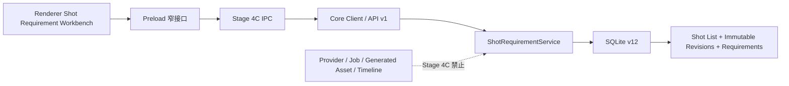

# Stage 4C 详细设计草案：结构化镜头与资产需求清单

> 负责人：LiuWei（架构师）
> 状态：已确认冻结；Gate 4C-1 至 Gate 4C-4 均通过；Gate 4C-5 已授权，随本次 PR 合并主干后通过
> 日期：2026-08-18
> 上位契约：`docs/design/STAGE4C_CONTRACT_FREEZE.md`
> 实现基线：`master` / `27e5ab5` / SQLite v11 / Stage 4B

## 1. 设计目标

Stage 4C 建立可版本化、可确认的镜头与资产需求清单，补齐生成工作流中“创作目标”和“具体生成请求”之间的权威事实层。

设计必须同时满足：

1. 用户能人工建立 `1–24` 个有序 Shot，每个 Shot 有一个视觉需求并可选 TTS 旁白；
2. 保存形成不可变完整 Revision；
3. 并发编辑不会静默覆盖；
4. 确认动作与保存动作分离；
5. existing_media 只能引用同项目 Asset ID；
6. Provider、媒体生成、Asset 注册和 Timeline 写入均为 0；
7. 清单正文可在项目内恢复，但不进入日志和验收证据；
8. v11→v12 为纯追加迁移，Stage 1–4B 行为不变。

## 2. 架构与边界



### 2.1 可复用

- Project 与 Asset 的项目归属事实；
- Database 备份、迁移事务、WAL、外键和未知版本拒绝；
- Stage 1 Timeline 的不可变 Revision 思路；
- Stage 4B 的项目切换、迟到响应隔离和安装态 E2E 模式；
- Contracts 精确 key guard；
- Core Client → IPC → Preload 的窄接口边界。

### 2.2 不复用

- 不把 Shot List 塞入 Brief JSON；
- 不复用 CandidatePlan，因为它描述既有素材候选而非生成需求；
- 不复用 TimelineRevision，因为清单尚不可渲染；
- 不复用 MediaGenerationRequest 作为镜头实体；Request 是一次生成事实，不是可编辑需求；
- 不使用 Jobs，因为保存与确认是短事务命令；
- 不使用 Stage 2 egress preview/consent，因为本阶段没有外传。

## 3. 聚合与状态模型

```text
ShotList
  current_revision_id -----------+
  confirmed_revision_id -----+   |
                             |   |
ShotListRevision <-----------+---+
  |- parent_revision_id
  `- ShotRequirement[1..24]
       |- visual: existing_media | image
       `- narration: { tts + text } | null
```

### 3.1 状态

聚合状态只由两个指针表达：

- `empty`：没有 current；
- `drafted`：有 current、未确认或 confirmed != current；
- `confirmed`：confirmed == current。

这些状态建议由 DTO 派生，不在数据库增加可漂移的 `status` 字段。

### 3.2 不可变快照

每次保存完整复制所有 Requirements。最多 24 条，空间成本可控；完整快照比增量 Patch 更容易：

- 恢复与审阅；
- hash 与幂等；
- 并发冲突；
- 后续生成请求引用确定 Revision；
- 避免重放 Patch 产生隐藏错误。

## 4. 规范化与 hash

Core 在事务前规范化：

- 所有文本做 Unicode NFC；
- `title` 去首尾空格，内部空白压为单空格；
- `summary`、`visual_direction` 与 `narration.text` 保留换行，但规范化 CRLF→LF、去除行尾空格和首尾空白；
- 拒绝 Unicode 类别 `Cc/Cs`，仅允许 `\n` 和 `\t`；
- Requirement 顺序由数组位置权威化，忽略 Renderer 自报 ordinal；
- Asset ID 做 ASCII 标识符白名单校验。

hash 输入：

```json
{
  "schema_version": 1,
  "title": "...",
  "summary": "...",
  "requirements": [
    {
      "ordinal": 0,
      "title": "...",
      "visual_direction": "...",
      "target_duration_us": 3000000,
      "visual": {"requirement_kind": "image", "source_asset_id": null},
      "narration": {"requirement_kind": "tts", "text": "..."}
    }
  ]
}
```

使用 UTF-8、key 排序、紧凑 JSON 和 `sha256:` 前缀。数据库中保存规范化正文与权威 hash。

## 5. Core 命令设计

### 5.1 `get_state(project_id)`

返回：

- 聚合根 ID；
- current Revision detail 或 null；
- confirmed Revision summary 或 null；
- 派生状态；
- 不返回 Asset 路径或 URI。

项目存在但无 Shot List 时返回正常空状态，不返回 `SHOT_LIST_NOT_FOUND`。`SHOT_LIST_NOT_FOUND` 仅用于按聚合 ID 的未来内部边界，本阶段公开 API 可不暴露。

### 5.2 `create_revision(project_id, input)`

伪代码：

```text
validate project active
normalize + validate full document
BEGIN IMMEDIATE
  load or create shot_list
  compare base_revision_id with current_revision_id
  validate each Shot has exactly one visual and at most one narration
  validate every existing_media asset belongs to project
  compute document_sha256
  if current hash equals hash:
    COMMIT and return current, reused=true
  insert revision
  insert 1..24 requirements
  update shot_list.current_revision_id + updated_at
COMMIT
return state + revision, reused=false
```

注意：

- 创建 ShotList 与首个 Revision 必须在同一事务；
- 项目归档时默认拒绝保存与确认，历史读取仍允许；
- 不能先插聚合根后在另一个事务插 Revision；
- 任何 Requirement 失败必须回滚全部写入；
- v12 不包含生成 Request 引用；本阶段不得建立资产需求与 MediaGenerationRequest 的关系；
- visual/narration 是 Shot 行与 DTO 中的结构化字段，不另建可漂移子状态；

### 5.3 `confirm(project_id, input)`

```text
BEGIN IMMEDIATE
  require project active
  load aggregate
  require current == expected_current
  require revision_id == current
  if confirmed == revision_id: idempotent success
  else update confirmed_revision_id + updated_at
COMMIT
```

确认不得执行后续动作。未来若要从确认 Revision 批量创建 Request，必须另建显式命令和 Gate。

### 5.4 `list_revisions` / `get_revision`

- 排序：`created_at DESC, id DESC`；
- limit：`1–100`；
- cursor：首版可沿用受控十进制 offset；
- summary 不返回 Requirements 正文，只返回 `requirement_count` 和 hash；
- detail 返回完整正文；
- 读取时验证项目归属，避免跨项目 ID 探测。

## 6. SQLite v12 实现细节

### 6.1 建表顺序

推荐顺序：

1. `shot_lists`（允许声明指向后建 revisions 的 FK）；
2. `shot_list_revisions`；
3. `shot_requirements`；
4. indexes；
5. immutable triggers。

隔离原型必须执行：

```sql
PRAGMA foreign_key_check;
PRAGMA integrity_check;
```

Gate 4C-2 已验证 current/confirmed 指针不能指向其他 Shot List 的 Revision，并完成复合外键与指针触发器两种方案比较。生产 v12 冻结为：

- `shot_list_revisions` 增加 `UNIQUE(id, shot_list_id)`；
- 聚合根指针使用 `(current_revision_id, id)` 和 `(confirmed_revision_id, id)` 复合外键；
- Revision 使用 `(shot_list_id, project_id)` 复合外键归属于 Shot List；
- 父 Revision 使用 `(parent_revision_id, shot_list_id)` 复合外键；
- 不可变性和 existing_media 同项目 Asset 归属由触发器保证。

复合外键方案在写入时拒绝跨清单指针，并可由 `PRAGMA foreign_key_check` 独立审计；Gate 4C-3 不得改回仅依赖业务代码或单列外键。

### 6.2 不可变触发器

对 `shot_list_revisions` 和 `shot_requirements`：

- `BEFORE UPDATE` → ABORT；
- `BEFORE DELETE` → ABORT。

对 `shot_lists`：

- 允许更新 current、confirmed、updated_at；
- 禁止修改 id、project_id、created_at；
- 可用受限 update trigger 或确保所有写路径只有 Core 服务，并用测试锁定列集合。

### 6.3 索引

```text
UNIQUE shot_lists(project_id)
INDEX shot_list_revisions(shot_list_id, created_at DESC, id DESC)
UNIQUE shot_list_revisions(shot_list_id, document_sha256)
UNIQUE shot_requirements(shot_list_revision_id, ordinal)
INDEX shot_requirements(visual_source_asset_id)
```

未来 provenance 关联不得提前占用 v12 字段；应在真实生成阶段以独立关联表或经重新冻结的外键迁移实现。

## 7. API 与 DTO 细化

### 7.1 State

```ts
interface ShotListState {
  shot_list_id: ShotListId | null;
  project_id: ProjectId;
  lifecycle: "empty" | "drafted" | "confirmed";
  current_revision: ShotListRevisionDetail | null;
  confirmed_revision: ShotListRevisionSummary | null;
}
```

空状态 `shot_list_id=null`，不得为了 GET 创建数据库行。

### 7.2 Summary 与 Detail 分离

`ShotListRevisionSummary`：

- IDs、parent、title；
- `requirement_count`；
- `document_sha256`；
- `created_at`；
- 不含 summary 和 creative direction 正文。

`ShotListRevisionDetail` 在 Summary 基础上增加：

- `summary`；
- 完整 Requirements。

这样历史列表不会无界加载正文，也降低误日志记录风险。

### 7.3 DTO 安全

Contracts guard 必须：

- exact keys；
- 递归拒绝 `path|uri|prompt|transcript|caption|authorization|secret|payload|raw_exception|stderr|command|traceback` 等敏感 key；
- ID、长度、枚举、微秒整数、空值关系精确验证；
- existing_media 的跨项目规则由 Core 权威验证，Renderer guard 只做形状验证。

## 8. Desktop 交互设计

### 8.1 入口与命名

入口建议：

```text
镜头需求
```

副标题固定：

> 人工规划素材需求；不会调用 Provider、不会生成媒体、不会写入时间线。

不要命名为“AI 分镜”或“生成视频”，避免暗示本阶段具备不存在的能力。

### 8.2 编辑区

- 标题；
- 摘要；
- Requirement 卡片列表；
- 类型选择；
- 需求标题；
- 创作说明；
- 可选目标时长；
- existing_media 的 Asset 选择；
- 添加、删除、上移、下移；
- 当前数量与 `1–24` 边界。

不提供富文本、Markdown 预览、HTML、附件、文件路径输入或任意 JSON 编辑器。

### 8.3 保存与确认

- “保存新版本”使用加载时 current ID 作为 base；
- 保存成功后更新 current，表单基线同步；
- 冲突时不自动覆盖，提示“已有更新，请重新载入后再保存”；
- “确认当前版本”单独操作并二次确认；
- 确认页只展示标题、需求数量和 hash，不复制全文到额外状态；
- 确认成功显示明确边界：“已确认需求；尚未创建生成任务”。

### 8.4 项目切换与竞态

沿用 Stage 4B 经验：

- 每个请求捕获 `project_id + epoch`；
- 返回时 epoch 不匹配则丢弃；
- 项目切换清空未保存表单、冲突、选中历史和确认弹窗；
- 组件卸载后不 setState；
- 不使用持久化前端 store 保存正文。

### 8.5 历史

- 默认加载 20 条 Summary；
- 点击后按 ID 获取 Detail；
- 标识 current、confirmed；
- “以此版本为编辑基线”只能先复制内容到表单，但保存仍必须基于最新 current；
- 若历史不是 current，UI 应明确这是“复制旧内容创建新版本”，不能回写历史。

## 9. Electron 与权限边界

新增 `stage4c-ipc.ts`，注册固定 channel：

```text
shot-list:get
shot-list:revisions
shot-list:revision:get
shot-list:revision:create
shot-list:confirm
```

每个 handler：

1. 校验 exact keys；
2. 限制字符串、数组和分页大小；
3. 调用 Core Client 固定方法；
4. 用 Contracts parser 校验响应；
5. 捕获错误后只抛安全摘要。

不增加：

- `dialog`、文件 grant、目录 grant；
- `shell.openExternal`；
- Renderer 网络权限；
- 通用 IPC；
- Provider secret 接口。

## 10. 错误与并发

### 10.1 Renderer 允许显示

- 稳定错误码映射后的短中文提示；
- 冲突、项目归档、Asset 不存在或跨项目；
- 校验字段名和允许范围；
- request ID（若现有错误 envelope 提供）。

### 10.2 禁止显示或持久化

- 原始异常和 stack；
- SQL、数据库路径、媒体路径或 URI；
- 用户正文的服务端回显错误；
- token、Authorization 或 Provider payload；
- stderr、command、traceback。

### 10.3 冲突策略

不做自动三方合并。Stage 4C 规模小，采用 fail-closed：

1. Core 返回 `SHOT_LIST_CONFLICT`；
2. UI 保留当前内存表单，但不写盘；
3. 用户可复制合成文本到系统剪贴板吗？首版不提供专用复制，以减少权限面；
4. 用户选择重新载入后丢弃本地表单；
5. 若未来需要草稿恢复或 merge，另行冻结。

## 11. 原型验证计划

Gate 4C-2 原型必须与生产表隔离，但使用真实 SQLite 约束模型。

### 11.1 准确性样本

至少覆盖：

1. 首次创建 1 条；
2. 最大 24 条；
3. 0 条和 25 条拒绝；
4. existing_media/image 视觉与可选、带正文 TTS 旁白组合正例；
5. video、TTS 作为 visual、image 作为 narration 均拒绝；
6. 缺少 visual、重复 visual、重复 narration、TTS 空正文和无 TTS 却带正文均拒绝；
7. existing_media 无 Asset、跨项目 Asset、缺失 Asset 拒绝；
8. image/tts 带 Asset 拒绝，任何生成 Request 引用字段作为未知字段拒绝；
9. 微秒边界；
10. Unicode NFC 与 CRLF 归一；
11. 控制字符和敏感 key 拒绝；
12. 相同文档幂等；
13. base revision 冲突；
14. 确认当前、重复确认、确认历史拒绝；
15. Revision/Shot UPDATE/DELETE 拒绝；
16. 项目归档只读；
17. v11→v12 真实副本迁移。

### 11.2 性能门槛

在普通开发机、WAL 和冷连接条件下建议：

- 24 条 Revision 保存 p95 ≤ 300 ms；
- state 读取 p95 ≤ 150 ms；
- 100 个 Revision 历史分页 p95 ≤ 200 ms；
- v11→v12 空表迁移 p95 ≤ 2 s（不含备份复制时间）；
- 数据库完整性检查通过。

性能不是为了提前优化，而是防止完整快照和错误索引设计在生产实现后返工。

### 11.3 隐私取证

- SQLite 应包含合成清单正文，这是授权的项目事实；
- 日志、stdout/stderr、Job 表、ProviderInvocation 和证据摘要不得包含正文 sentinel；
- Asset locations 可能合法包含既有路径，但 Stage 4C DTO/日志/证据不得读取或复制这些路径；
- ProviderInvocation 增量必须为 0；
- media_generation_requests/tasks 增量必须为 0；
- Timeline Revision 增量必须为 0。

## 12. 生产开发切片

切片表达依赖与所有权，不约束团队必须串行执行。

### 切片 A：Contracts

- IDs、DTO、guards、parsers；
- 错误码；
- `CONTRACT_VERSION=stage4c-v1`；
- 正反契约测试。

### 切片 B：SQLite v12 与领域服务

- 追加迁移；
- Revision、Requirements、hash、冲突和确认；
- 数据库与服务测试。

### 切片 C：Core API

- Pydantic strict request；
- 五个 routes；
- 安全 error mapping；
- API 集成测试。

### 切片 D：Desktop 桥接

- Core Client；
- Stage 4C IPC；
- Preload 窄方法；
- 恶意输入和未知响应字段测试。

### 切片 E：工作台

- 表单、排序、Asset ID 选择、保存、历史与确认；
- 项目切换、迟到响应和冲突；
- 组件测试。

### 切片 F：真实验收

- 开发态 Electron + Sidecar；
- Windows NSIS 全新安装和 v11→v12 原位升级；
- 重启、卸载、数据库与日志取证；
- 全量回归。

## 13. 测试矩阵

### Core / SQLite

- migration checksum v1–v11 不变；
- backup、rollback、unknown version；
- FK、trigger、integrity；
- canonicalization/hash；
- 事务原子性；
- project/archive/asset ownership；
- concurrent base conflict；
- confirmation idempotency；
- Provider/Job/MediaGeneration/Timeline 零副作用。

### Contracts

- exact keys；
- visual/narration 的 kind、text、null 与 source Asset 关系；
- 1/24 正例、0/25 反例；
- unsafe nested key；
- Summary 不含正文；
- Detail 不含路径和 Provider 字段。

### Desktop / Electron

- 空状态；
- 添加、删除、排序；
- visual existing_media/image 与可选 narration TTS 正文条件字段；
- 保存/幂等/冲突；
- 确认与历史；
- 项目切换和迟到响应；
- 安全错误映射；
- IPC 输入/输出 fail-closed。

### E2E / Windows

- 安装态创建 1 条与 24 条；
- 多 Revision 和确认；
- 项目切换；
- 重启恢复；
- 原位升级；
- 卸载保留用户数据库；
- Provider=0、无 Request/Task/Asset/Timeline 增量；
- 日志与证据无正文 sentinel 和路径。

## 14. 真实验收证据模型

只允许记录：

- schema version；
- 合成 project/list/revision/requirement ID；
- Revision/Requirement 数量；
- lifecycle；
- document hash；
- SQLite 版本和迁移 checksum；
- Provider、Request、Task、Asset、Timeline 增量计数；
- 安装包/Sidecar hash；
- 布尔检查结果和测试计数。

禁止记录：

- title、summary、creative direction 正文；
- Asset display name 之外的路径/URI；
- Provider token、Authorization、payload；
- 原始异常、stderr、command、traceback；
- 数据库绝对路径。

## 15. 风险与退路

1. **需求清单与 Timeline 重叠**
   - 退路：Requirement 不包含轨道、源时间范围、布局或可渲染文档；确认不写 Timeline。

2. **与 MediaGenerationRequest 重叠**
   - 退路：Requirement 是可版本化意图，Request 是不可变执行输入；Stage 4C 禁止自动创建 Request。

3. **正文隐私边界改变**
   - 退路：明确正文是用户主动保存的项目事实，但禁止日志/证据；不沿用 Stage 4A Prompt 的“完全不持久化”规则。

4. **SQLite 双向指针归属不严**
   - 退路：Gate 4C-2 已验证并冻结复合 FK；生产测试必须继续覆盖跨清单 current、confirmed、parent 和跨项目 Asset。

5. **App.tsx 再次膨胀**
   - 退路：独立目录和组件，只在 App 中放入口与 open state；不内联完整表单。

6. **范围滑向 AI 脚本或真实生成**
   - 退路：Provider=0、MediaGeneration Request 增量 0、Asset 增量 0、Timeline 增量 0 四项硬门禁。

7. **未来生成关联被提前固化**
   - 退路：v12 不预留生成 Request 外键；真实生成阶段以独立关联/溯源契约重新冻结。

8. **历史全文导致响应过大**
   - 退路：列表只返回 Summary，Detail 按需读取，最多 24 条。

## 16. 技术可行性评估

### ZhangSan（Core / SQLite / Jobs）

该方向不需要 Job runner。Gate 4C-2 已验证复合 FK 与触发器均可行，并选择复合 FK 作为指针与父 Revision 归属权威；跨项目 Asset 由触发器和 Core 双层校验。三张追加表和最多 24 个 Shot 的快照规模可控。

真实图片方向需要新的二进制 Provider、下载与 Asset 注册；真实 TTS 又与 Prompt 明文异步恢复冲突，两者都明显大于本阶段。

### YeJing（Contracts / Desktop / Electron）

五个窄 API 足以支持独立工作台。主要成本在条件表单、历史详情、项目切换、并发冲突和正文证据防泄漏。Renderer 只接触 Asset ID 与 display name，不应获得 location URI。建议升级 Contracts 版本，但不改变 Sidecar protocol。

### LiuKeAi（独立审查）

候选 C 范围可落地，但必须把“正文允许进入 SQLite/Renderer”和“不允许进入日志/证据”区分清楚。真实验收必须证明 Provider、MediaGeneration Request/Task、Asset 和 Timeline 四类增量均为 0。v12 不应预留生成 Request 外键；未来真实生成必须通过独立关联/溯源契约重新冻结。

## 17. Gate 推进建议

1. Gate 4C-1 已由用户确认，十项范围与契约冻结事项保持有效；
2. Gate 4C-2 隔离原型已通过，生产 DDL 冻结为复合外键归属 + 不可变性/Asset 归属触发器；
3. Gate 4C-3 已完成正式 SQLite v12、Core/API、Contracts、Electron 桥接、Desktop 工作台与开发侧全量验证；
4. Gate 4C-4 已完成开发态/安装态真实 Electron、v11→v12、重启、NSIS 安装卸载、隐私取证与全量回归；
5. Gate 4C-5 收尾、提交、推送、PR/MR 和合并已获授权；本次 PR 合并主干后通过；
6. 真实图片或 TTS Provider 应作为后续独立阶段重新冻结，不因 Stage 4C 完成获得隐式授权。

以上只定义门禁依赖，不约束团队成员按固定顺序执行；互不冲突的工作可由单会话或恢复后的 subagent 按文件所有权并行推进。
