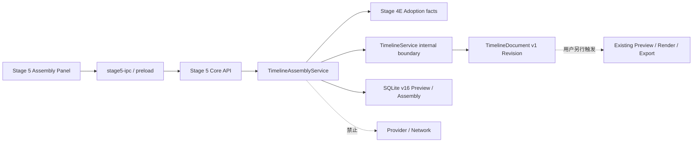

# Stage 5 详细设计草案：已采用图片的显式 Timeline 装配

> 负责人：LiuWei（架构师）
> 日期：2026-08-20
> 对应契约：`docs/design/STAGE5_CONTRACT_FREEZE.md`
> 建议数据库：SQLite v16
> 建议契约版本：`stage5-v1`
> 状态：Stage 5-R 当前源码已通过 Gate 5-R1–R5 恢复验收；历史 Gate 5-3/5-4 记录恢复有效；版本控制操作待用户授权
> Stage 5 Provider 调用：本阶段前后增量为 0

## 1. 设计目标

Stage 5 以最小跨域切片把 Stage 4E 当前 Adoption 安全地装配到既有 Timeline：

- 装配前生成本地确定性 Preview；
- 装配时重新验证 Requirement、Adoption、Asset、Timeline、Draft 和锁定；
- 原子创建 Timeline Revision 和不可变 Assembly；
- 复用 TimelineDocument v1 与既有渲染链路；
- 不调用 Provider、不保存正文、不改变 Stage 1–4E 契约。

## 2. 组件与依赖



依赖方向：Stage 5 消费 Stage 4C/4E 和 Timeline；Stage 4C/4E/Timeline 不反向依赖 Stage 5。

## 3. 核心流程

### 3.1 Prepare

1. 解析 project/requirement 和输入 DTO；
2. 读取 Project、Shot List、confirmed Revision、Requirement；
3. 读取当前 Adoption 及 Link/Task/Asset/Provenance；
4. 读取当前 Timeline Revision，拒绝无 Timeline或存在 Draft；
5. 验证 expected Adoption 和 base Timeline CAS；
6. 解析时长：显式值优先，其次合法 target，空 target 使用 3 秒；
7. 验证 `at_index` 与下游 locked Clip；
8. 生成冻结的 `proposed_clip_id`；
9. 通过 Timeline 内部 builder 生成目标 Document，不接受 Renderer 提供 Document；
10. 计算 base/proposed/preview hash 与安全影响摘要；
11. 在短事务内复验并插入 immutable Preview；
12. 返回严格白名单 DTO；Timeline Revision 增量和 Provider 增量均为 0。

### 3.2 Apply

1. 要求 `confirmed=true`；
2. `BEGIN IMMEDIATE`；
3. 读取 Preview，验证归属、过期时间和未应用状态；
4. 重验 current confirmed Requirement、current Adoption、Asset availability/Provenance；
5. 重验 current Timeline Revision、base hash、Draft 和锁定；
6. 使用 Preview 参数与 `proposed_clip_id` 重算目标 Document；
7. 比较服务端 hash、Preview hash 和客户端回传 hash；
8. 调用 Timeline 内部 Revision 边界写入新 Revision；
9. 插入 immutable Assembly；
10. `COMMIT`；返回 Assembly 与安全 Timeline Revision summary；
11. 任意失败 `ROLLBACK`，不得留下孤立 Revision 或 Assembly。

### 3.3 重放与并发

- Apply 前先按 `assembly_preview_id` 查询既有 Assembly；存在则返回原结果；
- 不存在时使用 `BEGIN IMMEDIATE` 串行化；
- 表上的 `UNIQUE(assembly_preview_id)` 是最后防线；
- 并发窗口内发生 Adoption/Timeline/Draft/availability 变化时，事务内校验失败；
- 不自动刷新 Preview 或重试 Apply。

## 4. Timeline 内部边界

### 4.1 不修改公共契约

不得新增 TimelinePatch operation，也不得改变：

- `TimelineDocument.schema_version=1`；
- image clip 字段；
- `TimelineLayout` 枚举；
- Revision、Undo/Redo 和 RenderPlan v1。

### 4.2 建议新增内部方法

在 `TimelineService` 增加仅供 Core 领域服务调用的内部边界，命名可在实现时调整：

```py
def build_asset_insert_document(
    db,
    *,
    project_id: str,
    base_document: dict,
    asset_id: str,
    proposed_clip_id: str,
    at_index: int,
    duration_us: int,
    layout: str,
) -> tuple[dict, dict]:
    ...
```

后置条件：

- 深拷贝 base Document；
- 只新增一个 image clip；
- 使用既有 Asset 归属/availability、时长、layout 和 Timeline normalize/validate；
- 将内部新 clip ID 替换为冻结的 `proposed_clip_id`；
- 返回目标 Document 和安全 impact；
- 不写数据库、不读取 Provider、不生成日志正文。

Revision 写入继续复用 `create_revision_from_document(db, ...)`，调用者持有事务。

### 4.3 锁定算法

```text
shifted_clips = base.clips[at_index:]
if any(clip.clip_id in locked_elements for clip in shifted_clips): reject
shifted_captions = captions whose source_clip_id is in shifted_clips
```

插入到末尾不会移动既有 Clip，因此允许。无绑定手工 Caption 不因插入而改写。最终仍由 Timeline normalize/validate 做权威校验。

## 5. Canonical hash

### 5.1 Preview hash 输入

```json
{
  "schema_version": 1,
  "project_id": "opaque-id",
  "shot_list_revision_id": "opaque-id",
  "shot_requirement_id": "opaque-id",
  "adoption_id": "opaque-id",
  "asset_id": "opaque-id",
  "base_timeline_revision_id": "opaque-id",
  "base_document_sha256": "sha256:...",
  "proposed_clip_id": "opaque-id",
  "at_index": 0,
  "duration_us": 3000000,
  "layout": "fit",
  "proposed_document_sha256": "sha256:..."
}
```

使用 UTF-8、key 排序、紧凑 JSON 计算 `sha256:`。不得把 Requirement 正文、Prompt、路径或完整 Document 放入 Preview hash 输入。

### 5.2 Document hash

沿用 TimelineService 当前 canonical JSON 与 `sha256:` 规则。Stage 5 不实现第二套 Document hash。

## 6. SQLite v16 实现拆分

### 6.1 Migration

- 新增 `database_v16.py` 导出 `V16_SQL`；
- `database.py` 只新增 import/version/migration entry；
- 不编辑 v1–v15 SQL；
- 普通追加迁移，不使用 v13/v14 rebuild 路径；
- 为两表配置不可变触发器和同项目校验。

### 6.2 查询索引

建议：

```sql
CREATE INDEX idx_stage5_previews_requirement_created
  ON shot_requirement_timeline_assembly_previews(
    shot_requirement_id, created_at DESC, id DESC
  );
CREATE INDEX idx_stage5_previews_expiry
  ON shot_requirement_timeline_assembly_previews(expires_at);
CREATE INDEX idx_stage5_assemblies_requirement_created
  ON shot_requirement_timeline_assemblies(
    shot_requirement_id, created_at DESC, id DESC
  );
CREATE INDEX idx_stage5_assemblies_output_revision
  ON shot_requirement_timeline_assemblies(output_timeline_revision_id);
```

### 6.3 不可变性

Preview 和 Assembly 均禁止 UPDATE/DELETE。过期、是否已应用、是否当前生效全部派生，不增加可变 status/is_current 列。

## 7. Core 服务设计

建议新增 `ShotRequirementTimelineAssemblyService`：

- `prepare(project_id, requirement_id, input)`；
- `apply(project_id, requirement_id, input)`；
- `get_preview(preview_id)`；
- `get_assembly(assembly_id)`；
- `list_assemblies(project_id, requirement_id, limit, cursor)`。

内部 helper：

- `_requirement_context`：当前 confirmed image Requirement；
- `_current_adoption_context`：Adoption/Link/Task/Asset/Provenance；
- `_timeline_context`：current Revision/hash/draft；
- `_resolve_duration`；
- `_build_preview`；
- `_safe_asset_summary`；
- `_is_currently_assembled`；
- `_preview_dto` / `_assembly_dto`。

服务不得 import Provider adapter，不创建 Job，不调用 Stage 4D Create/Retry。

## 8. API 与 DTO

### 8.1 Pydantic 请求

所有请求 `extra='forbid'`、strict；`confirmed` 必须字面量 true。ID、hash、整数和枚举由 Core 再做领域校验。

### 8.2 Contracts guards

`packages/contracts/src/stage5.ts` 独立定义：

- branded IDs；
- PrepareInput / PreparedPreview；
- ApplyInput / ApplyResponse；
- Assembly / AssemblyPage；
- 严格 exact-key guard 和 parser；
- Stage 5 专属 sensitive-key deny set。

禁止使用宽泛 `Record<string, unknown>` 透传响应。

### 8.3 安全 DTO 示例

```ts
interface ShotRequirementTimelineAssembly {
  assembly_id: ShotRequirementTimelineAssemblyId;
  project_id: ProjectId;
  shot_list_revision_id: ShotListRevisionId;
  shot_requirement_id: ShotRequirementId;
  adoption_id: ShotRequirementImageAdoptionId;
  asset: {
    asset_id: AssetId;
    kind: "image";
    availability: AssetAvailability;
    width: number;
    height: number;
    sha256: string;
  };
  assembly_preview_id: ShotRequirementTimelineAssemblyPreviewId;
  base_timeline_revision_id: TimelineRevisionId;
  output_timeline_revision: TimelineRevisionSummary;
  proposed_clip_id: TimelineClipId;
  proposed_document_sha256: string;
  created_at: string;
}
```

不得返回 Timeline Document、display path、Requirement 标题/视觉说明、Prompt、Caption 或 Transcript。

## 9. Desktop 交互设计

### 9.1 入口

入口位于 Stage 4E 当前 Adoption 卡片下。满足资格时显示按钮；不满足时显示稳定、可操作的本地原因。

### 9.2 表单

- 插入位置：`0..clip_count`，以“第 N 个镜头前/末尾”表达；
- 时长：秒输入，转换为整数微秒；
- 布局：沿用 `blurred_background | crop_fill | fit`；
- 默认时长来源必须标注为“Requirement 目标”或“默认 3 秒”。

Renderer 不提交完整 Timeline 或 Asset 路径。

### 9.3 确认页

显示：

- adopted Asset 安全缩略摘要；
- 插入位置、时长、布局；
- Clip 数、位移 Clip/Caption 数、前后总时长；
- base/proposed hash 的短显示；
- “不调用 Provider、不自动渲染、不自动导出”；
- 唯一 Apply 确认按钮。

### 9.4 成功与冲突

- 成功：展示新 Revision 和 Clip ID，并提供“前往时间线”；
- stale Adoption/Timeline/Draft/locked/expired：不自动重试，要求重新 Prepare；
- 同 Preview 重放：展示原 Assembly，不重复弹成功副作用；
- Timeline 页面通过既有 API 刷新，不由 Stage 5 响应携带完整 Document。

## 10. Electron / Preload

建议独立 channels：

```text
stage5:assembly-prepare
stage5:assembly-apply
stage5:assembly-preview-get
stage5:assembly-get
stage5:assembly-list
```

- Main 对 ID、hash、index、duration、layout、confirmed 做输入白名单；
- Core 响应先经 `stage5RendererSafe` 再经 parser；
- Preload 只暴露五个窄方法；
- 不暴露任意 URL、method、header、路径或 Provider 字段。

## 11. Windows 与打包

- 不新增 npm/Python 运行依赖；
- sidecar build 只需包含新模块；
- NSIS 验收覆盖 fresh v16 和 v15→v16；
- 安装态通过本地 PNG 和本地 API 操作，网络 fail-on-call；
- 重启后 Preview、Assembly、Timeline Revision 和 Undo/Redo 状态一致；
- 卸载后项目数据库保留且 hash 不被卸载器改写。

## 12. 测试设计

### 12.1 Core unit

- duration 三分支和边界；
- at_index 边界；
- proposed clip/hash 确定性；
- locked downstream 拒绝、末尾允许；
- Draft、stale Adoption、stale Timeline、unavailable Asset；
- active prior assembly 检测；
- DTO 不含正文/路径。

### 12.2 Migration

- fresh v1→v16；
- v15→v16 backup/checksum；
- v1–v15 checksum 不变；
- 表、索引、触发器；
- UPDATE/DELETE 拒绝；
- 跨项目和不一致链路 INSERT 拒绝；
- FK/integrity；
- 未知 v17 拒绝。

### 12.3 Integration

- Prepare 零 Timeline/Provider/Job 等副作用；
- Apply 精确 +1 Revision/+1 Assembly；
- Apply 原子回滚；
- 同 Preview 重放和并发；
- Undo/Redo 与当前生效派生；
- 分支后历史保留；
- API HTTP/error mapping 和分页。

### 12.4 Contracts/Desktop/Electron

- exact-key 与敏感字段拒绝；
- 输入转换和错误态；
- 确认按钮门禁；
- stale 后必须重新 Prepare；
- 不在 Renderer 数据中出现正文、路径、异常或 Provider 内容；
- IPC 路由、preload surface 和网络调用计数。

### 12.5 真实离线 E2E

- 隔离 Project、confirmed image Requirement、current Adoption、真实本地 PNG；
- Timeline 有无 Clip、末尾/中间插入、锁定拒绝；
- Apply 后真实 Timeline Revision、Undo/Redo、重启；
- 用户另行触发既有权威 Preview/Render并验证输出可播放；
- 开发态与安装态 fresh/v15→v16；
- Provider dispatch 0、网络 0、隐私扫描 0 命中。

## 13. 隔离原型 Gate 5-2

原型不得接生产 UI、Provider 或用户数据库。建议包含：

1. 临时 v16 表与触发器模型；
2. 0、1、24 Requirement 上下文；
3. 0、1、100 Clip Timeline；
4. at_index 首/中/末；
5. target null、边界内、边界外和显式 override；
6. locked 上游/下游组合；
7. Draft、stale Adoption、stale Timeline、expired Preview；
8. 重复和并发 Apply；
9. 故障注入验证 Revision/Assembly 原子回滚；
10. 规则样例预期匹配 100%，p95 不高于 300 ms；
11. Provider 调用与网络均为 0；
12. SQLite/输出隐私哨兵为 0 命中。

原型只证明确定性规则和性能，不声称真实 UI、FFmpeg 或 NSIS 已通过。

### 13.1 Gate 5-2 实际结论（2026-08-20）

- 原型边界：仅新增 `tools/prototypes/stage5_timeline_assembly_model.py` 与对应 prototype tests，未接入生产迁移、Core API、Contracts、Desktop 或 Electron；
- 规则矩阵：24 条实际执行样例全部匹配，准确率 100%；
- 规模与位置：覆盖 0/1/24 Requirement 上下文、0/1/100 Clip，以及首/中/末插入；
- 冲突与事务：覆盖 Draft、stale Adoption、stale Timeline、Asset unavailable、expired Preview、hash mismatch、重复/并发 Apply 和 Revision/Assembly 双故障点回滚；
- 测试：9 项 Stage 5 隔离原型测试通过，Core 全部 prototype 回归 25 项通过；
- 性能：20 次 Prepare/Apply 独立报告中，Prepare p95 为 15.636 ms，Apply p95 为 14.337 ms，均低于 300 ms；
- 数据：SQLite `integrity_check=ok`，`foreign_key_check` 违规数为 0；
- 安全：Provider dispatch 增量 0、网络调用 0、SQLite/报告隐私哨兵命中 0；
- 隔离：生产文件变更 0，README 变更 0。

结论：Gate 5-2 通过。该结论本身不等价于生产 SQLite v16、正式 API/UI、FFmpeg、NSIS 或真实离线 E2E 已通过；Gate 5-3 后续已获用户授权并完成。

### 13.2 Gate 5-3 实际结论（2026-08-20）

**生产实现**

- Core / SQLite：新增 v16 Preview/Assembly append-only 表与约束触发器，新增 Timeline Assembly 服务、Timeline 内部确定性 builder、迁移接入及五条正式 HTTP API；
- Contracts：新增独立 `stage5-v1` exact-key DTO/guards，并将全局契约版本升级为 `stage5-v1`；
- Electron：新增五个固定 IPC 和五个显式 preload 方法，不开放通用 URL、header 或 path 透传；
- Desktop：在 Stage 4E 当前 Adoption 下新增装配面板，支持位置、时长、布局、Prepare 安全摘要、显式 Apply、重放与固定安全错误；
- 兼容修正：仅更新旧测试对“最新迁移版本”的断言和 Stage 4D 隔离原型的迁移排除集合，未改变 Stage 1–4E 业务契约。

**开发验证证据**

- Stage 5 Core 及相关回归组合：22 项通过；
- v16 兼容修正定向组合：17 项通过；
- Core 全量：`460 passed, 1 skipped, 1 warning`，耗时 194.09 秒；警告为 Starlette/httpx 弃用提示；
- pytest 成功退出后清理 Windows 临时目录时出现 `PermissionError` atexit 噪声，不计为测试失败；
- Desktop 全量：`207 passed`；
- Contracts typecheck/build、Desktop typecheck/build 均通过；
- Ruff 对 Core 源码、测试及 Stage 4D/Stage 5 原型检查通过。

**安全与边界结论**

- 隐私测试发现通用 `removeSensitiveFields` 不能删除旧 Timeline API 合法使用的 `document`；实现改为新增仅供 Stage 5 使用的窄清敏边界，额外拒绝 `document`、`requirement`、`visual_direction`、`narration_text`；
- Stage 5 DTO/Renderer 不返回完整 Timeline Document、Requirement/Prompt/字幕/转写正文、媒体绝对路径、URI、Provider 凭据或原始异常；Core 内部 Document 仅用于本地确定性构造和 hash；
- 测试中的泄漏哨兵仅存在于测试夹具，不构成生产数据泄漏；
- Stage 5 Provider dispatch、网络调用、费用在本阶段前后增量均为 0；历史 Stage 4D 夹具或数据库中的既有调用记录不应被表述为总调用数 0；
- README 未修改，当前未提交。

**门禁结论**

Gate 5-3 的生产实现结论保持不变。Gate 5-4 已由 LiuKeAi 在生产实现只读边界下独立完成：Core fresh v16 与 v15→v16、真实本地 PNG 权威 Preview/Render、Electron 开发态与 Windows/NSIS 安装态 fresh/upgrade、重启、卸载保留、隐私和 Provider 零增量均通过。独立证据见 `docs/design/records/STAGE5_INDEPENDENT_ACCEPTANCE.md`。

Gate 5-R5 已基于当前源码完成 Windows/NSIS 收口重验：Sidecar/Desktop/NSIS 重建与独立 package verify 通过；installed_fresh 与 installed_upgrade_v15 E2E 均通过；真实 NSIS 静默安装与静默卸载 exit code 0；fresh 与 upgrade 两份专用数据库均保留且卸载前后 SHA-256 不变。Stage 5-R 恢复验收通过，历史记录恢复有效。下一步可执行 Gate 5-5 收尾门禁；版本控制、推送和 PR/MR 仍需用户授权。

## 14. 开发切片（不规定执行顺序）

### Slice A：Core / 数据

- v16 migration；
- Assembly service；
- Timeline internal builder；
- API/error mapping；
- Core tests。

### Slice B：Contracts / Electron

- `stage5-v1` DTO/guards；
- Core client；
- IPC/preload；
- contract/IPC tests。

### Slice C：Desktop

- 装配表单、确认页、历史和冲突状态；
- Timeline 刷新/跳转；
- component tests。

### Slice D：验收

- 离线 Electron E2E；
- 真实本地 PNG Preview/Render；
- Windows/NSIS fresh 与升级；
- 隐私扫描和文档收口。

这些切片按互斥文件所有权组织，可以串行或并行，不在文档中绑定执行拓扑。

## 15. ZhangSan 技术可行性评估

- 现有 `TimelineService.create_revision_from_document` 已支持调用者持有事务，可保证 Revision 与 Assembly 原子提交；
- image clip 和 FFmpeg image input 已存在，不需 RenderPlan 变更；
- v16 两表均可只追加，不需 rebuild；
- 最大实现风险是使用私有 Timeline helper 导致重复规则，解决方式是增加窄的 Core 内部 builder，而不是复制 Timeline 校验；
- `BEGIN IMMEDIATE`、Preview unique 与 CAS 足以处理并发和重放；
- 预计 Core/数据成本为中等，技术可行。

## 16. YeJing 技术可行性评估

- Stage 4E 已有 Requirement-scoped 面板，可新增独立子面板而不改主导航；
- Stage 5 DTO 可完全使用安全摘要，不需把 Timeline Document 或正文复制到新接口；
- 独立 IPC/preload 可避免扩张通用 fetch；
- Windows 不新增网络或依赖，重点是 v15→v16 和安装态离线交互；
- 预计 Contracts/Desktop/Electron 成本为中等，技术可行。

## 17. LiuKeAi 独立范围审查

- 范围只有“单条 adopted image 显式插入 Timeline”，未捆绑 TTS、资产库、Batch 或替换；
- 不修改 Stage 4E 的 Adoption 含义，也不把 Adoption 自动等同于装配；
- 不修改 TimelineDocument/RenderPlan/Provider 契约；
- Provider、网络和费用增量为 0，可在隔离环境落地验收；
- 主要门禁必须坚持：Draft fail closed、锁定间接位移拒绝、Preview/Apply 分离、Revision/Assembly 原子性和正文隔离；
- 验收可通过真实本地 PNG、既有 Preview/Render 与 Windows 安装态完成，判据可落地。

## 18. 风险与退路

1. **跨域事务留下孤立 Revision**
   退路：Stage 5 service 持有唯一事务；Timeline internal boundary 不自行 commit；故障注入强制验证。
2. **Prepare 与 Apply 生成不同 Clip/hash**
   退路：冻结 `proposed_clip_id`，共用同一 builder 和 hash 实现。
3. **插入间接移动锁定 Clip**
   退路：Prepare/Apply 双重检查所有下游 Clip，任何 locked 命中即拒绝。
4. **Timeline Draft 被静默冲突化**
   退路：Draft 存在时 fail closed，不自动删除或覆盖。
5. **Adoption 切换后装配旧图**
   退路：expected current Adoption CAS，Apply 事务内复验。
6. **同一图片重复插入**
   退路：同 Preview 幂等；当前 Document 含同 Requirement 历史 Assembly clip 时拒绝。
7. **正文经 Timeline DTO 泄漏到 Stage 5**
   退路：Apply 只返回安全 Revision summary，Stage 5 parser 禁止正文键。
8. **范围扩张到整表自动装配或 TTS**
   退路：触发变更控制，退回 Gate 5-1。

## 19. Gate 5-1 完成判据

- 已基于 Stage 4E 完成基线和真实代码盘点能力；
- 已比较三个候选并唯一推荐单条图片显式装配；
- 已给出 SQLite v16、`stage5-v1`、API/DTO、迁移和兼容方案；
- 已冻结 CAS、锁定、Draft、时长、幂等、事务和隐私原则；
- 已定义角色和互斥文件所有权，但不规定执行顺序；
- 已定义 Gate 5-2 至 Gate 5-5 和独立验收；
- Gate 5-1 当时只修改 Stage 5 文档，Stage 5 Provider 调用增量为 0；
- 用户已于 2026-08-20 接受契约文档第 16 节全部冻结项，Gate 5-1 已通过。


