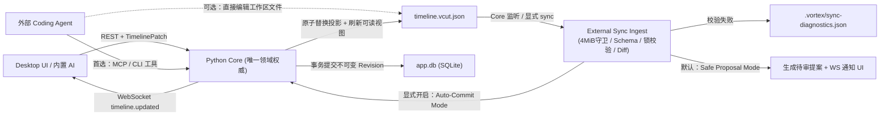

# Vortex Cut 时间线数据解耦与 Agent 协作工作区架构方案（最终版）

> **角色**：LiuWei（架构师）联合 ZhangSan（Core/数据模型）、YeJing（契约/Desktop）、LiuKeAi（独立评审）口径对齐  
> **状态**：已立项（2026-11-24 用户确认立项，待拆解规划门与实施切片；当前项目实际状态与能力边界只见 [`docs/STATUS.md`](../STATUS.md)）  
> **日期**：2026-11-24  
> **关联基线**：[`ARCHITECTURE.md`](../../ARCHITECTURE.md)、[`ADR-0002`](adr/0002-architecture-review-structure-debt.md)、[`ADR-0003`](adr/0003-ai-direction-and-privacy-hard-commitment.md)、[`ADR-0004`](adr/0004-ai-capability-master-plan-decisions.md)、[`P235_OPENFILM_TIMELINE_PARITY_PLAN.md`](P235_OPENFILM_TIMELINE_PARITY_PLAN.md)

---

## 1. 背景与核心架构裁决

本方案针对「将 OpenFilm 的 Agent-Native / 声明式文件工作流引入 Vortex Cut，并对 SQLite 与时间线数据进行解耦」的提案，结合 Vortex Cut 真实代码架构与既有 ADR 约束，给出可落地、无损且不破坏既有不变量的最终架构方案。

### 1.1 核心结论

**不采用“删除 SQLite 时间线表、用浮点秒 JSON 作为唯一真相源、由 Electron Main 监听写回”的推倒重来式方案**；改为采用：

> **Core 领域权威 + 不可变 Revision 账本（SQLite） + 声明式无损工作区投影/双向摄入（Disk Workspace） + MCP/CLI 优先暴露层**

三条根本设计原则：

1. **创作意图可导出、可 Diff、可双向协作，但领域不变量只能由 Python Core 裁决**：外部 Coding Agent（Claude Code、Cursor 等）可以通过 **MCP/CLI** 或编辑工作区声明式文件参与剪辑，但任何变更进入项目主线都必须经过 Core 校验、锁定守卫与不可变 `TimelineRevision` 落账，**绝不绕过 Core 直接覆盖运行态**。
2. **数据分层遵循“可重算/本机私有/审计账本留 SQLite，便携创作意图与逻辑清单落声明式工作区”**：同时保留应用级单一 `app.db`（承载跨项目模型清单、Provider 配置、全局任务调度与内容寻址派生缓存），不把全局库强拆成碎片化的每项目独立数据库。
3. **无损精度与 Agent 友好性解耦，不以牺牲精度换可读性**：持久化时间线文件严格遵守 `ARCHITECTURE.md` §7.3 的**整数微秒**红线，Agent 的低误差编辑通过 **MCP/CLI 语义工具 + 只读秒数摘要视图 + 结构化诊断反馈** 实现。

### 1.2 明确否决的反模式（与前置提案的差异裁决）

| 前置草案建议 | 本方案裁决 | 技术依据（对应既有代码与 ADR） |
|---|---|---|
| 时间线文件统一改用**浮点秒**（如 `12.40`） | **❌ 否决** | 直接违反 `ARCHITECTURE.md` §7.3（禁止浮点秒持久化）。29.97fps（`30000/1001`）、1.5ms 转场容差、100ms 最短片段、声画链接、VFR 录像与 word-timestamp 映射在往返序列化中会因浮点舍入产生漂移，破坏贴齐判定与渲染缓存哈希。 |
| 删掉 SQLite 时间线表，将 `project.vcut.json` 设为唯一真相源 | **❌ 否决** | `timeline_revisions` 本身已存储完整 `TimelineDocument` JSON，且承载不可变 Revision 链、10ms 级应用内 Undo/Redo、审片 Diff、乐观锁防漂移，以及渲染/导出/Agent 会话/工作单的外键溯源。普通用户不使用 Git，Git 不能替代应用内版本账本（ADR-0003）。 |
| 由 Electron Main 用 `chokidar` 直接校验并驱动 Zustand，同时把时间线状态机迁入 TypeScript | **❌ 否决** | 直接违反 `ARCHITECTURE.md` §5.1 与 **ADR-0002 R1**（已将 Electron Main 膨胀为第二业务网关定性为最高优先结构债）。双语言维护两套时间线校验器必然漂移，且无法消除 Python Sidecar（本地 ASR/CLIP/CV/RenderPlan 仍在 Python），收益为负。 |
| 把 `app.db` 拆成每个项目目录下的 `.vortex/index.db` | **❌ 否决** | 现有全局任务调度器、模型安装清单、Provider 配置、跨项目派生缓存均依托应用级 `app.db`。应保留应用级 `app.db`，仅在项目目录内放 `.vortex/` 绑定元数据与局部缓存/诊断文件。 |
| 用极简 Schema（省略特效/链接/转场源事实）并把字幕拆去 `main.srt` 托管 | **❌ 否决** | `.srt` 无法无损表达 `caption_id`、转录段溯源（`source_clip_id`/`source_segment_ids`）、ASS 花字/气泡/坐标样式覆盖及微秒时间；极简 Clip Schema 会丢失关键帧、变换、蒙版、抠像、声画链接、`page_overrides` 等已交付/规划能力。 |

---

## 2. 三层数据归属边界

系统将数据清晰划分为三层：**便携声明式工程层（可入 Git）**、**工作区本地辅助层（`.vortex/`，`.gitignore`）**、**应用级 Core 账本与多模态索引层（`app.db` + 应用缓存）**。

| 数据类别 | 归属层 | 存储介质 | 是否入 Git | 核心依据 |
|---|---|---|---|---|
| **项目元信息与画布配置**（标题、分辨率、`fps_num/fps_den`、配方引用） | 层 A：声明式工程层 | `vcut.project.json` | ✅ 是 | 跨机器/Agent 共享的基础工程契约 |
| **当前时间线创作状态**（轨道、片段、时间窗、变速、音频、变换/关键帧/蒙版/抠像、声画链接、转场源事实、字幕及样式、`locked_elements`、`note`） | 层 A（投影/同步）+ 层 C（权威修订链） | `timeline.vcut.json` ↔ SQLite `timeline_revisions` | ✅ 是 | 文件用于 Diff、Git 协作与外部 Agent 编辑；SQLite 保留不可变历史链、Undo/Redo 与所有外键引用 |
| **逻辑素材清单**（`asset_id`、`logical_key`、`kind`、`fingerprint`、`size_bytes`、只读媒体摘要、工作区内相对路径） | 层 A：声明式工程层 | `assets.manifest.json` | ✅ 是 | 解耦物理绝对路径；靠内容指纹支持跨设备重定位 |
| **创作简报与协作上下文**（Brief、粗剪理由、审片批注） | 层 A：声明式工程层 | `brief.json`、`context/notes.json` | ✅ 是 | 与 `timeline.vcut.json` 物理解耦，修改批注不污染时间线哈希与渲染缓存 |
| **受管/归档素材与 Page 包**（`managed` 素材、HTML `page` bundle） | 层 A：声明式工程层 | `assets/` | 按需（LFS/按项目策略） | 随工作区迁移的自包含资产；大体积外部录屏仍保持 `external` 引用不复制 |
| **工作区绑定指针与同步诊断**（`project_id`、`synced_revision_id`、校验报错详情） | 层 B：工作区本地层 | `.vortex/workspace-link.json`、`.vortex/sync-diagnostics.json` | ❌ 否 | 机器与运行态绑定信息；诊断文件供 Agent 读取自修 |
| **Agent 只读可读视图**（秒数/时间码表格、片段 note 索引、轨道概览） | 层 B：工作区本地层 | `.vortex/views/timeline.readable.md` | ❌ 否 | Core 自动派生，帮助 LLM 零误差理解时间线，**禁止作为写回源** |
| **本机外部素材物理路径与重定位记录** | 层 C：应用级 SQLite | `app.db` (`asset_locations`) | ❌ 否 | 绝对路径属于机器私有状态，绝不泄露进 Git 或跨机清单 |
| **不可变版本链、草稿、Undo/Redo、AI 提案与会话轨迹** | 层 C：应用级 SQLite | `app.db` (`timeline_revisions`, `timeline_drafts`, `timeline_navigation`, `*_proposals`, `agent_sessions`, `worklists`) | ❌ 否 | 高频事务、外键锚定、审片回滚与费用审计 |
| **本地多模态派生索引**（Whisper 转录词戳、CV Layer 0 信号、CLIP 向量、节拍、说话人、关键帧标签） | 层 C：应用级 SQLite | `app.db` (`transcripts*`, `cv_*`, `asset_semantic_index`, `beat_grids`, `asset_frame_tags` 等) | ❌ 否 | 二进制/向量密集、可完全重算，仅通过 Core API / MCP 提供只读检索 |
| **任务队列、渲染/导出记录、外传同意书、模型与全局派生缓存** | 层 C：应用级 SQLite + 应用缓存 | `app.db` (`jobs`, `render_artifacts`, `export_records`, `*_egress_*`, `derived_media_cache`) | ❌ 否 | 安全隐私审计硬边界（ADR-0003 D4）与跨项目缓存复用 |
| **UI 临时视图状态**（时间线缩放、滚轴、播放头、面板折叠） | Desktop 本地配置 | Electron user profile / settings | ❌ 否 | 个人交互偏好，不污染工程文件 Diff |

---

## 3. 推荐工程工作区目录结构

项目默认仍可在应用数据目录下零配置运行（兼容既有普通桌面用户）；当用户选择「绑定工作区文件夹 / 导出为协作工作区」时，生成如下自包含目录结构：

```text
my-vlog-workspace/
├── vcut.project.json            # [Git] 工程头：版本、画布、配方引用、工作区格式版本
├── timeline.vcut.json           # [Git] 与 Core TimelineDocument 100% 无损同构的时间线文件
├── assets.manifest.json         # [Git] 逻辑素材清单（无绝对路径；指纹 + 逻辑 ID + 媒体摘要）
├── brief.json                   # [Git/可选] 创作简报（与 Core Brief DTO 同构）
├── context/
│   └── notes.json               # [Git/可选] 审片批注与 AI 粗剪决策日志（与时间线哈希解耦）
├── assets/                      # [可选] 仅存放 managed / 归档素材与 page bundle
├── exports/                     # [可选] 显式导出的成片、.srt/.vtt 字幕或 OTIO/FCPXML
├── VCUT_AGENT_GUIDE.md          # [自动生成] 给 Coding Agent 的精简 Schema、MCP 与校验指引
└── .vortex/                     # [必须加入 .gitignore，机器管理，随时可删重建]
    ├── workspace-link.json      # 关联 app.db 的 project_id、synced_revision_id、synced_sha256
    ├── sync-diagnostics.json    # 外部改写校验失败时的结构化错误列表（供 Agent 自我修复）
    └── views/
        └── timeline.readable.md # Core 自动生成的只读可读摘要（秒数 + 时间码 + 片段 note）
```

### 3.1 `assets.manifest.json` 为什么严格禁止绝对路径

- **跨设备与隐私**：`D:\Footage\A001.mp4` 既暴露本机目录结构，又在换机后失效。
- **逻辑标识 + 指纹重定位**：清单仅记录稳定的 `asset_id`（以及人类/Agent 易读的 `logical_key`，如 `coffee_latte_01`）、`fingerprint`（复用 Core 既有采样哈希）、`size_bytes`、`kind`、`media_summary`（时长微秒、宽高、帧率、是否有音轨）与工作区内相对路径 `rel_path`（仅 `managed` 资产存在）。
- **外部大素材不强迫复制**：`external` 素材仍由本机 `app.db` 的 `asset_locations` 映射真实路径；跨机打开工作区时，若 `asset_locations` 缺失，Core 按 `fingerprint` 引导用户选择素材目录批量重定位（复用既有 `ASSET_MISSING` / relocate 机制）。

---

## 4. 无损声明式 Schema 与 Agent 友好设计

### 4.1 核心策略：Canonical 无损结构 + 只读可读视图 + 非渲染 `note`

1. **`timeline.vcut.json` 与 `TimelineDocument` 保持 100% 无损同构**：
   - 字段命名与类型直接复用 `packages/contracts` 中的 `TimelineDocument`（整数微秒 `*_us`、有理数帧率 `fps_num/fps_den`、`tracks` 数组视觉顺序、扁平 `clips[]` / `captions[]` / `locked_elements[]` / `transitions[]` / `provenance`），避免在 Core 与磁盘文件之间引入易出错的双重数据模型翻译层。
   - 仅在 `TimelineClip` 上增补一个**可选、非渲染元数据字段 `note?: string`**（长度上限 500 字符），用于记录人或 Agent 的剪辑意图（如「开场拉花特写，CLIP top1 召回」）。**硬约束**：`note` 字段在计算 `RenderPlan` / `IR` 缓存指纹时被剔除，修改备注不触发任何预览或渲染失效。
2. **用只读派生视图与工具层解决 LLM 算术短板**：
   - 每次投影 `timeline.vcut.json` 时，Core 同步刷新 `.vortex/views/timeline.readable.md`，把每个片段的 `clip_id`、`track_id`、`logical_key`、`start/end`（以 `MM:SS.mmm` 与浮点秒同时展示）、时长、`note`、锁定状态渲染成紧凑 Markdown 表格，供 Agent 快速定位，零微秒心算负担。
   - 通过 MCP/CLI 执行局部修改时，工具入参支持「按秒数 / 时间码 / 相对切点」表达，由 Core 按项目 `fps_num/fps_den` 确定性换算并写入精确微秒，彻底规避 LLM 手改 8 位微秒整数时的算术漂移。
3. **字幕不以 `.srt` 作为真相源**：
   - `captions[]` 留在 `timeline.vcut.json` 中，无损保留 `caption_id`、`source_clip_id`、`source_segment_ids`、`preset_id`、`style_override`（字体/描边/气泡/花字/坐标）。
   - 同时保留并强化显式的 `.srt` / `.vtt` 导出与导入命令（用于对接外部字幕审校工具）。

### 4.2 `timeline.vcut.json` 结构示例（与 Core 契约无损对齐）

```json
{
  "workspace_format_version": 1,
  "schema_version": 1,
  "project_id": "project_01j...",
  "canvas": {
    "width": 1920,
    "height": 1080,
    "fps_num": 30000,
    "fps_den": 1001,
    "background_color": "#000000"
  },
  "tracks": [
    { "id": "C1", "kind": "text", "locked": false, "hidden": false, "muted": false, "solo": false },
    { "id": "V1", "kind": "video", "locked": false, "hidden": false, "muted": false, "solo": false },
    { "id": "A1", "kind": "audio", "locked": false, "hidden": false, "muted": false, "solo": false }
  ],
  "clips": [
    {
      "clip_id": "clip_001",
      "track_id": "V1",
      "order_index": 0,
      "asset_id": "asset_coffee_01",
      "asset_kind": "video",
      "source_start_us": 12400000,
      "source_end_us": 16800000,
      "timeline_start_us": 0,
      "timeline_end_us": 4400000,
      "layout": "fit",
      "audio": { "enabled": true, "gain_db": 0, "fade_in_us": 0, "fade_out_us": 200000 },
      "picture_fade_out_us": 500000,
      "speed_milli": 1000,
      "note": "开场拉花特写，本地 CLIP 语义召回"
    }
  ],
  "captions": [
    {
      "caption_id": "cap_001",
      "track_id": "C1",
      "source_clip_id": "clip_001",
      "start_us": 200000,
      "end_us": 2400000,
      "text": "第一口先看这杯手冲的油脂",
      "preset_id": "default-bottom",
      "origin": "transcript",
      "edited": false,
      "source_segment_ids": ["seg_101"]
    }
  ],
  "locked_elements": [],
  "transitions": [],
  "provenance": {
    "created_by": "user",
    "source_transcript_ids": ["tr_001"]
  }
}
```

### 4.3 `assets.manifest.json` 结构示例

```json
{
  "manifest_version": 1,
  "project_id": "project_01j...",
  "assets": [
    {
      "asset_id": "asset_coffee_01",
      "logical_key": "coffee_latte_01",
      "kind": "video",
      "storage_mode": "external",
      "display_name": "A001_coffee_latte.mp4",
      "fingerprint": "sha256:9f86d081...",
      "size_bytes": 184523010,
      "rel_path": null,
      "media_summary": {
        "duration_us": 48200000,
        "width": 3840,
        "height": 2160,
        "fps_num": 30000,
        "fps_den": 1001,
        "has_audio": true
      }
    }
  ]
}
```

---

## 5. 双层协同、一致性与安全协议

整个双向同步闭环全部由 **Python Core** 拥有（Electron Main 不监听、不校验、不写时间线，严格遵守 ADR-0002 R1）。



### 5.1 Core → Disk（原子投影）

1. 当项目绑定了工作区目录，且 Core 在 SQLite 事务中成功提交新的 `TimelineRevision`（包括 UI 编辑、Undo/Redo、内置 Agent 采纳、MCP 提交）后，投递到该项目的**单通道顺序写队列**。
2. 写入步骤：先写 `timeline.vcut.json.tmp.<nonce>` → `flush` + `os.fsync` → 原子 `os.replace` 覆盖 `timeline.vcut.json` → 同步刷新 `.vortex/views/timeline.readable.md` → 更新 `.vortex/workspace-link.json` 的 `synced_revision_id` 与 `synced_sha256`。
3. **防回环机制**：Core 记录自身最近写出的 `(document_sha256, mtime_ns)`；文件监听回调收到变更后，若内容哈希等于 `synced_sha256` 则直接忽略，彻底避免死循环。

### 5.2 Disk → Core（External Sync Ingest）

当外部编辑器或 Coding Agent 修改了 `timeline.vcut.json`（触发 Core 文件监听，或外部显式执行 `vcut sync` / `POST /api/v1/projects/{id}/workspace/sync`）：

1. **体量与解析守卫**：复用既有 4 MiB 原文体量上限，超限直接拒收；JSON 解析失败或半截写入（防抖窗口 150ms 后重试一次）记入 `.vortex/sync-diagnostics.json`。
2. **完整领域校验**：把外部 JSON 喂入 Core 既有 `_normalize_and_validate()` 管线（含资产属于本项目、时长下限、轨道兼容、同轨不重叠、声画链接一致性、转场终态投影）。
3. **锁定保护守卫**：对比基线修订 `synced_revision_id` 与外部文档：
   - 任何被 `locked_elements` 标记的片段或 `track.locked=true` 轨道上的元素，若在外部文档中被删除、移动、修剪或修改属性，**一律拒绝自动应用**，并返回明确的 `TIMELINE_LOCKED` 诊断条目（写进 `.vortex/sync-diagnostics.json`）。
4. **基线分叉检测**：若 `workspace-link.json` 记录的 `synced_revision_id != projects.current_timeline_revision_id`（说明 UI 在外部编辑期间已产生新修订），**禁止静默覆盖**，强制转入冲突审阅状态，展示两边结构化 `TimelineDiff` 由用户决定采纳或放弃。
5. **双同步模式（项目级开关）**：
   - **审阅提案模式（默认，严格遵循 ADR-0003 D5）**：校验通过后生成 `ExternalWorkspaceProposal` + 结构化 `TimelineDiff`，经 WebSocket 推送到 Desktop 顶部审阅条，用户一键「采纳」才写入不可变 `TimelineRevision`（`created_by="external_sync"`），或一键「放弃」把磁盘恢复为当前修订。
   - **自动提交模式（用户显式开启，适合单人 Coding Agent 闭环）**：在校验通过、零锁定冲突、零基线分叉的前提下，自动落一条新不可变 `TimelineRevision`（`created_by="external_sync"`）并推送 Desktop 热重载。即使开启自动提交，用户仍可在 Desktop 内一键 `Ctrl+Z` 完整撤销外部 Agent 的修改。

### 5.3 隐私与安全硬边界（ADR-0003 D4）

- **本地零额外外传**：工作区同步、MCP Server 与 CLI 仅运行于本地回环与本地文件系统，不向任何外部云端上传素材、转录或时间线。
- **权限最小化**：
  - 外部 Agent / MCP 工具**不得**读取 SQLite 文件、**不得**获取明文 API Key、**不得**绕过 `egress_preview`/`egress_consent` 触发云端视觉/文本 Provider；
  - 任何需要导入本机外部新素材的操作，仍须经过显式授权路径（Desktop 文件授权或用户显式通过本地 CLI 参数授权），防止任意文件读取越权；
  - 对 HTML `page` 资产仍完全遵守 P235-R4 的独立沙箱与安全复核门禁。

---

## 6. 配套架构调整（完整收口五项对比建议）

除时间线数据解耦外，对 OpenFilm 对比中提出的其余四项架构建议做出明确取舍与落位：

1. **优先落地 MCP Server + 轻量 CLI（兑现 ADR-0003 D1，最高杠杆）**：
   - 在现有冻结的 `/api/v1` REST 契约与 `TimelinePatch` 之上新增薄适配层（`packages/mcp-server` 或 Core 内置 `vcut` CLI 子命令），**不新增第二套领域模型**。
   - 首批暴露的工具簇：
     - **只读检索与洞察**：`list_projects`、`get_timeline_summary`、`search_transcripts`、`search_semantic_clips`（Chinese CLIP + CV 信号融合）、`inspect_asset_signals`；
     - **受控编辑**：`propose_timeline_patch`（干跑 + 返回结构化 `TimelineDiff` 与精确错误字段）、`apply_timeline_patch`（带 `base_revision_id` 乐观锁，受 AI 白名单或用户授权模式约束）、`undo_timeline` / `redo_timeline`；
     - **工作区与预览**：`workspace_validate`、`workspace_sync`、`trigger_authoritative_preview`。
2. **明确拒绝把时间线状态机迁入 Electron Main，继续按 ADR-0002 R1 收窄 Main**：
   - Python Core 保持单一领域权威（Desktop、CLI、MCP、未来服务端共享）；
   - Electron Main 继续向 OS 集成白名单收敛（窗口、文件授权、凭据保护、Sidecar 守护、P235-R4 `PageFrameBroker`）。
3. **补齐专业 NLE 工程导出（切入“本地 AI 前置粗剪”生态位）**：
   - 在 Core 新增单向导出编译器：`TimelineDocument` → **OpenTimelineIO (`.otio`)** 与 **FCPXML**（对接 DaVinci Resolve / Premiere Pro / Final Cut Pro）；
   - 明确记录有损降级警告清单（例如 Vortex 专有花字/抠像/蒙版无法被 FCPXML 原生表达时，在导出报告中显式列出，不静默丢弃）。
4. **分层增强渲染自动化视觉与音画自检**：
   - 在既有 `services/core/src/aivs_core/rendering/validation.py`（已覆盖 probe + 全量 decode + SHA-256）之上，增量补齐 `ARCHITECTURE.md` §9.3 规划的成片质量检查：**异常黑帧检测、意外静音/响度越界检查（复用既有 EBU R128 测量口径）、字幕安全区溢出检查**；
   - 对 P235-R4 引入的 HTML `page` 资产渲染，在独立帧服务中引入借鉴 OpenFilm `look` 的**乱序抽帧确定性自检**（同一 `t` 乱序重复渲染两次，断言像素哈希一致），把确定性检查用在真正可能非确定性的浏览器渲染环节。

---

## 7. 分阶段低风险实施路线

### 前置依赖与排期约束

- **与 P235 解耦与排序**：当前主线正在推进 P235（含 `TimelineDocument` 的转场源事实、`page` 资产及数据库迁移，状态见 [`docs/STATUS.md`](../STATUS.md)）。本方案**不与 P235 抢改契约**：Phase 1 可在 P235 契约冻结后立即启动，且不破坏任何现有 SQLite 表结构与老项目数据。

### Phase 1：无损工程包导出/导入 + MCP/CLI 最小闭环（零存储重构风险）

- **范围**：
  1. 在 `packages/contracts` 与 Core 冻结 `vcut.project.json`、`timeline.vcut.json`、`assets.manifest.json`、`.vortex/sync-diagnostics.json` Schema；
  2. 为 `TimelineClip` 增加可选非渲染字段 `note?: string`（验证修改 `note` 不改变 RenderPlan/IR 缓存键）；
  3. 实现 `workspace export` / `workspace import` / `workspace validate` 与只读 `.vortex/views/timeline.readable.md` 生成器；
  4. 落地第一版 **MCP Server + `vcut` CLI**（只读多模态检索 + `TimelinePatch` 干跑/Diff/提交 + `VCUT_AGENT_GUIDE.md` 生成）。
- **退出条件**：
  - 任意现有项目导出为工作区目录后，重新导入生成的 `TimelineDocument` 与原文档逐字节/语义等价（Round-trip 零精度损失，含 29.97fps、转场、关键帧、字幕样式、声画链接）；
  - 外部 Coding Agent 可通过 MCP 完成「本地语义检索素材 → 构造 Patch 粗剪 → 查看 Diff → 生成可回退 Revision」完整闭环；
  - `assets.manifest.json` 经负向断言验证**不含任何本机绝对路径**。

### Phase 2：工作区绑定 + Core 双向同步闭环（Round-trip）

- **范围**：
  1. 为项目新增可选工作区绑定配置（`workspace_dir`、`sync_mode: "proposal" | "auto_commit"`），老项目默认未绑定、行为逐字节不变；
  2. 实现 Core → Disk 顺序原子投影（临时文件 + `fsync` + `os.replace` + 哈希防回环）；
  3. 实现 Disk → Core 的 `External Sync Ingest`（4 MiB 守卫、完整领域校验、锁定守卫、基线分叉检测、`.vortex/sync-diagnostics.json` 输出）；
  4. Desktop 新增顶部「外部工作区变更审阅条」（查看 `TimelineDiff`、一键采纳、一键恢复磁盘）及工作区同步状态指示。
- **退出条件**：
  - 外部 Agent 直接修改 `timeline.vcut.json` 触发校验失败时，DB 状态零变化且 `.vortex/sync-diagnostics.json` 产出可定位到字段的结构化错误；
  - 外部修改触碰 `locked_elements` 或 `track.locked` 时被硬拒绝（附负向对照测试）；
  - UI 编辑与外部编辑并发分叉时进入冲突审阅，不静默丢弃任一方改动；
  - 自动提交模式下，外部修改落不可变 Revision，Desktop 内单次 `Ctrl+Z` 可完全回退并原子回写磁盘。

### Phase 3：专业 NLE 互操作与成片自检增强

- **范围**：
  1. 实现 `TimelineDocument` → OTIO / FCPXML 导出器及不支持特性的显式降级报告；
  2. 在 `rendering/validation.py` 增量接入异常黑帧、响度越界（EBU R128）与字幕安全区检查（区分阻断性错误与审片告警）；
  3. 为 HTML `page` 帧渲染管线增加乱序抽帧确定性自检命令（`vcut look`）。
- **退出条件**：
  - 导出的 OTIO / FCPXML 经 schema 校验并在主流 NLE（Resolve / Premiere / FCP 至少其一）实测可无报错导入且切点误差 ≤1 帧；
  - 故障注入（全黑段、超响度、越界字幕、非确定性 HTML `Date.now()` 污染页）可被自检稳定拦截，且正常样片零误报。

---

## 8. 风险登记预案（正式立项时转入 `docs/STATUS.md` §4）

依据 `AGENTS.md`「文档同步纪律」Rule 3，本方案进入 Planning Gate 批准时，以下风险对策须逐条独立登记到 `docs/STATUS.md` §4：

| 预编号 | 风险 | 失控后果 | 硬性对策与验收负向对照 |
|---|---|---|---|
| R1 | **时间精度与 Round-trip 漂移** | 29.97fps 贴齐失效、假重叠开新轨、缓存抖动 | 持久化严禁浮点秒；单测覆盖 29.97fps / 变速 / L-J cut / 字幕 word-time 导出再导入逐字段相等。 |
| R2 | **外部改写绕过锁定与领域不变量** | Agent 篡改锁定片段、跨项目引用资产、破坏链接组 | 所有磁盘摄入强制走 Core `_normalize_and_validate()` + 锁定守卫；负向测试证明解锁后同一变更才可通过。 |
| R3 | **双向同步回环与并发写撕裂** | 死循环狂刷 Revision、半截 JSON 破坏工程、静默覆盖 UI 编辑 | 原子替换 + `(sha256, mtime_ns)` 去重 + `synced_revision_id` 乐观锁分叉检测；集成测试注入半截写入与并发修改。 |
| R4 | **本机绝对路径或隐私凭据泄露进工作区** | Git 提交泄露本机路径或 API Key | `assets.manifest.json` 严格白名单序列化；自动化断言扫描导出工作区零绝对路径、零 `provider_configs` 凭据。 |
| R5 | **非渲染备注污染渲染缓存** | 改一句 `note` 导致整片预览/导出失效重算 | RenderPlan/IR 缓存键显式剥离 `note`；单测断言仅改 `note` 前后 IR 哈希逐字节相同。 |
| R6 | **Electron Main 职责回潮** | 违反 ADR-0002 R1，双端校验漂移 | 文件监听、Schema 校验、Diff、投影全部留在 Python Core；Main 仅负责原生目录选择对话框授权。 |
