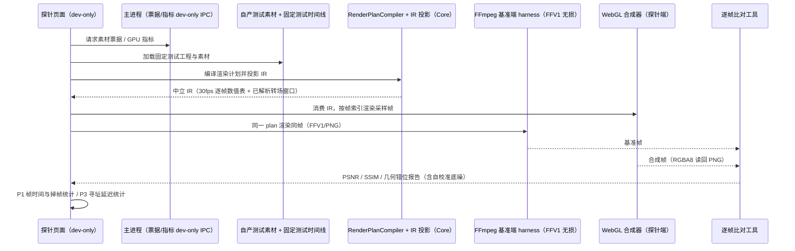

# M3-0 预览合成引擎技术验证详细设计

> **历史验证记录（2026-09-04）**：本文保留 M3-0 当时的验证方案、判据和结果。阶段优先级、发布版本及当前能力以 [`STATUS.md`](../../STATUS.md) 为准；本文中的阶段背景与规划安排不代表当前状态。

> 设计角色：LiuWei（架构师）
> 文档状态：已冻结 v1.0（Gate M3-0-1 放行，2026-09-04；评审与放行记录见 [Gate 记录](STAGE_M3_0_GATE_M3_0_1_REVIEW_RECORD.md)）
> 日期：2026-09-04
> 修订：v0.2 依据三方评审修订——主线锚点更新为"Stage 轨道已收口 + M2 进行中"（原 Stage 5-R 前提已失效）；三探针判据全部操作化（掉帧定义、帧对齐、色彩管线、种子与分布、延迟口径）；基准端改无损（FFV1）；opacity 关键帧语义按权威实现纠偏（fade 近似而非 lerp）；探针入口落地方式与隔离机制明确；Gate 证据集合与红线检查点补齐。
> 上位文档：[总体架构设计](../../../ARCHITECTURE.md)
> 关联文档：[M2 里程碑](../../requirements/M2_ROADMAP.md)、[项目发布状态](PROJECT_RELEASE_STATUS.md)、[Stage 8 收口](../STAGE8_POST_RELEASE_CLOSURE.md)、[阶段 0 技术验证详细设计](../STAGE0_DETAILED_DESIGN.md)（体例基线）、[M2-B2 转场设计](../M2_B2_TRANSITIONS_DESIGN.md)、[M2-B3 关键帧设计](../M2_B3_KEYFRAMES_DESIGN.md)（问题实证）

## 1. 文档目的

M2 已交付的转场与关键帧特性在文档中明确记录了交互预览的能力空白：

- M2-B2 §5.3："交互预览不做 xfade 实时渲染（HTML5 video 无法交叉混合）……预览浮层显示'转场仅权威预览生效'。此为已知近似。"
- M2-B3 §4.2："交互预览不渲染动画（HTML5 video 无法几何变换）……预览浮层提示'动画仅权威预览生效'。"

这不是未来风险，而是当前每个编辑用户每天都遇到的体验缺口：交互预览与成片之间隔着整条 FFmpeg 权威渲染管线。同类竞品（剪映、万兴喵影）以自研实时合成引擎提供"拖上去即所见即所得"，这是产品成立层面的差距，不是帧率层面的差距。

M3-0 的目标**不是交付引擎本体**，而是参照阶段 0 的范式，在冻结任何渲染计划 IR 契约、编写任何生产合成器代码之前，用三个可丢弃探针优先消除以下高风险：

1. WebGL/WebGPU 能否在 Electron Renderer 内对多轨时间线做实时合成（性能）。
2. 浏览器合成器的输出能否与 FFmpeg 权威渲染逐帧一致（预览=导出，所见即所得的架构保证）。
3. 帧精确寻址（seek/解码）的延迟能否支撑交互级手感。
4. 渲染计划 IR 的权威生成方应放在 Core 还是 Renderer（架构归属，需证据决策）。

## 2. 范围与验收场景

### 2.1 必须实现

- 三个独立探针（P1 合成性能、P2 逐帧一致性、P3 帧寻址），代码均为一次性验证性质。
- 一个逐帧比对工具（合成器输出 vs FFmpeg 基准输出的自动化 diff 报告）。
- 一份《M3-0 技术验证报告》，含三探针证据、硬件记录、结论与路线建议。
- 一份 IR 契约冻结草案：**仅当三探针全部通过（或按第 5 节回退后达标）时产出**，范围仅限 §7.2 实测覆盖的特征子集；须声明与 `render-plan-v1` 的关系（扩展/投影/替换），并对 M2 已交付但不在实测子集内的特性（dissolve/wipe/slide/zoom 等其余转场、scale/rotate 关键帧、画中画蒙版/抠像、reframe）显式标注"不在预览=导出保证范围，维持仅权威预览口径"。
- 回退路线决策记录（ADR）：任一探针未达标即产出，无论其他探针结果。

### 2.2 明确不实现

- 不实现生产用合成器，不改造 `apps/desktop` 现有交互预览（App.tsx）。
- 不冻结任何 IR/渲染计划契约（探针期 schema 仅为草案）。
- 不做本地 AI 感知能力扩展（转录→规划→装配闭环之外的第二场仗，单独立项）。
- 不引入 three.js、pixi.js 等渲染框架（raw WebGL2 优先，除非 P1 证明必要）。
- 不触碰 Stage 主线与 M2 里程碑任何在办工作；探针不阻塞、也不被其阻塞。
- 探针代码一律放独立目录（`apps/desktop/src/probes/`，若 electron-vite 渲染器根配置不同则以实际渲染器根为准），仅经动态导入进入模块图，生产构建不打包；不以任何形式修改 App.tsx 现有交互预览路径，并记录探针运行基线 commit。
- 不修改 `services/core` 现有渲染管线（`rendering/*`）行为；单帧渲染 harness 与比对工具放独立工具目录，只读调用现有编译器与滤镜构造逻辑。
- 不承诺任何面向用户的性能指标；验证期数据仅用于内部决策。
- 不支持 HDR/10bit、可变画布实时切换、外部插件等超出当前 M2 语义的范围。

## 3. 已有事实基础（代码证据）

| 事实 | 位置 | 对探针的意义 |
|---|---|---|
| 渲染计划编译器已存在，版本 `render-plan-v1`，输出含 `segments`（clip_id、layout、transform、speed_milli、reverse_playback、mask、keying、keyframes、transition_in 等）、`captions`、`inputs`（仅 duration_us/has_audio）、`output` profile 与内容指纹 | `services/core/src/aivs_core/rendering/plan.py`（`RenderPlanCompiler`） | IR 雏形已存在，且字段比预期更全。plan 真正缺的：①输入视频流几何（宽/高/SAR）；②已解析字幕样式（preset_id → ASS 样式解析在 `rendering/ass.py build_ass`） |
| 时间线语义的 FFmpeg 权威实现：转场 xfade（借用式重叠，offset=累积输出长−T）、position 关键帧真 lerp、**opacity 关键帧的实际行为是整体 fade 近似（`fade=alpha=1:st=0:d=末关键帧t`，恒 0→1 渐入；`_lerp_expression` 的 opacity 分支未参与渲染）**、蒙版 geq、抠像 | `services/core/src/aivs_core/rendering/ffmpeg.py`（关键行为 ：109–112、:116–124、:177–191、:411–483） | P2 基准端与合成器语义的唯一对齐依据；关键帧动画**仅作用于 V1 主轨**（`visual_chain` 仅 V1，`_pip_overlay_chain` 不叠加） |
| 代理媒体链路已验证：任务 kind=`proxy` 产出 `proxy.mp4`（MP4/H.264/yuv420p/CFR 30fps，**宽高均 ≤960**） | `services/core/src/aivs_core/jobs.py`、`media/render.py`（`proxy_filter()` 强制 fps=30） | P3 可直接复用；P1 的 1080p 指标需探针自产素材（见 §7.1），现有代理仅作对照口径 |
| 交互预览现状：播放头处主轨双 `<video>`（背景静音 + 前景，同 src）+ 每个 PiP 浮层 1 个 `<video>` + 字幕 DOM 叠加，自标"非权威"；播放时钟为 setInterval 驱动，寻址走 `currentTime` 赋值 | `apps/desktop/src/app/App.tsx`、`PreviewPipOverlays.tsx` | P1 的对照起点——现状基线本身已含多路解码开销，P1 三轨合成并非从 1→3 的质变 |
| 受控媒体协议 `aivideo://`：票据制、`ACAO:*` + Range/206 + supportFetchAPI，票据 TTL 5 分钟 | `apps/desktop/electron/main/restricted-media.ts` | 探针素材访问路径（dev-only IPC 签发票据）；`<video>` 须加 `crossorigin="anonymous"` 才能上传 WebGL 纹理 |
| 权威预览 stale 机制、内容指纹（`document_sha256`、`content_fingerprint`） | `rendering/plan.py`、M2-B2 设计 | 未来"编辑→IR 重算→合成器增量刷新"的既有机制基础 |

## 4. 技术基线

| 范围 | 基线 | 说明 |
|---|---|---|
| Electron | 仓库锁定版本（36.2.1，Chromium 136 系 / Node 22.15.0） | 能力基线：WebGPU、WebCodecs（含 DedicatedWorker 中 `VideoDecoder`）、`requestVideoFrameCallback` 均默认可用，仍以能力检测为准 |
| TypeScript | 仓库锁定版本（5.8 系） | WebGPU 类型需 `@webgpu/types` devDependency 或本地 d.ts；WebCodecs 类型以 tsc 实测为准，缺则本地声明兜底。均为 devDependency |
| 合成 API | raw WebGL2 主路径 / WebGPU 对照路径 | 不引入渲染框架 |
| 解码 | `<video>`（现有）/ WebCodecs `VideoDecoder`（P3 对比） | 硬解路径以 `VideoDecoder.isConfigSupported({ hardwareAcceleration: "require" })` 验证 |
| 探针入口 | dev-only，环境变量 `AIVS_M3_PROBE` 门控 | 是对 STAGE0 §8.3"开发/打包差异"条款的**已申报增量**：仅新增 dev 工具入口，不改启动协议与 Core 链路。仓库 lint 为 `tsc --noEmit`（无 ESLint），隔离靠构建机制不靠 lint（见 §7.1） |

## 5. 风险清单

| 编号 | 风险 | 消除手段 | 失败回退 |
|---|---|---|---|
| R1 | WebGL/WebGPU 在 Electron Renderer 内无法多轨实时合成 | P1（判据与硬件断言见 §7.1） | 自产 540p 素材复测 → 仍失败则评估"合成引擎移出 Renderer"（独立渲染进程/原生模块）作为 M3 备选 |
| R2 | 浏览器合成器与 FFmpeg 无法逐帧一致 | P2，消除手段为**事前免疫**：无损基准（FFV1）+ 第 0 步自校准定底噪 + 采样表避开已知系统差帧；语义差则该特性剔除出 IR 子集、维持"仅权威预览"现状口径，**绝不带已知漂移冻结契约** | 逐帧 diff 归因；仍不可归因则按语义差流程处理 |
| R3 | 帧精确寻址延迟不满足交互手感 | P3 | 确定最优解码路径组合；仍不达标则将"逐帧步进"降级为代理低清直出 |
| R4 | IR 权威生成方归属错误导致双语义漂移 | P2 一并验证：IR 携带 Core 解析的逐帧数值表与转场窗口，两端只做"应用" | 预期方向为"Core 生成 IR、Renderer 只消费"；若证据相反，以探针数据决策并记录 ADR |
| R5（观测项） | WebAudio 时钟与视频合成同步策略未定 | P1 顺带记录 | 不作为本阶段放行条件，仅记录方案建议 |
| R6 | GPU 进程崩溃/驱动重置污染测量 | 探针捕获 `webglcontextlost` 与 `render-process-gone`，作废该轮并自动重跑；报告含 reset 计数 | 环境问题先行排除，再触发 R1 回退 |
| R7 | 软件渲染（SwiftShader/llvmpipe）静默通过 | 硬件适配器断言（`UNMASKED_RENDERER_WEBGL` / WebGPU adapter info），检出即作废该轮 | 修复测试环境 |
| R8 | `aivideo://` 票据 5 分钟过期导致长跑 404 | 会话内重签机制（dev-only IPC） | 缩短单轮时长 |
| R9 | 刷新率/DPR/窗口遮挡/电源策略差异导致不可复现 | 测试协议固定（见 §7.1 通过标准） | 按协议复测 |
| R10 | 基准端编码损失与帧/色彩口径未钉死导致 diff 不可归因 | P2 第 0 步自校准 + FFV1 无损基准 + 比对管线固定（见 §7.2） | 口径修订（须 ADR）后复测；仍不可归因则按 R2 语义差流程处理 |
| R11 | 子集外语义被静默漏渲染污染比对 | 投影器白名单硬失败；测试时间线构建时断言不含排除语义 | 修正 IR 投影或采样表 |

## 6. 成功路径

## 7. 探针方案

### 7.1 P1 合成性能探针

- **载体（四层隔离，不采用独立 html 入口）**：
  1. 主进程：`createWindow` 中当 `!app.isPackaged && process.env.AIVS_M3_PROBE` 存在时，向 dev 加载 URL 追加 `?probe=<名>`（与既有 `AIVS_E2E_*` 环境变量同风格；`will-navigate` 已禁运行期导航，参数只能在加载时注入）。
  2. 渲染入口：`main.tsx` 读取 `location.search`，仅当 `import.meta.env.DEV && probe ∈ {m3p1, m3p3}` 时 `await import("../probes/<名>")` 并替代 App 挂载——生产构建中 `import.meta.env.DEV` 静态替换为 false，动态导入分支被 tree-shake，探针代码不进产物。
  3. 目录约定：探针代码全部位于 `apps/desktop/src/probes/`，只经上述动态导入进入模块图，不 import App.tsx，不向生产代码导出符号。
  4. 构建产物校验：`pnpm build` 后于 `out/renderer` 内 grep 探针标记字符串（如 `m3p1`）应零命中，纳入 `package:verify`。
- **实现**：raw WebGL2 为主路径（WebGPU 对照路径仅记录数据，不计入通过判定，不可用则跳过）；V1 主轨代理素材 + 2 条覆盖轨（PiP 语义，与权威端"单视觉轨 + 覆盖层"一致）+ 1 条字幕层；rAF 驱动合成循环。素材经 dev-only IPC（`AIVS_M3_PROBE` 门控）签发 `aivideo://` 票据访问，`<video>` 加 `crossorigin="anonymous"`；GPU 进程内存经同一门控 IPC 读取 `app.getAppMetrics()`。
- **素材**：探针自产固定参数测试素材脚本（H.264 yuv420p CFR 30fps，1080p，分辨率与 GOP 显式指定并写入报告；540p 回退素材由同一脚本产出）；素材须含持续运动内容。现有 ≤960p 代理可作对照口径运行，但注明"1080p 合成画布 + ≤960p 源，解码负载低估"，不作为通过判定依据。
- **通过标准**（判据适用对象：WebGL2 主路径）：
  - 环境：单显示器 60Hz、100% 缩放（DPR 1.0）、固定窗口 1440×960、窗口全程前台、插电 + 高性能电源计划。测试机型（冻结时写入）：**Intel NUC11PAHi7（i7-1165G7）+ Intel Iris Xe Graphics，驱动 31.0.101.3222，32GB 内存，显示 3440×1440**——满足"不低于 Iris Xe 级核显"下限；系统存在虚拟显示适配器（OrayIddDriver Device），探针硬件断言必须以 Iris Xe 适配器为准。
  - 掉帧率：以 30fps 内容帧为节奏，单帧合成未在 33.3ms 预算内完成提交计为掉帧；掉帧率 = 掉帧数 / 1800（60s × 30fps）< 1%。
  - 帧时间 p95：相邻两次合成任务起始的 `performance.now` 差值序列的第 95 百分位 ≤ 33ms；呈现间隔另行记录，不作为通过判据。
  - 随机 scrub：以固定种子（报告记录种子值）的确定性 PRNG 在 [0, 时长) 均匀采样 100 个目标时间；出图延迟 = seek 发起到目标帧实际呈现（`requestVideoFrameCallback` 呈现时间，`mediaTime` 校验偏差 ≤ 1 帧）的差值，p95 ≤ 100ms，报告附 100 个原始样本，冷/热（前 10 次 vs 其余）分开报告。
  - 轮次：连续播放测试重复 3 轮取中位与最差判定。
  - 证据：GPU 适配器断言非软件渲染（检出 SwiftShader/llvmpipe 本轮作废）、`app.getGPUFeatureStatus()` 与 `getGPUInfo("complete")` 摘要、`VideoDecoder.isConfigSupported` 硬解路径证据、GPU reset 事件计数、硬件与环境记录（机型、CPU/GPU/驱动、Electron/Chromium 版本、FFmpeg 版本）。
- **失败回退**：自产 540p 素材复测；仍失败则触发 R1 回退路线评估。

### 7.2 P2 逐帧一致性探针（核心）

- **中立 IR 草案**（Core 侧投影，ZhangSan）：从 `RenderPlanCompiler` 输出投影出渲染计划中立 JSON，schema 仅限本探针使用（不冻结、不进契约）。范围：
  - canvas、segments（源引用、trim、layout 变换、speed、**transform 静态中心点 x/y/scale/rotate/opacity——PiP 采样必需**）；
  - inputs **增补输入视频流几何（width/height/SAR，取自 asset media_info / ffprobe——PiP 内容盒计算必需）**；
  - 转场子集：B2 冻结 8 种中的 `fade`（可选 `fadeblack`），即 xfade `transition=fade`；复刻 xfade 混合公式与借用式重叠语义（激活条件：锚点段与时间序后继首尾相接；offset = 累积输出长 − T）；dissolve 等其余转场不进子集；音频（acrossfade）不在 P2 范围；
  - 关键帧子集：position 逐帧线性 lerp（与 `_lerp_expression` 一致：窗口外取边界值、x/y 为相对画布中心比率）；**opacity 以 ffmpeg.py 实际权威行为为准——整体 fade 近似（`fade=alpha=1:st=0:d=末关键帧t`，恒 0→1 渐入；`_lerp_expression` 的 opacity 分支未参与渲染），IR 与 WebGL 端必须复刻该近似而非"真 lerp"**，并记入报告的"权威端已知近似"清单；
  - captions 文本层（基础样式，不含 ASS 全量效果）；
  - **IR 携带按 30fps 展开的解析后逐帧数值表 + 已解析转场窗口/offset**：插值、借用式 offset、黑底填充收敛到 Core 单点，两端只做"应用"——整类消除插值语义漂移，并直接支撑 R4。
  - 子集明确排除：mask/keying/reframe、scale/rotate 关键帧、非 V1 轨关键帧（权威端覆盖轨链路不叠加关键帧动画）、ASS 全量效果。投影器遇子集外语义必须拒绝并报错（白名单硬失败，R11）；测试时间线构建时断言不含排除语义，关键帧只配 V1 主轨。
- **基准端（无损）**：harness 直调 `compile → ffprobe → build_ass → build_timeline_args`（与 `rendering/service.py` 同序，不经 job 系统），encoder 参数原样传递但**替换为 `ffv1`（mkv 容器，保持 yuv420p 域无损）**，或对 filter graph 追加 `select`+`-frames:v 1` 直出 PNG。**禁止以生产 H.264（libopenh264 3M/10M）产物作比对基准**，编码损失会污染 PSNR；生产 mp4 可另存为"第二参考口径"。
- **比对口径（先于实现钉死）**：
  - 帧对齐：输出 CFR 30fps，采样以帧索引 n 定义（n ↔ PTS n/30）；WebGL 端按 IR 逐帧数值表渲染对应帧，段内相对时间与 ffmpeg.py trim/setpts 窗口推导一致。
  - 色彩：测试素材统一携带 BT.709 VUI 标记（或统一 untagged 并两端钉死同一矩阵），比对在单一矩阵下转换。
  - **第 0 步自校准**：色卡/渐变合成时间线经 FFmpeg 两路提取的 PSNR 底噪 + 601/709 失配量化写入报告，再套用 40dB 门（R10 免疫）。
  - 合成端 canvas 以 RGBA8 读回编码 PNG；PSNR 以 ffmpeg `psnr` 滤镜在 RGB 空间计算，SSIM 同口径记录；比对工具命令行写入报告。几何错位以 FFT 相位相关法（±8px 搜索窗）估计整帧平移，报告逐帧偏移值。
  - 字幕帧单独口径：文本光栅化（libass vs 浏览器）为预期系统差，按"text bbox 位置/IoU + 全帧 diff 比率"报告，不计入 40dB 硬门。
- **采样要求**：≥ 24 帧，覆盖：转场中点、转场起止 ±1 帧、关键帧区间内非端点帧、PiP 叠加帧、字幕帧；**避开"转场区间 ∩ 活动字幕"重叠帧**（B2 §4.2 已知偏移），如覆盖则该帧只报告不判门。
- **通过标准**：非字幕采样帧全部 PSNR ≥ 40dB 且几何错位 ≤ 1px。任何阈值修订必须先产出 ADR（附 diff 归因证据）并经规划门确认，验收时不得以"等效"名义临时放宽。报告附全部采样帧时间戳清单与两侧帧 PNG（或 SHA-256 清单 + 最差 5 帧 PNG 存档）。
- **R4 归属验证**：本探针按"Core 生成 IR（含逐帧数值表）、Renderer 只消费"实现，并记录该方向的实际阻力（schema 表达力缺口、同步成本）；结论写入验证报告，作为契约冻结的架构依据。

### 7.3 P3 帧寻址探针

- **三路对比**：HTML5 `<video>.currentTime` seek（即现状寻址路径）；WebCodecs（`VideoDecoder` + DedicatedWorker）；WebCodecs + 帧缓存。
- **实现要点**：
  - WebCodecs 路线需 MP4 demuxer——决策为 devDependency 引入 mp4box.js 或手写 BMFF 解析（代理为自产 faststart 单视频轨文件，手写可行）；开工时定并写入报告。
  - `VideoDecoder` 可在 DedicatedWorker 中使用，但 `decodeAudioData` 不在 Worker 暴露（AudioContext 仅主线程），音画校验的音频端固定在主线程。
  - `VideoFrame` 必须 `close()`；帧缓存需设上限（1080p NV12 约 3MB/帧）并记录命中率与内存曲线。
  - `aivideo://` 票据长会话内重签（R8）。
- **素材**：自产固定参数素材（1080p 与 ≤960p 各一组）+ 现有 `proxy.mp4`（含 VFR 源转出，沿用阶段 0 口径）。
- **测量口径（与 P1 scrub 同口径）**：t0 = 寻址调用前 `performance.now()`，t1 = 目标帧实际呈现（`requestVideoFrameCallback` 的 `mediaTime` 校验呈现帧与目标帧偏差 ≤ 1 帧时长）；100 个随机目标均匀覆盖全片并含片段边界邻域；另测相邻帧 ±1 步进延迟；冷/热分开报告；报告 p50/p95/max 与直方图。
- **通过标准**：三路中至少一路（WebCodecs 或 WebCodecs + 帧缓存）达到：随机跳转 100 次出图延迟 p95 ≤ 100ms，且每次跳转后首次呈现帧的 PTS 与请求目标时间偏差 ≤ 1 帧（30fps 下 ≤ 33.4ms），100 次全部满足，解码失败/黑帧事件计数为 0。报告逐路原始数据；主解码路径建议必须指向达标路径。若 1080p 素材就绪，同步加测一轮以支撑 M3 主解码路径建议。

## 8. 与现有阶段的衔接与角色分工

- 本段是本设计起草时的阶段安排快照，不作为当前状态声明。当前阶段与工作线见 [`STATUS.md`](../../STATUS.md)；M2 的需求及验收基线见 [`requirements/M2_ROADMAP.md`](../../requirements/M2_ROADMAP.md)。
- 探针代码全部一次性验证性质：按 §7.1 四层隔离，不进生产路径；**在 M3-0-3 验收结束前不得删除**，丢弃或留作参考实现的处置决定记入放行记录。
- 角色分工（按 AGENTS.md）：
  - LiuWei：本文档维护、路线决策、Gate 放行。
  - ZhangSan：P2 的 IR 投影（含逐帧数值表方案）与 FFmpeg 无损基准端 harness、比对工具。
  - YeJing：P1/P3 的 Electron/Renderer 探针与 dev-only 入口四层隔离。
  - LiuKeAi：验证报告与证据的独立验收（含复跑能力检查，见 §11）。
- 独立跟进事项（非本阶段交付，LiuWei 排期）：`design/M2_B3_KEYFRAMES_DESIGN.md` 末尾残留的 git 提交脚本文本清理及其 §3 opacity 方案（colorchannelmixer）勘误；`rendering/ffmpeg.py:103–107` 失真注释与实现对齐（该项同时作为 P2 报告"权威端已知近似"清单第一项）。

## 9. 时间与成本估算

- 单人等效 1–2 周：P1 约 3–4 天，P2 约 5–7 天（采纳逐帧数值表方案后成立且有富余），P3 约 3–4 天（含 MP4 demuxer 决策与实现），三者可并行。
- 不引入新的生产运行时依赖；mp4box.js、`@webgpu/types` 等仅为 devDependency 候选，是否引入由探针开工时决策并记录。不产生面向用户的承诺。

## 10. 不采用的方案

- 不提前冻结 IR 契约；不带着未量化的预览偏差进入实现。
- 不直接改造 App.tsx 现有预览，不在验证期替换"权威预览"机制。
- 不捆绑本地 AI 能力扩展（单独立项，避免重蹈 Stage 6 范围捆绑失控）。
- 不引入 three.js/pixi.js 等框架，除非 P1 数据证明必要。
- 不采用独立 html 探针入口（dev 下主进程仍需改加载 URL，工作相同却使生产产物多出一个 html，隔离更弱）。
- 不以生产 H.264 产物作 P2 比对基准。
- 不因探针结果调整 M2 里程碑的优先级、范围或验收口径。

## 11. 验收与放行（Gate）

| Gate | 条件 | 放行物 |
|---|---|---|
| M3-0-1 | 本文档经规划门评审冻结；测试机型与驱动版本随冻结写入 | 冻结版验证方案，随代码基线 commit 一并提交（避免提交漏文件事故重演） |
| M3-0-2 | 三探针证据齐备，验证报告成稿。报告至少包含：a) 探针代码清单、运行基线 commit、探针代码与生产路径的零改动 diff 报告；b) 硬件与环境记录（机型、CPU/GPU/驱动、Electron/Chromium 版本、FFmpeg 版本、显示分辨率与刷新率、电源模式）；c) 全部原始数据（帧时间序列、seek 原始样本与种子、P2 逐帧 PSNR/SSIM/错位值与帧清单、P2 第 0 步自校准底噪数据）；d) 比对工具源码与运行日志；e) 固定测试工程 document JSON 与素材 SHA-256；f) 未验证项与剩余风险清单（含"权威端已知近似"清单） | 《M3-0 技术验证报告》 |
| M3-0-3 | LiuKeAi 基于上述证据可独立重算全部统计量（P2/P3 工具可在存档输入上复跑；P1 接受"报告证据 + 原始数据 + 一次可复跑见证"的报告制验收）；ZhangSan / YeJing 分别书面确认各自探针证据无口径偏差；**若产出 IR 契约冻结草案，须随附"已知逐帧偏差清单"（可为空），草案不得包含任何已知不一致特征——违反此红线即验收不通过**；探针代码在 M3-0-3 结束前不得删除，丢弃或保留的处置决定记入放行记录 | M3 立项建议 + IR 契约冻结草案，或回退路线 ADR |

放行结果三态：

- 三探针全部通过 → M3 预览合成引擎正式立项，进入契约冻结。
- 按第 5 节回退路线复测后达标（如 P1 降代理分辨率通过）→ M3 立项建议须携带对应约束（写入立项范围），不得默认按全性能口径立项。
- 任一探针按回退路线仍失败 → 输出决策记录，M3 立项暂缓，不以未验证假设继续投入。

## 12. Gate M3-0-1 放行记录

- **决策**：项目所有者，2026-09-04，"冻结 v0.2 放行"。
- **评审基础**：ZhangSan（有条件放行，条件 B1–B4 已落实于 §7.2/§5）、YeJing（有条件放行，条件已落实于 §7.1/§7.3/§4）、LiuKeAi（需补充后可决策，阻塞 B1–B4 与建议 S1–S9 已落实于全文）。逐条映射见 [Gate M3-0-1 评审记录](STAGE_M3_0_GATE_M3_0_1_REVIEW_RECORD.md)。
- **冻结变更**：测试机型与驱动版本写入 §7.1；文档状态升 v1.0；本文件随代码基线（`uiux-polish-round3` @ `cab8b95`）commit 提交。
- **下一 Gate**：M3-0-2 探针实施（§7）与验证报告（§11 证据集合 a–f）。
